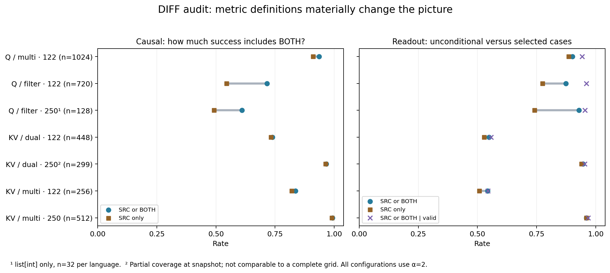

# DIFF: independent setup and results audit

Audit of [Claude’s analysis](../claude/diff_eval_analysis.md), the evaluation scripts, implementation, notebooks, and saved results. Result snapshot: **2026-09-07 17:34:32 UTC**. This is a separate analysis; the original report, experiment code, and results were not edited. No model generation or oracle calls were rerun.

The principal finding survives scrutiny: **250-head KV transfer on multi-predicate `var_eq` prompts is extremely effective under the saved evaluation**, reaching 508/512 source-directed generations without ablation. The matched 122→250 comparison also supports a substantial improvement. Several stronger interpretations need qualification: the alpha comparisons do not isolate alpha; identical ablated/unablated readouts arise from the evaluation design; and query interventions continue during decoding rather than occurring only once at the pivot. The oracle also has a concrete contextual blind spot.

## 1. What the experiments implement

The proposed abstraction separates task specification from progress. Given a set of tasks and a prefix that has completed some of them, the next task depends on both. Q transfer changes which outstanding task is selected while retaining destination instructions. KV transfer replaces instruction information while retaining a destination prefix with shared completed work. This is a useful organizing hypothesis; the interventions establish causal effects of these components without uniquely identifying a literal set-subtraction algorithm.

| Family | Source/destination relationship | Intended effect |
|---|---|---|
| Q / multi-predicate | Same task set; different amounts of completed work | Continue with the source’s next predicate |
| Q / filter | Same filtering goals; different completed filtering work | Select the source’s remaining filter |
| KV / dual computation | A common completed computation; different remaining computation | Replace the destination’s remaining computation with the source’s |
| KV / multi-predicate | Same completed predicates; different remaining predicate | Compute the source’s remaining predicate from destination context |

The multi-predicate Q sampler uses **nested prefix progress**, usually source progress of `k−1` and destination progress of one task. It does not cover arbitrary equal-sized, different completed subsets. KV multi-predicate prompts use a common set of `k−1` completed predicates and one different frontier predicate on each side. Compatibility filtering exists for KV multi-predicate sampling; the Q multi-predicate sampler does not invoke the same compatibility test. See [data.py](../../src/diff/data.py).

### Query intervention

[q_transfer_eval.py](../../scripts/diff/q_transfer_eval.py) and `run_q_transfer_intervention` in [functional.py](../../src/diff/functional.py) transplant selected heads’ `q_proj` activations before RoPE. The prefill patch covers the final pivot tokens: one for multi-predicate, with heuristic multi-token pivots for filter variants. These are token-count conventions, not an assertion that source/destination pivot tokens are identical.

The CLI defaults to **32 steering forward passes**, including prefill. During decoding it reuses the source’s final pivot query at subsequent current-token positions. Therefore describe this as **pivot-initialized, sustained query steering**, unless explicitly running the one-pass condition. The helper’s own default is 16; the CLI passes its default of 32.

The intervention alpha boosts selected head OV outputs at the last position throughout generation. It is not solely a multiplier applied to the original transplanted query, nor limited to the Q-steering window. Saved Q gaze is measured with the Q patch without this OV boost. Attention, generation, and GoalScope are consequently related diagnostics, not three measurements of precisely the same intervention execution.

### KV intervention

`headwise_kv_patch` and its custom attention forward in [functional.py](../../src/diff/functional.py) insert source task-span K/V into selected destination query heads’ attention computation. The implementation handles grouped-query attention by selecting outputs per query head rather than indiscriminately patching every head sharing a KV head. Source keys are rotated to destination positions.

**The patch applies to all query positions in the prefill**, and remains active during decoding. Earlier destination representations can therefore change and affect later-layer queries. “The destination query is not directly transplanted” is accurate; “the query remains fixed” is too strong for the whole forward pass. A pivot-only attention intervention would be a useful separate diagnostic.

`pad` equalizes task-span lengths by inserting newline token IDs before the shorter span. It does **not** align absolute span starts. Across 3,245 saved KV records, all spans have equal lengths but **1,547 have different source/destination starts**. Source re-rotation handles destination coordinates. Newline insertion should not be presumed behaviorally inert. Saved raw prompt strings are the original prompts, whereas span/pivot indices describe the token-spliced inputs; saving final token IDs would make this reproducible without reconstruction.

The multi-predicate KV span contains the full task list, not just the changed predicate. Thus the intervention transfers a task specification that includes shared information.

### GoalScope and ablation

`goalscope_readout` uses its own defaults: additive norm-relative injection, **readout alpha 0.1**, injection layers 35–45, and steering throughout readout decoding. This differs from intervention alpha 2. See [GoalScope](../../src/goals/goalscope.py) and the wrapper in [functional.py](../../src/diff/functional.py).

A uniform positive scaling of the aggregate readout vector cancels under normalization in isolation. Earlier-layer intervention boosts can still change later vectors, so the full pipeline is not necessarily alpha-invariant.

For KV runs, non-goal-head `zero`/`restrict` ablation is applied to **generation, not readout extraction**. Identical readout text between off/restrict is consequently expected by construction. It does not demonstrate that readouts are insensitive to ablating the execution that produced them. Also, the restrict hook silently returns when its attention mask is missing or not 4-D; future runs should assert that the intended restriction actually executes.

## 2. Validation and metric definitions

The offline audit reads **121 result configurations and 6,909 records**. It checks duplicate keys, recomputes causal/readout/gaze flags from saved labels or scores, and compares available metadata summaries. **No discrepancies were found in those checks.** This validates bookkeeping, not the semantic accuracy of the oracle or a rerun of model behavior.

The following distinctions matter:

- **Causal success:** the saved classifier labels the patched continuation `SRC` **or `BOTH`**. It focuses on the first computation/statement and can accept partial source behavior. This is not an execution-based program-correctness score.
- **Patched readout = SRC:** the exclusive source label. Claude’s `pat=SRC` generally uses this quantity.
- **Readout shift:** the stored flag accepts `SRC` **or `BOTH`**.
- **Valid:** clean source and destination readouts respectively include their expected task, each allowing `BOTH`. This does not require unambiguous baseline readouts.
- **Readout shift given valid:** a conditional rate after selecting records with valid clean readouts. Always report its denominator and validity rate.
- **Gaze success:** source-target value-weighted attention exceeds destination-target attention. The clean comparison is an absolute baseline preference, not a normalized subtraction score.

See [eval.py](../../src/diff/eval.py). The causal judge receives task descriptions and the generated suffix, **not the code prefix defining its variables**. It also always maps source to option A and destination to B. Context omission and answer-order sensitivity need separate checks.

### Main results, recomputed

All rows below use alpha 2. Percentages are **micro averages over saved records**, not unweighted averages over configuration cells. KV multi rows use `var_eq`; 122-head KV rows use restrict ablation; 250-head KV rows use no ablation.

| Setup | N | Causal SRC or BOTH | Causal SRC only | Readout SRC only | Readout SRC or BOTH | Valid | Shift given valid |
|---|---:|---:|---:|---:|---:|---:|---:|
| Q multi, 122 | 1,024 | 93.55% | 91.11% | 88.57% | 90.14% | 83.20% | 94.25% |
| Q filter, 122 | 720 | 71.53% | 54.44% | 77.50% | 87.36% | 76.94% | 96.03% |
| Q filter, 250¹ | 128 | 60.94% | 49.22% | 74.22% | 92.97% | 85.94% | 95.45% |
| KV dual, 122 | 448 | 73.88% | 73.21% | 52.90% | 54.91% | 94.42% | 55.79% |
| KV dual, 250² | 299 | 96.66% | 96.32% | 93.98% | 94.65% | 93.98% | 95.37% |
| KV multi, 122 | 256 | 83.59% | 82.03% | 50.78% | 54.30% | 96.09% | 54.47% |
| KV multi, 250 | 512 | 99.22% | 99.02% | 96.09% | 96.09% | 96.68% | 96.77% |

¹ Only `list[int]`, 32 examples in each of four language directions. Not comparable to the complete 122-head filter grid.

² Partial coverage at the frozen snapshot. Python→Python has 224 records across four datatypes; Python→C++ has 75. There are no C++-source records in this saved run at the snapshot. Do not present its pooled rate as a completed balanced grid.



The full table, including alpha 1, zero ablation, and indentation pivots, is in [tables.md](diff_eval_audit/tables.md). Configuration/datatype/language breakdowns are in [config_summary.csv](diff_eval_audit/config_summary.csv) and [axis_summary.csv](diff_eval_audit/axis_summary.csv).

Claude’s approximate 75% KV-dual and 72% Q-filter results are consistent with **macro** averages: 75.14% and 72.50%, respectively. Their difference from this table is an aggregation choice, not corrupted arithmetic. Explicitly name the averaging rule in the paper.

### Findings that need qualification

**Clean readouts are not uniformly 95–100% faithful.** For Q multi alpha 2, source/destination baseline correctness is 92.48%/88.96%, and joint validity is 83.20%. For Q filter it is 88.61%/87.64%, with joint validity 76.94%. The conditional 96.03% filter shift describes a selected subset; the unconditional inclusive rate is 87.36%, and exclusive source readout is 77.50%.

**BOTH materially affects filter results.** At 122 heads, causal success falls from 71.53% to 54.44% when requiring the exclusive source label. This does not mean BOTH should automatically count as failure: a conjunction can be sensible behavior. It means the paper should distinguish source incorporation from exclusive replacement.

**Attention movement does not ensure behavioral transfer.** Q multi alpha 2 has 99.90% source gaze preference versus 1.17% clean preference; Q filter has 96.81% versus 2.78%. Yet filter generation transfer is substantially weaker. This is useful evidence about the gap between attention routing and continuation behavior.

**Top250 is broader than “more late goal heads.”** It contains all 122 original heads, whose layers range from 28 to 55. Of 128 added heads, 80 are in layers 28–55, 16 in 0–27, and 32 in 56–63. The selected layer range reaches 0 and 63; that does not mean every layer is represented. These 250 heads are 9.77% of the model’s 2,560 query heads. The success of this broader intervention is strong, but does not establish a minimal circuit or that every selected head carries an abstract goal representation.

## 3. Which comparisons identify an intervention effect?

Matching below requires the same configuration factors apart from the compared treatment, the same example key, and identical saved source/destination prompt strings. It does not retroactively guarantee identical software or tokenization versions.

| Comparison | Matching evidence | Conclusion |
|---|---|---|
| KV multi `var_eq`, 122 restrict → 250 restrict | All 256 old examples match; causal 214→253, with 42 gains and 3 losses | Strong evidence for improvement of the intervention package |
| KV multi 250, restrict → off | All 512 match; causal 506→508, with 4 gains and 2 losses | Off works very well on this setup; a small difference does not prove general equivalence |
| KV dual, 122 restrict → 250 off | 299 matched examples; causal 77.93%→96.66%, 60 gains and 4 losses | Strong package improvement, but head set, readout set, and ablation differ |
| Q multi, alpha 1 → 2 | Only 4 exact shared examples among 1,024 per run | Aggregate improvement does not isolate alpha |
| Q filter, alpha 1 → 2 | 203 shared keys; none has identical prompts; all match after stripping trailing whitespace | Alpha is confounded with pivot whitespace and sampling |
| Q filter, 122 → 250 | Only 21 exact shared examples; 8→14 causal successes | Encouraging overlap, too small for a general rescue claim |
| KV multi, indent → `var_eq` | Only 2 shared keys per ablation strategy | Aggregate pivot association, not a controlled pivot-effect estimate |

The 122→250 KV-multi readout improvement is also substantial: inclusive source readout 54.30%→96.09%, and exclusive source readout 50.78%→96.09%, on the matched 256 examples. **Both patch and readout head sets change**; the ablation’s excluded head set changes as well. It cannot isolate the contribution of patch heads alone.

For the 512 off/restrict pairs, **all readout strings are identical**, whereas only 377 generation strings are identical. This is consistent with ablation being excluded from readout extraction, and shows that behavior is not literally identical even when headline rates are close.

The saved 122-head restrict pivot rates are 58.59% indent and 83.59% `var_eq`; zero-ablation rates are 54.69% and 71.88%. I do not recover a single controlled 55%→81% pivot comparison from these runs. Configuration-dependent seeds change the sampled predicate combinations between pivot variants and languages.

Detailed matches and gain/loss counts: [paired_comparisons.json](diff_eval_audit/paired_comparisons.json).

## 4. Failure analysis: one evaluation fix and one scientific addition

### A likely false negative caused by omitting the prefix

One of the four failures in the 250-head, no-ablation KV-multi run has source goal `has_duplicate`, destination goal `count_positive`, and shared completed goal `distinct_count`. The destination context and generated suffix together are:

```python
# Already in the destination prefix:
a = len(set(nums))
b =
# Patched continuation:
    len(nums) - a
return a, b > 0
```

The formatting above separates the patch boundary for exposition; the actual continuation completes the assignment. `len(nums) - len(set(nums)) > 0` correctly detects duplicates. The oracle instead treats the suffix as unrelated/ambiguous arithmetic because it never sees what `a` means. This is a concrete reason to supply the full destination prefix and result-binding context to the causal judge. I have **not silently changed the saved label or reported 508/512 score**.

The other three failures illustrate why automatic relabeling is inappropriate:

- Absolute value appears inside `std::abs(n) == 10`; whether this satisfies the target depends on whether partial source use or correct result computation is required.
- A purported primality computation uses integer `std::begin(n)`/`std::end(n)` and trivial divisibility checks; this is a real code/semantic problem.
- An all-lowercase target appears after an initial first-character check; a first-computation metric can reject a continuation containing the goal later.

Full records are preserved in [kv250_off_failures.json](diff_eval_audit/kv250_off_failures.json). Rejudge with context and a documented rubric; retain both original and revised labels.

### Readout/behavior disagreement deserves its own analysis

In the 250-head Q-filter Python→C++ cell, **30/32** readouts include the source task but only **14/32** generations do. One example has source goal “multiple of three” and destination goal “negative.” The patched readout says it is checking divisibility by three, while the continuation begins:

```cpp
(x < 0) out.push_back(x);
```

This is a clear instance of source-directed readout coexisting with destination-directed generation. It should not be hidden by conditioning readout on clean validity or by reporting only aggregate readout accuracy.

For comparison, the 512-example KV-multi off run has 489 cases where both causal and inclusive readout tests succeed, 19 causal-only, 3 readout-only, and 1 neither. Q filter at 122 heads has 459 both, 56 causal-only, 170 readout-only, and 35 neither. These joint outcomes are more informative about GoalScope’s relationship to behavior than two separate means.

## 5. Corrections and cleanup worth making

These are recommendations; this audit intentionally leaves the experiment implementation untouched.

**Evaluation first.** Give the oracle the full prefix plus suffix, clearly mark the first new computation, and distinguish goal incorporation, exclusive replacement, and complete computational correctness. Add semantic checks on clean source/destination generations, since clean readout validity is not a clean generation baseline. Audit a sample with reversed A/B ordering. For deterministic predicates, lightweight execution checks can supplement the oracle while preserving the intended first-step metric.

**Freeze examples independently of treatment.** Persist one manifest containing task sets, progress, target, prompt strings, final token IDs, and span/pivot mappings. Run alpha, head-set, ablation, and pivot variants from that manifest. A key alone does not identify an identical prompt, and stripping whitespace for matching would conceal a real intervention-site change.

**Strengthen provenance and resume behavior.** Store source revision, sampler version, seed, model/tokenizer revision, head-file content hashes, `n_steer_tokens`, generation budget, readout strategy/alpha/layers, and final tokenized inputs. Current run names collapse head identities such as lambda/content differences into labels like `goal_250`. Resume by key can retain previously unevaluated or failed-oracle records; separate generation completion from evaluation completion and permit retrying missing/error judgments. Treat per-invocation summaries as partial unless reconciled with all saved rows.

**Update notebook grouping.** In [05.1_kv_eval_results.ipynb](../../notebooks/diff/05.1_kv_eval_results.ipynb), preserve `ro-` in run parsing and `letter_stub`/pivot in row metadata. Current aggregation can combine indent and `var_eq`; largest-run selection and ablation summaries can mix head sets, readout sets, and pivots. Group by the complete treatment tuple before comparing ablation. Do not label every `neither` judgment “incoherent”: it can be coherent third-task behavior or an oracle-context error.

In [04.1_eval_results.ipynb](../../notebooks/diff/04.1_eval_results.ipynb), align explanatory markdown with current result paths and the absolute gaze statistic. Keep historical delta-gaze correction cells clearly historical. Older failure notebooks’ string-naming issue should likewise not be described as a current CLI bug: the current default is the list `["letters"]`.

**Tighten implementation descriptions.** Correct stale KV structures/comments referring to query transfer, and the KV runner docstring claiming readout heads are always the original goal set despite the configurable readout-head option. Assert the restrict mask path executes. Add a small deterministic hook check for selected-head routing, source-to-destination RoPE, and patch timing before expensive runs; this is more valuable than another broad sweep without intervention verification.

## 6. What I would add scientifically, in priority order

1. **A fixed-example control matrix.** On a modest representative manifest, compare no patch, boost only, self patch, and donor patch at alpha 1/2. Include matched-size control heads. For Q, compare one-pass and sustained steering; for KV, compare pivot-only and all-query-position patching. This addresses what component is responsible for transfer and whether the proposed single-step attention abstraction predicts the implemented intervention.

2. **Separate patch quality from readout quality.** Run the 2×2 matrix of 122/250 patch heads and 122/250 readout heads on identical examples. Keep ablation off for the first comparison. Then partition the added heads into early/middle/late groups. This can explain the strong improvement without conflating a better intervention with a different measurement instrument.

3. **The same-destination factorial experiment proposed for Figure 1.** Hold one destination prompt fixed. Use one donor with the same task set but different completed subset, and another with a changed task set but the same completed subset. Record the two predicted next tasks and their clean baselines. Extend to equal-sized different progress subsets, shuffled task order, and fillers. This tests progress identity beyond number of completed tasks or position in an instruction list. Joint Q/KV donor combinations can test whether the components compose as predicted; predefine what happens when a donor query addresses an absent/incompatible task.

4. **A disagreement/failure section.** Report the joint generation/readout table, strict versus inclusive scores, and contextual rejudging. The Q-filter gap is scientifically interesting: selected-head readout and attention movement can occur without the corresponding first continuation. Stratify by datatype and language before attributing the gap to filter syntax or model competence.

5. **Generalization after those controls.** Finish missing cells, then test held-out task descriptions/concepts and another model before claiming broad generality. The current evidence concerns one model and these task/template families. Head selection plus successful transfer does not alone show a unique or minimal representation of goals.

I would use **250-head, alpha-2, no-ablation, `var_eq` KV multi-predicate** as the strongest current demonstration. I would not yet standardize every setup on that recipe or retire alpha/ablation controls. At the snapshot, 250-head Q-multi results are absent, Q-filter covers only `list[int]`, and KV-dual is partial. In particular, the 250-head filter Python→C++ result remains 43.75% causal success.

## 7. Reproducibility and scope

The [audit directory](diff_eval_audit/) contains a compressed frozen copy of result records, input hashes and metadata, independent recomputation scripts, full summaries, matched comparisons, head-set composition, and a [PDF metric comparison](diff_eval_audit/metric_definitions.pdf).

- [audit.py](diff_eval_audit/audit.py) reads live results and creates the snapshot/tables. **Rerunning it refreshes the snapshot**, so copy the directory first if preserving this exact audit.
- [extend.py](diff_eval_audit/extend.py) derives extra checks, failure examples, and the plot from the frozen snapshot; its source manifest records the implementation files available when it runs.
- [manifest.json](diff_eval_audit/manifest.json) records result inputs; [source_manifest.json](diff_eval_audit/source_manifest.json) records code/notebook/report hashes; [additional_checks.json](diff_eval_audit/additional_checks.json) records geometry, averaging, and matching checks.

Saved records are reused across treatments and task combinations, so 6,909 is a record count, not the number of independent experiments. Language cells often contain only 32 examples; a perfect cell is not evidence of universal reliability. The snapshot is a sequential filesystem read, not an atomic checkpoint of any ongoing jobs. Existing metadata agreed with the rows read, but absent/partial files describe coverage at this snapshot rather than job status.

This review validates saved bookkeeping, reads the current implementation and notebooks, and manually inspects selected failures. It does not certify historical code provenance, rerun model hooks, execute every generated program, or independently relabel the full dataset. The strongest conclusions are therefore the matched saved-result improvements and the explicit implementation/evaluation qualifications above.
