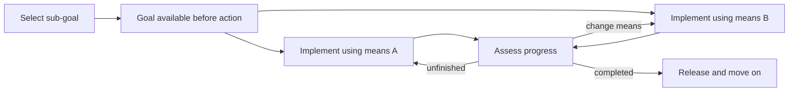

# Goal pursuit as a state machine: references and Figure 1 ideas

September 22, 2026. Research and figure planning only; no Overleaf edits. The proposed diagrams below are our synthesis, not a reconstruction of a single philosopher's theory or a demonstrated finite-state architecture inside the LM.

## Useful precedents

### 1. Explicit goal life cycle: Harland et al. (2014)

James Harland, David N. Morley, John Thangarajah, and Neil Yorke-Smith. *An operational semantics for the goal life-cycle in BDI agents*. Autonomous Agents and Multi-Agent Systems 28:682–719. [Paper](https://starlab.ewi.tudelft.nl/papers/n108.pdf), [DOI](https://doi.org/10.1007/s10458-013-9238-9).

**Look at Figure 2, printed p. 693 / PDF page 12.** It models individual goals using Pending, Active, Suspended, and Monitoring states, plus Aborting and termination. Monitoring is specific to maintenance goals. The formalism separates a goal's status from its associated plans. This is an engineered agent semantics, not an empirical account of human cognition. The text and caption were checked; the browser could not render this figure.

**Design idea:** retain one goal identity while its pursuit status and implementation change. Avoid importing the whole diagram: suspension, monitoring, and abort cleanup would distract from our evidence.

### 2. Changing means while retaining the goal: Morandini et al. (2009)

Mirko Morandini, Loris Penserini, and Anna Perini. *Operational Semantics of Goal Models in Adaptive Agents*. AAMAS 2009, pp. 129–136. [Paper](https://www.ifaamas.org/Proceedings/aamas09/pdf/01_Full%20Papers/02_11_FP_0633.pdf).

**Look at Figure 3, printed p. 135 / PDF page 7, and §5.** A cleaner tries sweeping, finds the room remains dirty, and uses mopping toward the same RoomClean goal. The example distinguishes completing a procedure from satisfying the parent goal. I inspected the rendered figure, which includes a retry transition from provisional success back to active pursuit.

**Design idea:** branches for alternative means belong inside pursuit of one goal. This also makes clear why adaptive recovery can instantiate both plasticity and obstacle persistence.

### 3. Commitment before execution: the Rubicon model

Peter M. Gollwitzer (1990), *Action Phases and Mind-Sets*, pp. 53–92. [Author-hosted chapter](https://www.socmot.uni-konstanz.de/sites/default/files/90_Gollwitzer_Action_Phases_MindSets.pdf). Also Achtziger and Gollwitzer (2007), [*Rubicon Model of Action Phases*](https://www.socmot.uni-konstanz.de/sites/default/files/07_Achtziger_Gollwitzer_Rubicon_model_of_action_phases.pdf).

This psychological phase model separates deliberation, pre-action planning, action, and evaluation. The 1990 chapter's p. 62 explicitly connects commitment with overcoming hindrances through different means or routes. The phase boundaries provide a useful visual distinction between adopting a goal and beginning execution. This is a phase model, not a formally specified finite-state machine. The inspected 2007 entry contains prose rather than a diagram.

**Design idea:** put a visible boundary between pre-implementation capture and generated implementation. The LM evidence does not establish a human-like deliberative phase or suppression of competing intentions.

### 4. A minimal pursuit loop: TOTE

George A. Miller, Eugene Galanter, and Karl H. Pribram (1960), *Plans and the Structure of Behavior*. [Pribram archive's account](https://www.karlpribram.com/plans-and-the-structure-of-behavior/).

The Test–Operate–Test–Exit structure is a compact feedback-control precedent: test a condition, operate if necessary, and test again before exiting. The archive confirms the model's provenance; I did not inspect the original book's figure in this search.

**Design idea:** a continuation loop with an exit makes persistence and completion legible. Do not place a verified “goal achieved?” comparator inside our LM diagram: the boundary intervention currently establishes control over advancement/staying, not semantic completion checking.

### 5. Philosophical constraints on the transitions

Cohen and Levesque (1987), [*Intention = Choice + Commitment*](https://cdn.aaai.org/AAAI/1987/AAAI87-073.pdf), and the expanded (1990) [*Intention is choice with commitment*](https://doi.org/10.1016/0004-3702(90)90055-5), formalize persistence and conditions for relinquishing goals. Use this to motivate release after believed achievement or impossibility, rather than an obligation to continue forever. These are logical accounts, not the source of a particular state diagram proposed here.

Bratman and Williams remain the references for partial plans, directive representations, and abstraction. See the [existing citation mapping](goal_framing_research_brainstorm_2026_09_20.md) and [Williams review](williams_intention_like_representations_review_2026_09_20.md). None of these sources supplies our exact three-attribute definition.

## Recommended Figure 1: an abstract goal above its changing implementation

The key visual distinction should be **goal identity versus implementation state**. The attributes are properties of the transitions and trajectories, not three successive states named “pre-commitment,” “plasticity,” and “persistence.”

Use two aligned panels:

**(a) Functional account of goal pursuit.** A goal is selected before action; its identity stays visible while the implementation changes; pursuit ends or shifts when appropriate. Draw an enclosing band labeled with the active goal and place alternative implementation paths beneath it. A small conceptual recovery detour can illustrate obstacle persistence, but should not be the central path.

**(b) Evidence in the LM.** Ground the same arrangement in a brief code prompt, an exact pivot, a head-output capture, the resulting verbalization, and cross-language implementation transfer. A separate temporal strip shows measurements of goal-related information at positions during implementation. Connect the end of the strip to the boundary experiment with the measured language “advance / stay.”

A schematic for the conceptual panel (our synthesis):

The diagram is deliberately an illustration of the functional account. For the LM panel, replace the inferred progress-assessment node with observations and interventions; do not copy all theoretical edges into the empirical panel.

### Exact evidence-to-visual mapping

| Attribute | Functional visual | LM counterpart | Wording to avoid |
| --- | --- | --- | --- |
| Pre-commitment | Goal node before first action | Highlight `b =` as a pivot; cache selected attention-head contributions; verbalize the upcoming operation | “The model has settled every competing intention” |
| Plasticity | Same goal above alternative means | Source encoding transplanted into another programming-language context; show different output tokens for the same operation | “The model replans after an obstacle” based only on cross-language transfer |
| Temporal persistence | Goal band spans several changing action states | Different vectors at multiple token positions, with matching goal color and an affinity/readout annotation | Repeated copies of one vector, which imply an unchanging stored state |
| Obstacle persistence | Detour/recovery edge back toward the same goal | Separate qualitative examples of recovery and failure, if included | A solid recovery loop suggesting established robust behavior |
| Release / transition | End current pursuit and start another | Boundary-signal patch changes advancement or staying | A validated semantic completion detector |

The cache must visibly originate from **head outputs at the pivot**, not a free-floating “goal” box. A small inset can show `prompt + partial code → model at highlighted token → selected head contributions → cached encoding`. The verbalization and implementation-transfer arrows should both start from that cache.

Use an actual saved source/readout/transfer example when producing the paper figure. A palindrome example is a useful design placeholder, but invented outputs should not appear as empirical results. Keep the token position and the source/destination programming languages legible.

## Two other layouts

**Option B: three columns, theory above / experiment below.** Columns are pre-commitment, plasticity, and temporal persistence. Each has a tiny conceptual sketch above its corresponding LM observation. Place completion as the endpoint of the persistence column; keep obstacle examples in the appendix. This is the clearest comparison and avoids implying that every philosophical property is established. It sacrifices the single continuous life-cycle story.

**Option C: one goal, branching implementations.** Put a goal representation centrally, with a Python path and a C++ path beneath it. Show the pivot and cached head outputs on the Python path, then a transplant arrow to C++. A band across native implementation tokens indicates temporal goal information. This centers the strongest causal finding and keeps the figure compact. The life-cycle/release idea can become a later figure.

My preference is the aligned two-panel version if the figure can span both columns, or Option C if it must fit a single column. For this paper's evidence, an explicit recovery loop is optional and probably belongs outside the teaser.

## Caption strategy

Use **“Functional attributes of goal pursuit and their investigation in an LM”** rather than “the philosophical definition of goals.” Attribute the conceptual panel to a synthesis of planning, action-phase, and goal-management accounts. Label the empirical panel as measurements and interventions. The caption should distinguish sustained representational structure from obstacle recovery, and boundary control from verified completion recognition.

A candidate caption opening:

> **From functional goal pursuit to neural representations.** (a) A goal can precede action, guide different implementations, and remain relevant while execution unfolds. (b) We investigate corresponding properties in an LM by capturing selected attention-head outputs before implementation, reading their content, transferring the encoding across programming-language contexts, and tracing goal-related structure through the generated sequence.

Add the boundary-signal clause only if the panel actually includes its intervention. Any recovery branch in the conceptual panel should be explicitly identified as a broader attribute explored qualitatively in this work.
