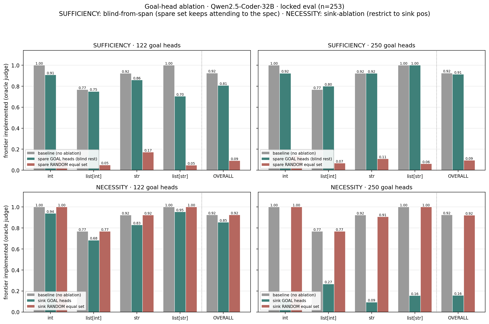
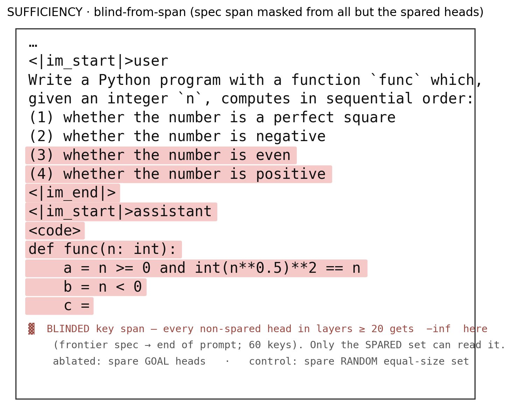

# Goal-head ablation: sufficiency & necessity

> **Paper usage** (section numbers as of the 2026-09-29 build of `Overleaf-draft/Goals-Overleaf/main.pdf`)
> - Main: §4 A Causal Bottleneck Imposed by Goal Heads — sufficiency (`sec:mechanism:ablation`) and necessity (`sec:mechanism:necessity`) paragraphs; results figure `tab:goal-ablation` (`Figures/ablation/ablation_results-crop.pdf`, placed in the §3.4 source file `persistance.tex`); the 250-head choice is re-cited in §5.1.1 KV-transfer.
> - App G Sufficiency of Goal-Head Access (`app:sufficiency`) — `fig:sufficiency-setup`, `tab:goal-ablation-exact`, `tab:sufficiency-qual`.
> - App H Necessity of Goal-Head Access (`app:necessity`) — `fig:necessity-setup`, `tab:goal-ablation-necessity`.

**Model:** Qwen2.5-Coder-32B-Instruct · **Data:** locked prefill-to-frontier eval (`data/goalscope_eval.json`), all 4 datatypes aggregated, **n = 253** · **Metric:** oracle judge on the greedy-decoded frontier value — "does the completion still implement the frontier description?"

Two head budgets are tested: the **122** core goal heads (mask thr>0.9, band 25–56) and the **250**-head superset (top-250 by training-snapshot count, `goal__lam20_top250.json`, spanning from layer 0).

Scripts: `scripts/evaluation/eval_ablation_sufficiency.py`, `eval_ablation_necessity.py`, shared machinery in `ablation_common.py`. Scaled up from `notebooks/clock/13_middle.ipynb` (§4/§5/§7) and `notebooks/diff/07.2_goalhead_sink_sufficiency.ipynb`.

---

## Exact intervention setup

Both tests share a driver (`run_ablation_eval`, `ablation_common.py`): build the prefilled prompt that ends at the frontier's `{var} =` stub, greedy-decode the one-line predicate body, and grade it with the oracle judge. Each datapoint is run under **three conditions** — `baseline` (no ablation), `ablated`, `control` — that differ only in *which* heads the intervention hits. Both interventions engage **only for query rows at absolute position ≥ `q_start`**, where `q_start = len(prompt_ids) - 1` = the frontier **pivot** (the `=` token); earlier query rows are untouched. The mask is added to the **pre-softmax attention scores** (`…self_attn.…nn_functional_softmax_0.input`) and is **KV-cache aware**, so it persists across every decode step.

The two tests deliberately use **different mechanisms**, each matched to the question it asks. `n_layer = 64`, `n_heads = 40`.

### Sufficiency — blind-from-span (13_middle §5 / 07.2)

Every head in layers ≥ `from_layer` (**=20**) *except the spared set* keeps running normally, but has `-inf` added at the **frontier spec span**: the key positions from one token before the frontier's NL description through the **end of the prompt** (`range(min(span_toks)-1, P)` — the goal spec *and* the trailing pivot region). Layers < 20 are fully intact. So the spared heads are the *only* ones in the upper stack that can still read *what* the frontier asks for.

- **`ablated`** = spare the **goal** heads → blind `complement_heads(goal, 20, 64, 40)` = every upper head except the goal set. Heads blinded in layers 20–63: **1638** for goal122 (= 1760 − 122) and **1524** for goal250 (= 1760 − 236, since 14 of the 250 goal heads sit below layer 20 and are outside the `[20,64)` blind pool).
- **`control`** = spare a **random** equal-size set drawn from the **later half of the model** (`layers ≥ n_layer//2 = 32`, excluding the goal heads) → blind everyone else. Matched head budget; fixed, budget-independent depth band (see *Control-group selection* below).

The figure prints a real prompt (spec `int_python_003`, frontier `is_even` = variable `c`) with the exact blinded key span shaded — the frontier description `(3)` through the `c =` pivot (60 keys). Every non-spared upper head gets `-inf` on the shaded tokens; they still attend to everything above it (task preamble, predicates `a`/`b`).

Concretely on this prompt: with only the goal heads able to see the shaded span the model still writes `c = (n % 2 == 0)` (✓); hand the same privilege to a random equal-size set and it wanders off — e.g. `c = (n * (n + 1)) // 2` (✗). Across n=253 the goal-spared run stays near baseline while the random-spared control collapses to ~0.09.

### Necessity — three ablation strengths on the goal heads (`--sink_strat`, 13_middle §4/§7)

`eval_ablation_necessity.py --sink_strat {bos, blind_task, blind_task_and_progress}` applies one of three interventions to the target heads, engaging only for query rows ≥ the pivot (the `=` token); every other head runs normally. `from_layer` here is just the lower bound of the matched-control pool (`goal_from`), not a blinding boundary.

- **`bos`** (sink; the original) — the heads may attend **only to position 0** (`<|im_start|>`): `-inf` at every other key, ≈ zeroing the head's useful output. Nothing in the *prompt* is blinded; the query rows from the pivot on are the thing restricted.
- **`blind_task`** — the heads are blinded from **only the current task's description span** (`frontier_desc_positions`); they attend everywhere else.
- **`blind_task_and_progress`** — the heads are blinded from the task description **through the pivot** (`frontier_block_positions` = spec text + the progress code up to the current-progress token; the same span sufficiency's `blind_span` uses), attending everywhere before it.

In all three, **`ablated`** = the **goal** heads and **`control`** = a **random** equal-size set from the **later half** (`layers ≥ 32`, disjoint from the goal heads). If ablating the goal heads hurts no more than the random set, they are **not** necessary (the computation reroutes).

### Control-group selection

The matched control is a random set of the **same size** as the goal set, drawn from the **later half of the model** — layers `≥ n_layer//2 = 32` (of 64) — and **disjoint from the goal heads**; fixed seed (123). Both axes use the same rule (`--control_pool later_half` in `ablation_common.py`).

We use a **fixed later-half band** rather than the goal set's own layer span because the latter is budget-dependent: `goal_from = min(goal-head layer)` is 28 for the 122-head set but **0** for the 250-head set (which includes 12 layer-0 heads). Drawing the 250 control from `[goal_from, 64) = [0, 64)` would sample it across the *entire* network while the goal heads themselves concentrate in layers ~40–55 — a shallower-on-average, non-comparable control. The fixed `[32, 64)` band keeps the control depth-comparable and identical across head budgets.

**Robustness:** switching from the previous `goal_band` control to `later_half` changed every control cell by ≤ 0.012 (with `baseline`/`ablated` reproduced exactly, since those don't depend on the control), so the conclusions below are insensitive to the control-pool choice.

---

## Results

### Sufficiency — the goal heads carry the goal

| condition | 122 overall | 250 overall |
|-----------|:-----------:|:-----------:|
| baseline | 0.925 | 0.925 |
| **spare GOAL heads** (blind rest) | **0.806** | **0.913** |
| spare RANDOM equal set (later-half control) | 0.103 | 0.087 |

Sparing the goal heads keeps generation near baseline; sparing a random later-half set of the same size **collapses to ~0.09** (122: 0.103, 250: 0.087) — i.e. when the goal heads are the *only* heads allowed to read the spec span, the model still implements the frontier. The 250-head set recovers baseline almost completely (0.913 vs 0.925); the 122-head set recovers most of it (0.806). **The goal heads are sufficient to route the goal.**

Per-datatype, the 122-head residual gap is concentrated in `list[str]` (1.00→0.70) and `str` (0.92→0.86); `int` stays strong (1.00→0.91). The 250-head set is at/near baseline across all four types.

### Necessity — depends heavily on WHICH input you deny the goal heads

All n=253, baseline = 0.925 for both budgets. `ablated` = the goal heads under the named strategy; `control` = the same intervention on a matched random set.

| strategy (goal heads) | blinded span | 122 ablated | 250 ablated | control (122 / 250) |
|-----------------------|--------------|:-----------:|:-----------:|:-------------------:|
| `blind_task` | current task description only | 0.881 | 0.806 | 0.925 / 0.925 |
| `bos` (sink) | attend only to pos 0 (≈ zeroed) | 0.854 | **0.158** | 0.925 / 0.925 |
| `blind_task_and_progress` | task desc → pivot (spec + progress) | **0.372** | **0.249** | 0.929 / 0.925 |

*All controls use the **later-half** control (layers ≥ 32). Every strategy × budget was re-run under it; vs the earlier `goal_band` control the only change was `bos`·250 (0.921 → 0.925). Controls stay ~0.92–0.93 across all six cells — the goal-head effects are not control-pool artifacts.*

Reading across the three strengths:

- **Reading the task description at the pivot is *not* what the goal heads need.** `blind_task` — denying them exactly the current task's spec text — barely moves either budget (122: 0.881, 250: 0.806). The goal has already been folded into the residual upstream; the heads don't re-read the spec at the pivot.
- **Their necessary input is the progress/code region up to the pivot.** `blind_task_and_progress` — the same as `blind_task` but extended through the progress code to the pivot — collapses both budgets (122: 0.372, 250: 0.249).
- **`blind_task_and_progress` *redirects* the goal heads to the previous task — it doesn't merely break them.** With the frontier's spec + progress hidden, the latest task the goal heads can still read is the **previous predicate**, and the model coherently implements *that* at the frontier slot (e.g. frontier "even" → ablated writes `n < 0` = the previous "negative" task; frontier "even" → `n == int(str(n)[::-1])` = the previous "palindrome" task). Oracle re-judging the ablated outputs against the *previous visible task* confirms it: **83.1%** of the 130 goal122 regressions (108/130) and **74.2%** of the 155 goal250 regressions (115/155) implement the previous task. So the low frontier-rate (0.372 / 0.249) is task **misselection**, not model breakage — which is also why it can look "harsher" than the `bos` sink: the sink zeros the heads and the network reroutes back to the frontier (122: 0.854), whereas here the heads stay live and causally select the latest task they can see. This is a *stronger* causal result — the goal heads decide **which** task is implemented from the most recent task description they can read.
- **The 250 set is broadly necessary.** Under the two harsh interventions it collapses (sink 0.158, blind_task_and_progress 0.249); only `blind_task` (spec-only) leaves it near baseline (0.806).
- **All effects are goal-specific**: the matched random control stays ~0.92 across every strategy and budget.

So the earlier "the core 122 are not necessary" holds *only for the sink*: zeroing the 122 heads reroutes (0.854), but denying them the progress context while they stay active does break them (0.372). The redundancy that lets the sink reroute lives *within* the ~128 heads beyond the core 122; the union of the goal-writing heads is necessary under every harsh denial.

---

## Takeaway

- **Sufficient (both budgets):** the goal heads alone, reading the spec span, reproduce baseline frontier implementation; a matched random set cannot (~0.09).
- **Necessary — depends on what you deny.** The full 250-head set is necessary under the harsh interventions (sink → 0.16, blind_task_and_progress → 0.25); the core 122 reroutes under the sink (0.85) but still breaks when blinded from the progress context while staying active (blind_task_and_progress → 0.37). Denying only the task-description span barely hurts either budget (blind_task ≥ 0.81) — the goal heads' necessary input is the **progress/code up to the pivot**, not the spec text at the pivot. Every effect is head-specific (random control ~0.92).

Net: the "intent to implement next(DIFF)" is carried by a **distributed, redundant set** of attention heads — sufficient in any reasonably-sized spared subset, necessary in its union, and reliant on the progress/code context (not the re-read spec) at the pivot. This refines the earlier "sufficient but not necessary" framing: *not necessary* holds only for the confident 122-head core **under the sink**; *necessary* re-emerges once the redundant tail is included, or once the intervention denies the progress context rather than merely zeroing the heads.

- **The goal heads causally select *which* task is implemented.** When blinded from the frontier's spec+progress (`blind_task_and_progress`) they don't produce garbage — they implement the **previous** task, the latest one they can still read (83.1% of goal122 / 74.2% of goal250 regressions). Task selection at the pivot is routed through the goal heads' view of the task list.

---

### Run provenance

| axis | budget | leaf dir |
|------|:------:|----------|
| sufficiency | 122 | `sufficiency/heads=spare_goal__goal122__fromL=20__strat=blind_span__dtype=all__nspec=253__seed=123__ctrl=later_half` |
| sufficiency | 250 | `sufficiency/heads=spare_goal__goal250__fromL=20__strat=blind_span__dtype=all__nspec=253__seed=123__ctrl=later_half` |
| necessity (bos/sink) | 122 | `necessity/heads=goal__goal122__fromL=32__strat=sink__dtype=all__nspec=253__seed=123__ctrl=later_half` |
| necessity (bos/sink) | 250 | `necessity/heads=goal__goal250__fromL=32__strat=sink__dtype=all__nspec=253__seed=123__ctrl=later_half` |
| necessity (blind_task) | 122 | `necessity/heads=goal__goal122__fromL=32__strat=blind_task__dtype=all__nspec=253__seed=123__ctrl=later_half` |
| necessity (blind_task) | 250 | `necessity/heads=goal__goal250__fromL=32__strat=blind_task__dtype=all__nspec=253__seed=123__ctrl=later_half` |
| necessity (blind_task_and_progress) | 122 | `necessity/heads=goal__goal122__fromL=32__strat=blind_task_and_progress__dtype=all__nspec=253__seed=123__ctrl=later_half` |
| necessity (blind_task_and_progress) | 250 | `necessity/heads=goal__goal250__fromL=32__strat=blind_task_and_progress__dtype=all__nspec=253__seed=123__ctrl=later_half` |

All under `results/evaluation/ablation/Qwen2.5-Coder-32B-Instruct/`. Figure regen: scratchpad `fig_ablation.py`.
