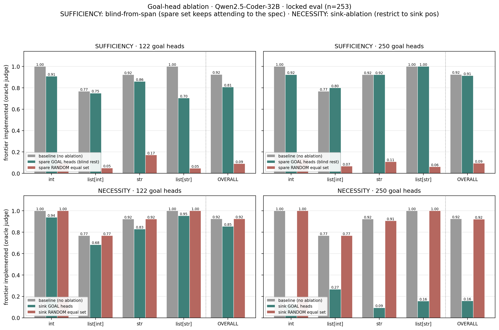
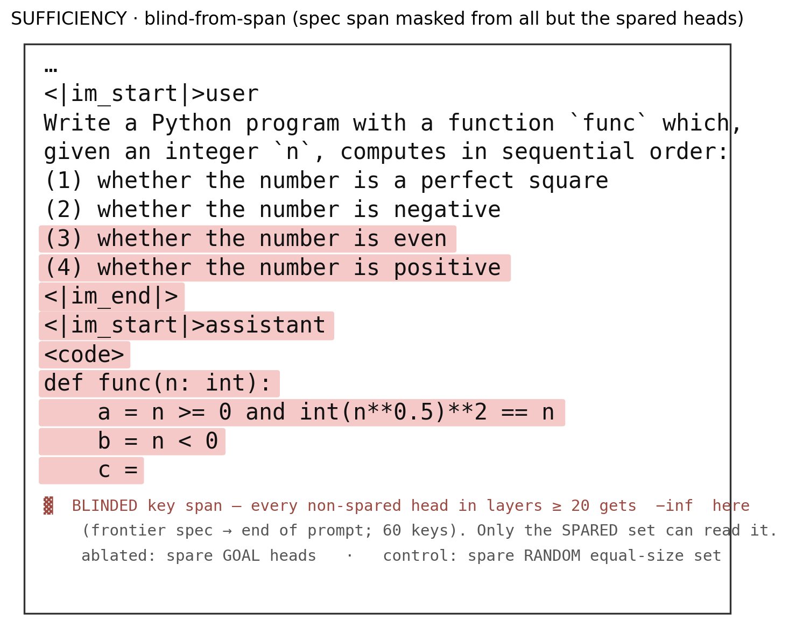
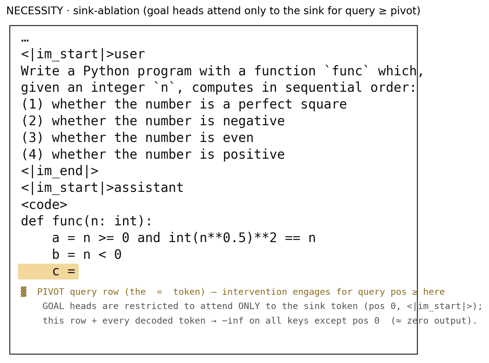

# Goal-head ablation: sufficiency & necessity

**Model:** Qwen2.5-Coder-32B-Instruct · **Data:** locked prefill-to-frontier eval (`data/goalscope_eval.json`), all 4 datatypes aggregated, **n = 253** · **Metric:** oracle judge on the greedy-decoded frontier value — "does the completion still implement the frontier description?"

Two head budgets are tested: the **122** core goal heads (mask thr>0.9, band 25–56) and the **250**-head superset (top-250 by training-snapshot count, `goal__lam20_top250.json`, spanning from layer 0).

Scripts: `scripts/evaluation/eval_ablation_sufficiency.py`, `eval_ablation_necessity.py`, shared machinery in `ablation_common.py`. Scaled up from `notebooks/clock/13_middle.ipynb` (§4/§5/§7) and `notebooks/diff/07.2_goalhead_sink_sufficiency.ipynb`.

---

## Exact intervention setup

Both tests share a driver (`run_ablation_eval`, `ablation_common.py`): build the prefilled prompt that ends at the frontier's `{var} =` stub, greedy-decode the one-line predicate body, and grade it with the oracle judge. Each datapoint is run under **three conditions** — `baseline` (no ablation), `ablated`, `control` — that differ only in *which* heads the intervention hits. Both interventions engage **only for query rows at absolute position ≥ `q_start`**, where `q_start = len(prompt_ids) - 1` = the frontier **pivot** (the `=` token); earlier query rows are untouched. The mask is added to the **pre-softmax attention scores** (`…self_attn.…nn_functional_softmax_0.input`) and is **KV-cache aware**, so it persists across every decode step.

The two tests deliberately use **different mechanisms**, each matched to the question it asks. `n_layer = 64`, `n_heads = 40`.

### Sufficiency — blind-from-span (13_middle §5 / 07.2)

Every head in layers ≥ `from_layer` (**=20**) *except the spared set* keeps running normally, but has `-inf` added at the **frontier spec span**: the key positions from one token before the frontier's NL description through the **end of the prompt** (`range(min(span_toks)-1, P)` — the goal spec *and* the trailing pivot region). Layers < 20 are fully intact. So the spared heads are the *only* ones in the upper stack that can still read *what* the frontier asks for.

- **`ablated`** = spare the **goal** heads → blind `complement_heads(goal, 20, 64, 40)` = every upper head except the goal set (1760 − |goal| heads blinded: 1638 for goal122, 1510 for goal250).
- **`control`** = spare a **random** equal-size set drawn from the goal band (`range(goal_from, 64)`, `goal_from` = shallowest goal-head layer) → blind everyone else. Matched head budget, matched depth.

The figure prints a real prompt (spec `int_python_003`, frontier `is_even` = variable `c`) with the exact blinded key span shaded — the frontier description `(3)` through the `c =` pivot (60 keys). Every non-spared upper head gets `-inf` on the shaded tokens; they still attend to everything above it (task preamble, predicates `a`/`b`).

Concretely on this prompt: with only the goal heads able to see the shaded span the model still writes `c = (n % 2 == 0)` (✓); hand the same privilege to a random equal-size set and it wanders off — e.g. `c = (n * (n + 1)) // 2` (✗). Across n=253 the goal-spared run stays near baseline while the random-spared control collapses to ~0.09.

### Necessity — sink-ablation (13_middle §4/§7)

The target heads are restricted to attend **only to the sink position** (`sink_pos = 0`): for query rows ≥ the pivot, their softmax input gets `-inf` at every key except position 0 (which stays 0), ≈ zeroing the head's useful attention output. Every other head runs normally. `from_layer` here is just the lower bound of the matched-control pool (`goal_from`), not a blinding boundary.

- **`ablated`** = sink the **goal** heads themselves.
- **`control`** = sink a **random** equal-size set from the goal band (`range(goal_from, 64)`, disjoint from the goal heads).

The figure prints the same prompt; here nothing in the *prompt* is blinded. Instead the intervention marks the **query rows from the `c =` pivot onward** (shaded): at those rows the goal heads' softmax scores become `-inf` everywhere except key position 0 (the sink token `<|im_start|>`), so their attention output ≈ 0 while every other head runs normally.

If sinking the goal heads hurts no more than sinking a random equal-size set, the goal heads are **not** necessary (the computation reroutes).

The control in both tests is depth-matched — the random set is drawn from `range(goal_from, 64)`, so a result cannot be an artifact of a shallower/deeper pool than the goal set. (This fixed an earlier sufficiency control that sampled from a fixed `from_layer=20` pool.)

---

## Results

### Sufficiency — the goal heads carry the goal

| condition | 122 overall | 250 overall |
|-----------|:-----------:|:-----------:|
| baseline | 0.925 | 0.925 |
| **spare GOAL heads** (blind rest) | **0.806** | **0.913** |
| spare RANDOM equal set | 0.091 | 0.095 |

Sparing the goal heads keeps generation near baseline; sparing a depth-matched random set of the same size **collapses to ~0.09** — i.e. when the goal heads are the *only* heads allowed to read the spec span, the model still implements the frontier. The 250-head set recovers baseline almost completely (0.913 vs 0.925); the 122-head set recovers most of it (0.806). **The goal heads are sufficient to route the goal.**

Per-datatype, the 122-head residual gap is concentrated in `list[str]` (1.00→0.70) and `str` (0.92→0.86); `int` stays strong (1.00→0.91). The 250-head set is at/near baseline across all four types.

### Necessity — no *small* subset is necessary, but the full set is

| condition | 122 overall | 250 overall |
|-----------|:-----------:|:-----------:|
| baseline | 0.925 | 0.925 |
| **sink GOAL heads** | **0.854** | **0.158** |
| sink RANDOM equal set | 0.925 | 0.921 |

This is the more interesting half:

- **The core 122 heads are *not* necessary.** Sinking them drops overall only 0.925→0.854 — well above collapse — while the random control is untouched (0.925). The goal computation **reroutes**: knocking out the 122 heads that most confidently encode the goal barely hurts, because the signal is redundantly available elsewhere.
- **The 250-head set *is* necessary.** Sinking the full set collapses to **0.158**, while sinking 250 *random* heads (also from layer 0) leaves generation intact (0.921). So the collapse is specific to the goal heads, not a generic "ablate 250 heads and it breaks" effect.

The redundancy therefore lives *within* the ~128 heads beyond the core 122: any small confident subset can be spared (rerouted around), but the union of the goal-writing heads is both **necessary and sufficient**.

---

## Takeaway

- **Sufficient (both budgets):** the goal heads alone, reading the spec span, reproduce baseline frontier implementation; a matched random set cannot (~0.09).
- **Necessary (only at the full 250-head set):** the core 122 heads are individually redundant (sink → 0.85, reroutes), but the full goal-head set is necessary (sink → 0.16) and the effect is head-specific (random control → 0.92).

Net: the "intent to implement next(DIFF)" is carried by a **distributed, redundant set** of attention heads — sufficient in any reasonably-sized spared subset, necessary only in its union. This refines the earlier "sufficient but not necessary" framing: *not necessary* holds for the confident 122-head core, but *necessary* re-emerges once the redundant tail is included.

---

### Run provenance

| axis | budget | leaf dir |
|------|:------:|----------|
| sufficiency | 122 | `sufficiency/heads=spare_goal__goal122__fromL=20__strat=blind_span__dtype=all__nspec=253__seed=123` |
| sufficiency | 250 | `sufficiency/heads=spare_goal__goal250__fromL=20__strat=blind_span__dtype=all__nspec=253__seed=123` |
| necessity | 122 | `necessity/heads=goal__goal122__fromL=28__strat=sink__dtype=all__nspec=253__seed=123` |
| necessity | 250 | `necessity/heads=goal__goal250__fromL=0__strat=sink__dtype=all__nspec=253__seed=123` |

All under `results/evaluation/ablation/Qwen2.5-Coder-32B-Instruct/`. Figure regen: scratchpad `fig_ablation.py`.
