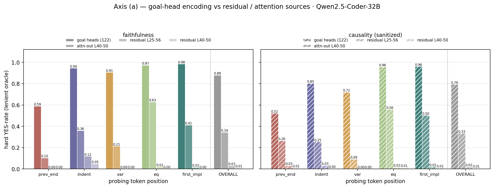
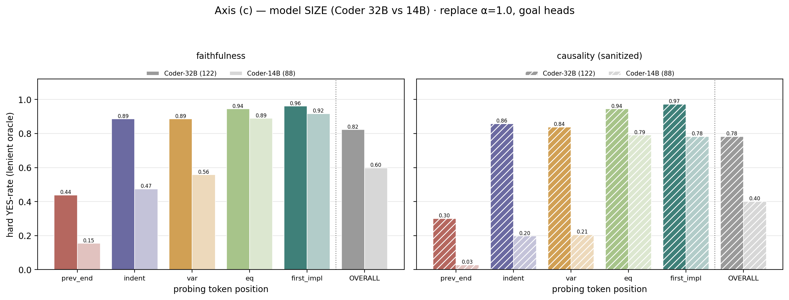
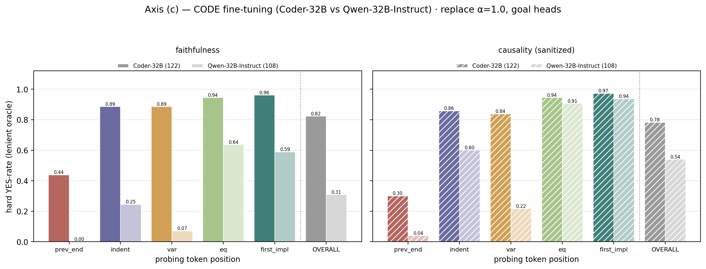
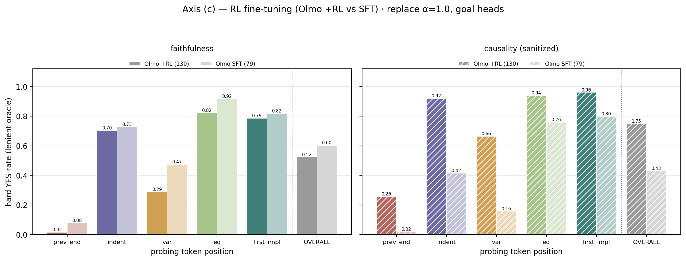

# GoalScope evaluation matrix — pending jobs, and why

*Started 2026-08-10; results updated 2026-09-10 on the locked prefill-to-frontier corpus. Write-up of
axes (a), (b), (c). Figures: `figures/goalscope_axis_*.png` (regenerated by `notebooks/clock/12.2_goal_eval_axis.ipynb`).*

Three questions about how good the goal-head encoding actually is:

| | question | manipulation |
|---|---|---|
| **a** | is the goal-head aggregate better than the raw residual? | source of the injected vector |
| **b** | how many heads does the encoding need? | head-set size |
| **c** | does it depend on scale / code-FT / RL-tuning? | model |

All runs use the **locked prefill-to-frontier corpus** (`data/goalscope_eval.json`, all 4 datatypes
aggregated → **253 datapoints × 5 pivots = 1265 records**, `span=frontier`, `seed=123`), both
`--mode faithfulness` and `--mode causality`. **Causality is sanitized** (trivial sign/zero read-outs
forced to NO). Parse with `scripts.evaluation.faithfulness_io`. Old int-only `span=rule` runs are
archived under `results/evaluation/goalscope_old_pred/`.

---

## Results (2026-09-10, `hard_yes` pooled over pivots)

### (a) goal-head aggregate vs raw residual / attention output — Qwen2.5-Coder-32B (α=0.1)

| source injected | faithfulness | causality |
|---|---|---|
| **goal heads (122, `additive_norm`)** | **0.879** | **0.792** |
| attention-module output, L40–50 (`resid_norm`) | 0.343 | 0.334 |
| residual stream, L25–56 (`resid_norm`) | 0.031 | 0.020 |
| residual stream, L40–50 (`resid_norm`) | 0.009 | 0.006 |

**The head selection does nearly all the work.** The goal is highly readable from the 122 goal heads,
only partially from the *full* attention output at the concentration band (0.34, mostly at `eq`/`first_impl`),
and essentially **not** from the raw residual stream (~0.01–0.03) — whose norm is dominated by non-goal
content, so norm-relative injection of it carries almost no goal signal.

### (b) sparsity — how many heads? *(running; results pending)*

Qwen2.5-Coder-32B, `additive_norm α=0.1`, head-set sizes **5, 10, 25, 50, 100, 150, 200, 250, 300** +
the 122 anchor (`job_list/goalscope_eval/goalscope_eval_b_sparsity.json`). Jobs still running on the
remote box; §2 of the notebook + this section populate once they land.

### (c) generalization across models — `replace α=1.0`, goal heads

| model (goal heads) | faithfulness | causality |
|---|---|---|
| **Qwen2.5-Coder-32B** (122) | 0.823 | 0.783 |
| **Qwen2.5-Coder-14B** (88) | 0.598 | 0.401 |
| Qwen2.5-32B-Instruct (108) | 0.308 | 0.540 |
| Olmo-3.1-32B-Instruct **+RL** (130) | 0.523 | 0.749 |
| Olmo-3.1-32B-Instruct **SFT** (79) | 0.603 | 0.430 |

|  |
|---|
|  |
|  |

- **Scale** (Coder 32B vs 14B): the encoding is markedly cleaner at 32B — faith 0.82 vs 0.60, caus 0.78 vs 0.40.
- **Code fine-tuning** (Coder-32B vs Qwen-32B-Instruct): the biggest gap — faith 0.82 vs 0.31, caus 0.78 vs 0.54.
- **RL fine-tuning** (Olmo +RL vs SFT): causality **up** (0.75 vs 0.43) but faithfulness **down** (0.52 vs 0.60).

> Caveat (c): the steer band is fixed at (35, 46) for every model — the *Qwen-32B* band. For Olmo (goal
> band (10, 36)) it sits outside the goal region, so the Olmo numbers confound "where the goal heads live"
> with the model change (see Comparability rules below).

---

## The magnitude caveat (applies to a and b)

`additive` injects `h + α·g_enc`: the added magnitude is `α·‖g_enc‖`, an **absolute** quantity,
while the thing it perturbs has magnitude `‖h‖`. Nothing holds the ratio fixed, and two terms move
independently of the thing under test:

* `‖h‖` grows with depth — so a single run applies a different relative perturbation at each of the
  11 steer layers;
* `‖g_enc‖` grows with head count, since it is a **sum** over heads — so **(b) at fixed α confounds
  "more heads" with "stronger injection"**, which is precisely the variable it means to isolate.

`additive_norm` (commit `283847e`) injects `h + α·‖h‖·ĝ` instead, so α means "add this fraction of
the local residual norm". **α does not carry over** — 0.2 has no meaning under the new units, hence
the α sweep in job group 0.

For **(a)** the same argument decides the strategy: `‖h_src‖` (a full residual) is far larger than
`‖g_enc‖` (a sum over ~120 heads), so a plain additive comparison at fixed α steers the residual arm
much harder and reads magnitude, not content. `eval_residual_patchscope.py` therefore uses
`resid_norm` (= `add_norm` semantics).

> **Open question for the spec.** The original brief for (a) said `strategy="additive", alpha=0.1`,
> exactly as the PatchScope paper. The script as built is norm-relative for the reason above, and is
> also an *additive* injection rather than the paper's single-layer **replace**. If the literal
> replication matters, two arms to add: `--source-agg last` (single layer, closest to the paper) and
> a plain-`additive` residual arm to show what the magnitude confound does. Not yet built.

---

## Job groups

### 0. Calibrate α for `additive_norm` *(prerequisite for a and b)*

α is in new units, so everything downstream needs a defensible value first. Qualitatively α=0.1
already looks right on causality (`12.1`: coherent C++, e.g. `first_impl` →
`for(i=1;i<=value/2;++i) if(value%i==0) sum+=i; return sum>value`), and the residual smoke test at
the same α produced *degenerate* text — so the two arms may not want the same α.

- [ ] `additive_norm` × {0.05, 0.1, 0.2} × faithfulness, goal heads, `n_specs=64` — pick α, then run
      the full grid at it
- [ ] `resid_norm` × {0.02, 0.05, 0.1} × faithfulness, `n_specs=64` — same, for the residual arm

Small `n_specs` on purpose: this is calibration, not a result.

### a. Residual-latent baseline

Isolates how much of the read-out quality comes from the **head selection** versus what the raw
residual at the same positions already carries. Source band = `GOAL_BAND` so both arms cover the
same depth.

- [ ] `resid_norm` faithfulness, α=TBD, `--source-agg mean`
- [ ] `resid_norm` causality, α=TBD, `--source-agg mean`
- [ ] `additive_norm` goal heads faithfulness, α=TBD ← the arm it is compared against
- [ ] `additive_norm` goal heads causality, α=TBD

In `job_list/goalscope_norm_vs_residual.json` (currently pinned at α=0.1; update after group 0).

Optional, only if the literal paper replication is wanted: `--source-agg last`, and a plain-additive
residual arm.

### b. Head sparsity

Top-k by mask value: **25, 50, 100, 150, 200, 300**. Export each with
`notebooks/clock/__head_inspection.ipynb` (`CFG["goal"]["topk"]`, writes
`head_sets/<model>/goal__lam20_top<k>.json`), then point `--heads` at the path.

- [ ] export the six json head sets
- [ ] 6 × faithfulness, `additive_norm`, α=TBD
- [ ] 6 × causality, `additive_norm`, α=TBD

Two things to watch:
* **must be `additive_norm`** — under `additive` this sweep measures ‖g_enc‖ growth (above);
* the goal mask **saturates**: 117 of Qwen-Coder-32B's heads sit at exactly 1.0, so k ≤ 117 cuts
  through a tie block and the selection is index order, not importance. `n_tied@K` in
  `__head_inspection` flags it. k = 25 / 50 / 100 are all inside that block — report them as
  "an arbitrary 25 of the 117 maximal heads", not "the top 25".

### c. Model axes

Three contrasts, one variable each:

| axis | models |
|---|---|
| scale | Qwen2.5-Coder-32B-Instruct vs **Qwen2.5-Coder-14B-Instruct** |
| code fine-tuning | Qwen2.5-Coder-32B-Instruct vs **Qwen2.5-32B-Instruct** |
| RL tuning | Olmo-3.1-32B-Instruct vs **Olmo-3.1-32B-Instruct-SFT** |

- [x] Qwen2.5-Coder-14B faithfulness + causality — done (pulled from umibozu)
- [x] Qwen2.5-32B-Instruct — done (mask trained; see (c) above)
- [x] Olmo-3.1-32B-Instruct-SFT — done
- [x] Olmo-3.1-32B-Instruct — done (`replace`; the `additive_norm` arm is (a)-only, Coder-32B)

**Blockers cleared** (2026-09-10): all five model masks now exist in `results/localization/`, and
all 5 model-axis runs are on disk (`replace α=1.0`, 253-spec corpus) — see the (c) table above. Head
sets are exported under `head_sets/<model>/goal__lam20_thr0.9_band<band>.json`. Remaining: the axis-(b)
sparsity sweep is still running on the remote box.

Also note `Qwen2.5-Coder-14B-Instruct` has **no `GOAL_BANDS` entry** — it will fall back to full
depth with a warning, which is not comparable to the 32B's (25,56). Look at its mask heatmap and set
a band before running, or the scale axis measures band width as much as scale.

---

## Comparability rules

* Never compare an `additive` number with an `additive_norm` one — different units.
* Within (b), all six head sets must share one α, and it must be `additive_norm`.
* Within (c), the steer band is currently fixed at (35, 46) for every model. That is the *Qwen-32B*
  band; for Olmo (whose goal band is (10, 36)) it sits outside the goal region entirely. Either set
  a per-model steer band or state plainly that the band is held fixed and the axis therefore
  confounds "where the goal heads live" with the model change.
