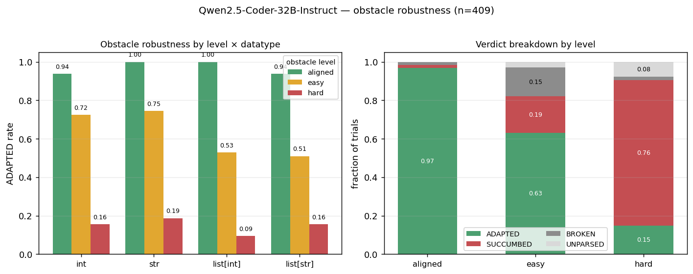

# Obstacle robustness of code LLMs (behavioral)

*Core model: Qwen2.5-Coder-32B-Instruct (figure + tables); cross-model comparison across 6 models below.*

*2026-09-20. How robustly does the model still implement a sub-goal when its frontier is forced to start
with a misleading prefix? Behavioral (generation-level) check; the goal-**encoding** persistence test is
separate. Notebook: `notebooks/persistance/03_obstacle_robustness.ipynb`. Machinery:
`scripts/evaluation/obstacle_prefills.py` (obstacles), `scripts/evaluation/obstacle_eval.py`
(`judge_adapts`). Cache: `results/notebook_caches/obstacle_robustness/Qwen2.5-Coder-32B-Instruct/`
(409 per-trial files + `rows.json`).*

## Method

**Task.** Current QTASKS corpus — 4 datatypes (int / str / list[int] / list[str]), 16 predicates each.
Each trial builds a **two-condition prompt with the first condition prefilled** (prior progress), and
obstructs the second (the target sub-goal `g_k`):

```
def func(n: int):
    a = len(str(abs(n)))     # a prior sub-goal, PREFILLED (a different predicate)
    b = <OBSTACLE PREFIX>    # frontier: target g_k, forced to start with the prefix
```

The model greedy-generates the rest of the `b =` line; we grade the completed right-hand side.

**Obstacles (appended verbatim after `b =`).** Three categories, all *escapable* — there is always a
syntactic way to still reach `g_k` despite the forced start (verified 0/64: the wrong expression is kept
fully parenthesized so one nullifier can override it):
- **aligned** — a correct start of `g_k` (ceiling control).
- **easy** — type-appropriate ignorable / slight-adaptation stubs the model should absorb trivially
  (bool: `True and` / `False or` / `not` / `(`; numeric: `0 +` / `(`; char: `"" +` / `(`).
- **hard** — actively adversarial: a forced **wrong sibling** predicate `((<sibling>)` and a wrong-op /
  wrong-type fragment (`- 1 +`). The model must recognize and work around a committed wrong start.

**Scoring — bespoke oracle, plasticity-aware.** `judge_adapts(task, obstacle_stub, full_rhs)` →
**ADAPTED** (implements `g_k`, working around the forced stub), **SUCCUMBED** (followed the stub to the
wrong op), **ESCAPED** (reaches `g_k` but by degenerately discarding the stub), **BROKEN**
(invalid/incomplete). We deliberately do **not** score reference-impl equality — a robust model may adapt
via a different valid implementation (the plasticity point). **ADAPTED rate = obstacle robustness.**

**Scale.** All 64 predicates × up to 4 prefixes/category (`N_PER=4`) = **409 trials**, greedy decoding,
per-trial cached/resumable. Oracle: `claude-sonnet-4-6`, temperature 0.

## Results (core model: Qwen2.5-Coder-32B-Instruct)



*Left: ADAPTED rate by obstacle level × datatype. Right: verdict breakdown by level. Aligned (correct
start) is near-ceiling; even easy/ignorable stubs sag to ~0.63; hard collapses to 0.15 with 76% SUCCUMBED.*

**ADAPTED rate by level × datatype** (n=409):

| level | int | str | list[int] | list[str] | **all** | n |
|---|:-:|:-:|:-:|:-:|:-:|:-:|
| aligned (ceiling) | 0.94 | 1.00 | 1.00 | 0.94 | **0.97** | 64 |
| easy | 0.72 | 0.75 | 0.53 | 0.51 | **0.63** | 217 |
| hard | 0.16 | 0.19 | 0.09 | 0.16 | **0.15** | 128 |

**Verdict breakdown by level** (fraction; ESCAPED omitted — it never fired):

| level | ADAPTED | SUCCUMBED | BROKEN |
|---|:-:|:-:|:-:|
| aligned | 0.97 | 0.02 | 0.02 |
| easy | 0.63 | 0.19 | 0.15 |
| hard | 0.15 | **0.76** | 0.02 |

## Findings

1. **The model is not very obstacle-robust at the frontier.** A forced *wrong-sibling* start makes it
   **succumb 76%** of the time; it finds the escape only **15%**. The ceiling (aligned 0.97) confirms the
   harness and judge are calibrated — the collapse is real, not an artifact.
2. **Even "easy" perturbations hurt more than expected (0.63).** Not because the model can't syntactically
   ignore them, but because stubs like `not` / `True and` nudge it into *subtly wrong or simplified*
   expressions: e.g. `is_positive` + `not ` → `not 0 > n` (= n≥0, off-by-boundary); `is_prime` + `True and `
   → `True and 1 < n` (drops the primality test, just `n>1`). The prefix perturbs the *content*, not just
   the syntax.
3. **The capability exists but is rarely deployed under hard obstacles.** The 15% hard-ADAPTED cases are
   genuine creative escapes: `is_odd` + `(((n % 2 == 0))` → `(((n % 2 == 0)) == False)`; `count_spaces` +
   `((len(s))` → `((len(s)) - len(s.replace(" ","")))`; `sign` + `- 1 +` → `- 1 + (n >= 0) * 2`. So the
   model *can* work around a committed wrong start — it just usually doesn't.
4. **Datatype gradient (hard):** list[int] weakest (ADAPTED 0.09, SUCCUMBED 0.88), str strongest (0.19);
   all low.

## Failure-mode anatomy (Coder-32B): what the model does with each obstacle

Greedy decoding makes each obstacle's response near-deterministic, so the failures are not noise — they
are **prefix-specific tics**: given the forced prefix you can largely predict the completion motif. Going
through the 409 Coder-32B completions (`results/notebook_caches/obstacle_robustness/Qwen2.5-Coder-32B-Instruct/rows.json`),
five motifs account for almost all the non-ADAPTED behavior.

**1. `0 +` (easy numeric) → the "complex-number placeholder" tic + the unclosed generator.**
Only 21% ADAPTED. Three motifs cover 25/38 completions:
- **`0j` complex-zero filler (10/38).** Forced to add something to `0` and unsure what, the model emits
  the *complex* zero: `0 + 0j`, `0 + 1j`. Twice it even annotates it —
  `0 + 0j  # Placeholder for complex number, not used in calculation` and
  `0 + 0j  # Placeholder for complex number, but we'll use it as a tuple`. This is exactly the tic
  hypothesized: `0 +` reliably summons a nonsensical `0j`/`1j` placeholder (often for `count_*` goals).
- **Unclosed generator body (11/38, all BROKEN).** `0 + 1 for c in s if c.isdigit())` — it primes a
  `sum(0 + 1 for …)` body but drops the `sum(` wrapper, yielding a `SyntaxError`.
- **Degenerate constant (6/38).** `0 + 0` / `0 + 1` — just closes with a constant (wrong).

**2. `- 1 +` (hard scalar) → "goal recognized, offset never escaped." The single most systematic case.**
87% SUCCUMBED, and in **63/63** completions the model keeps the forced `- 1 +` verbatim at the front and
appends the *correct* goal expression: `- 1 + sum(1 for x in nums if x % 2 == 0)`, `- 1 + (n > 0)`,
`- 1 + len(s.split())`, `- 1 + any(c.isdigit() for c in s)`. It plainly **knows the sub-goal** — it just
treats `- 1 +` as an immovable additive term and returns `goal − 1` (off-by-one), or for booleans tries
`- 1 + 2 * (bool)` rescaling (4×). The handful of ADAPTED escapes are exactly the cases where a trailing
`+ 1` or `* 2` nullifies the offset (`sign → - 1 + (n >= 0) * 2`; `total_sum → - 1 + sum(nums) + 1`;
`count_spaces → - 1 + len(s.split())`). So the failure is not a wrong goal — it is an inability to *back
out of a committed constant*.

**3. `not` (easy bool) → reflexive `not 0` / `not 1` literal (23/25).** The model almost always inserts a
numeric literal right after `not` (18× `0`, 4× `1`, 1× `0.5`) then continues with a comparison:
`not 0 == n % 2`, `not 0 <= n`, `not 0 in nums`. This double-negation gambit lands correctly when the
predicate negates cleanly (`is_odd`, `is_negative`) but slips on boundaries (`not 0 > n` = `n ≥ 0` for
`is_positive`, off by the `n == 0` case) or inverts membership (`not 0 in nums` flips `contains_zero`).

**4. `((` (easy) → a generator/tuple context it cannot close (46% BROKEN).** For direct scalar goals the
extra parens are harmless (`((len(s)))`, `((n % 10 + 10) % 10)`). But for *count* goals `((` primes a bare
comprehension body with no `sum()`: `((c.isalpha() for c in s))`, `((x > 0) for x in nums)` (16/39) — a
generator object or a `SyntaxError`, never an `int`. A secondary tic wraps a 1-tuple: `((sum(nums),))`,
`((min(nums),))` (5/39).

**5. Wrong-sibling `((<sibling>)` (hard) → anchor-and-build-from-the-wrong-primitive (17/24 SUCCUMBED).**
Forced to open with a *different* predicate's expression, the model keeps it as a **building block** and
tries to derive the true goal from it rather than discarding it: forced with `((len(str(abs(n))))`
(digit-count) but asked for `digit_sum`, it writes `((len(str(abs(n)))) - 1) * 9 + sum(int(d) …)`;
`last_digit → ((len(str(abs(n)))) - 1)`. It contorts around the committed wrong primitive — almost always
incorrectly.

**Overarching pattern.** Across all five, the obstacle behaves as a **hard syntactic commitment the model
will not retract.** Its sub-goal recognition is largely intact (most visible under `- 1 +`, where the goal
expression is nearly always correct), but it *bolts the goal onto the forced prefix* instead of escaping
it — off-by-a-constant, or into a syntactic dead end. The escapes that do happen are precisely the algebraic
coincidences where the forced fragment can be cancelled (`+1`, `*2`, an extra `)`). This is consistent with
the behavioral collapse in the tables above: the capability is present, but the model defaults to *local
continuation of the committed tokens* over *global re-planning toward the goal*.

## Cross-model comparison

The same 409-trial escapable-obstacle set + `judge_adapts` was run on six models via
`scripts/evaluation/obstacle_robustness_eval.py` (one model per process; per-trial cached; results in
`results/obstacle_robustness/<model>/`). ADAPTED rate:

| model | aligned | easy | hard |
|---|:-:|:-:|:-:|
| Qwen2.5-Coder-32B-Instruct *(main)* | 0.97 | 0.63 | 0.15 |
| Qwen2.5-32B-Instruct | 0.97 | 0.66 | 0.12 |
| Qwen2.5-72B-Instruct | 0.94 | 0.57 | 0.12 |
| Olmo-3.1-32B-Instruct | 0.94 | 0.57 | **0.21** |
| GLM-4-32B-0414 | 0.91 | 0.54 | 0.12 |
| Qwen2.5-Coder-14B-Instruct | 0.91 | 0.50 | 0.09 |
| Olmo-3.1-32B-Instruct-SFT | 0.89 | 0.35 | 0.08 |

- **Weak obstacle robustness is universal.** Every model has a ~0.9+ ceiling (aligned), sags to
  ~0.35–0.66 under *easy* (ignorable) perturbations, and collapses to **0.08–0.21 under hard**. No model
  exceeds 0.21 on hard.
- **Instruct-tuning helps markedly** — the cleanest contrast is Olmo full-instruct vs SFT-only: easy
  0.57 vs 0.35, hard 0.21 vs 0.08 (echoing the older prefill-probing finding that instruct-tuning boosts
  adversarial robustness).
- **Scale is not the driver.** The 72B (0.57/0.12) does not beat the 32B class; the two Qwen-32B models
  are the most robust overall, Olmo-3.1-32B-Instruct is the single most hard-robust (0.21), and the 14B is
  the weakest Qwen instruct. Robustness tracks tuning/family more than parameter count here.
- *Qwen3.8-27B was excluded — its `qwen3_5` (MTP) architecture is unsupported by `ModelandTokenizer`.*

## Caveats

- **Behavioral, not representational.** This measures the *model's* obstacle robustness (generation), not
  the *goal-encoding's* persistence. The encoding-level obstacle test (does the goal-head readout stay on
  `g_k` under the obstacle; does encoding-persistence mediate recovery) is the separate leg-(iii) work.
- **UNPARSED = 16 (~4%).** The judge's output didn't match the verdict tags on 16 complex RHSs; they sit
  in the denominator but count as no verdict, so all rates are marginally *under*-stated. Worth a parser
  fix / re-judge.
- **ESCAPED never fired** — either genuinely absent (forced prefixes can't be truly discarded) or the
  judge doesn't separate it from ADAPTED/SUCCUMBED. Treat the 4-way as effectively 3-way here.
- **Judge is the arbiter** (plasticity-lenient). Most calls look right; a few ADAPTED are slightly off
  (`sign` escape mishandles 0) and a few SUCCUMBED are borderline-creative — the rates are oracle
  judgments, not ground truth.
- **Prompt is a 2-condition minimal frontier**, not the full multi-predicate context of the main paper.

## Takeaway

Qwen2.5-Coder-32B-Instruct exhibits **weak obstacle robustness** at a sub-goal frontier: near-ceiling with
a correct start, **~0.63** under mild (ignorable) perturbations, and **~0.15** under a committed wrong
start (76% succumb). Robustness *is* achievable — a real fraction of hard cases show creative escapes —
but it is not the model's default. This mirrors the earlier prefill-probing finding (`0_lm_performance.md`,
~74% adversarial on the older single-line set) in spirit, and sharpens it with a graded, escapable,
plasticity-aware obstacle design. **Across six models the pattern is universal** (hard ≤ 0.21 everywhere),
driven by tuning/family more than scale — so obstacle robustness is a genuine limitation, not a
single-model quirk. For the paper's persistence(ii) leg, this is the behavioral half; the representational
half (goal-encoding persistence under the same obstacles) remains to be run.
