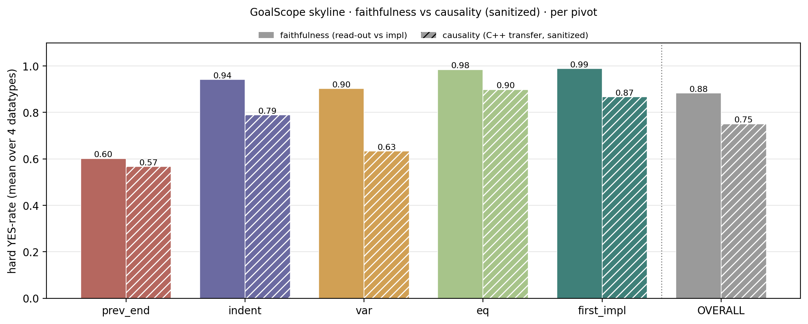
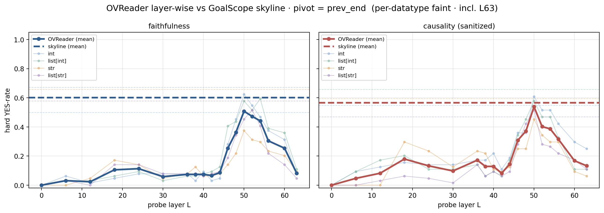
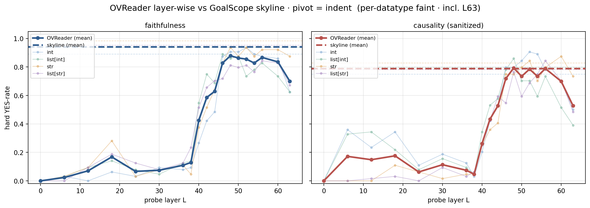
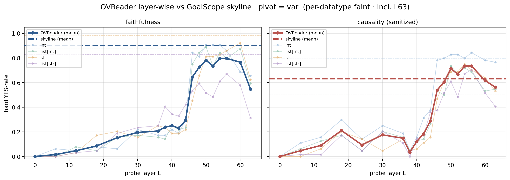
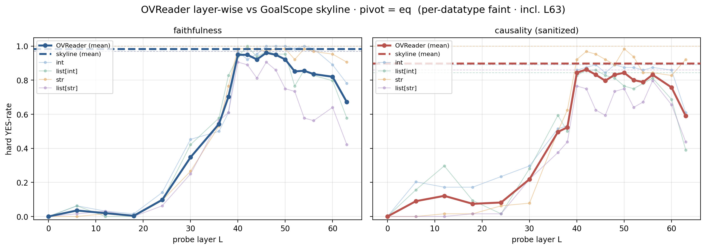
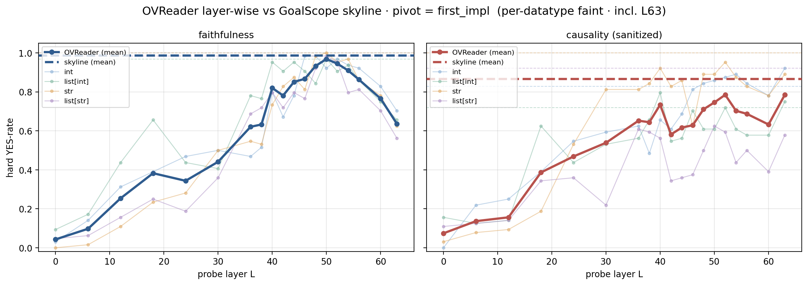

# OVReader — probing the residual's OV-write subspace for the goal (DIFF)

*Companion to `src/goals/goalscope.py` (`OVReader`), `scripts/evaluation/eval_ov_reader.py`,
`scripts/evaluation/ov_reader_io.py`, and `notebooks/diff/7_ov_reader_eval_demo.ipynb`.
Last updated 2026-09-11. All 8 jobs complete ({faithfulness, causality} × 4 datatypes, python, **n=64**),
now including the **last layer (L63)** — the probe layer list always appends `n_layer-1`.*

> **Causality is now sanitized** (see §5.0). Trivial sign/zero frontiers are excluded from target
> selection and trivial read-outs (`value > 0` / `== 0` / `< 0`) are forced to NO, so the no-goal
> C++-stub default can no longer inflate the score. All causality numbers/figures below reflect this.

---

## 0. What it is, in one line

For a residual stream `h` taken after an arbitrary layer `L` at a pivot token, **OVReader measures whether
the goal heads' output–value (OV) circuit, applied to `h`, already points along the goal direction** — i.e.
whether the upcoming sub-goal (the "DIFF") is *already present in the residual* before the goal-head layers
concentrate. It does so by turning that OV image of `h` into a steering vector and reading it out through
GoalScope.

This is the **write-side** complement to the goal-head *transplant* evals (`diff_eval_analysis.md`): those
ask "can I move the goal by transplanting head q/k/v"; OVReader asks "is the goal *linearly readable* from
the residual, in the exact form a goal head would write it, and from which layer on".

---

## 1. Motivation

The DIFF hypothesis says the model, at a pivot, holds a representation of the next instrumental goal. The
transplant evals show the goal heads' pivot **output** carries it (GoalScope readout ≈ 0.9). Two newer
observations push the locus *earlier*:

1. the goal-head **query** already carries the computed next goal, not just progress
   (`diff_eval_analysis.md` ★ Headline);
2. we want to know **where in depth** the goal first becomes linearly present in the residual.

OVReader answers (2) on the write side: it sweeps `L` and asks at each layer whether the goal is in the
subspace the goal heads *write from*.

### Why the OV transform (and not a projection)

Three candidate "does `h` contain the goal" probes were tried; only the third was useful:

| probe | operator on `h` | subspace | result |
|---|---|---|---|
| Q-read | `W_Q_j·diag(g)` then pseudo-inverse back | rowspace(`W_Q`) — what the query *reads* | not useful |
| O-write | `W_O_j·W_O_j⁺` | colspace(`W_O`) — where the head *writes* | not useful |
| **OV-write** | `W_O_j·W_V_kv·diag(g)` | the actual OV **image** of `h` | **useful** ✓ |

The projections only test "is `h` non-orthogonal to the read/write subspace". The **OV transform** is the
concrete vector the head *would inject into the residual if its value came from `h`* — a much stronger,
directional test, and the one that verbalizes the goal.

---

## 2. The mechanism (math)

Notation: `d = d_model` (5120), `d_h = d_head` (128), `n_heads = 40`, `n_kv = 8`, GQA `group = 5`.
Goal head `k = (l, j)`; its GQA key/value head is `kv = j // group`.

**Per-head weights** (read straight from the model):

- `W_O^{(l,j)} = o_proj.weight[:, j·d_h : (j+1)·d_h]` — shape `(d, d_h)`, the head's write matrix.
- `W_V^{(l,kv)} = v_proj.weight[kv·d_h : (kv+1)·d_h, :]` — shape `(d_h, d)`, the kv-head's value matrix.
- `g^{(l)} = input_layernorm.weight` — shape `(d,)`, the pre-attention RMSNorm gain (Qwen2 uses `weight*`,
  no `1+`).

**The OV image of `h`.** A head's contribution to the residual is `W_O · (Σ attn · value)`, and each value
is `W_V · RMSNorm(x)`. Ask the counterfactual "what would head `(l,j)` write if its value were sourced from
this residual `h`":

$$
\text{ov}_{(l,j)}(h) \;=\; W_O^{(l,j)}\; W_V^{(l,kv)}\; \mathrm{RMSNorm}_l(h)
\;=\; \underbrace{\tfrac{1}{\mathrm{rms}(h)}}_{\text{scalar → drop}} \; W_O^{(l,j)}\,W_V^{(l,kv)}\,\big(g^{(l)}\odot h\big).
$$

- **RMSNorm** = `(1/rms(x))·(g ⊙ x)`. The `1/rms` factor is a positive **scalar** (direction-preserving),
  dropped since we only use the resulting direction. The per-dimension **gain `g` rotates** the direction,
  so it is **folded into the value read** as `g ⊙ h` (not ignored).
- This is the full **OV transform** `M = W_O W_V diag(g)` (a `d×d` map) applied to `h` — *not* a projection.
  It is computed lazily from the small factors `(W_O_j, W_V_kv, g)` (never materializing `M`).

**Aggregate over goal heads** (unit-normalized per head so no single head dominates; only direction is used
downstream):

$$
h_{\text{ov}}(L) \;=\; \operatorname{mean}_{(l,j)\in\text{READOUT\_HEADS}}\; \frac{\text{ov}_{(l,j)}(h)}{\lVert \text{ov}_{(l,j)}(h)\rVert}, \qquad h = h(L)\ \text{= residual after layer } L.
$$

**Steer + read out (GoalScope).** Inject `h_ov(L)` into a neutral probe prompt over a steer band (layers
35–46) with `head_additive_generate(strategy="additive_norm", alpha)`:

$$
h' \;=\; h_{\text{resid}} \;+\; \alpha\,\lVert h_{\text{resid}}\rVert\,\frac{h_{\text{ov}}}{\lVert h_{\text{ov}}\rVert},\qquad \alpha=0.15.
$$

`additive_norm` normalizes internally, so only the **direction** of `h_ov` matters — which is why dropping
`1/rms` and the per-head magnitudes is sound. If the probe then verbalizes the goal, `h(L)` already carries
it in the goal heads' OV-write direction.

**Two read-out modes** (`mode=` — the only thing that differs is the destination prompt):
- `faithfulness` — the NL probe "What are you doing at this line?"; grade the description vs the frontier code.
- `causality` — steer into an information-less C++ stub `bool check(auto value){`; grade the C++ continuation
  as cross-language transfer of the same idea (the read-out is prefixed with the stub before grading).

RoPE is applied *after* `W_Q/W_K` and does not enter the OV path, so it is irrelevant here.

---

## 3. Implementation (`src.goals.goalscope.OVReader`)

```
OVReader(mt, readout_heads)
  .readers                     # cached per-head (W_O_j, W_V_kv, g), CPU float32 — built once
  .resid_ov_vec(h)             # h_ov = mean_j unit(W_O_j W_V_kv (g⊙h))
  .probe_inputs(mode)          # cached GoalScope destination prompt per mode
  .apply_probe(prompt, pivot, probe_layers, *, mode, steer_layers, max_new_tokens, alpha,
               n_steer_tokens) -> {layer: readout}
```

Efficiency: `apply_probe` reads the residual after **every** probe layer at the pivot in **one** forward
(`src.functional.get_hs` with a list of `(layer_name, pivot)` locations), stacks the per-layer `h_ov` into a
`(n_layers, d)` batch, and issues **one batched** `head_additive_generate` call — so N probe layers cost one
forward + one generation, not N of each. Readers are built once in `__init__` and reused across every
datapoint/pivot/layer.

---

## 4. Evaluation harness (`scripts/evaluation/eval_ov_reader.py`)

**Corpus — prefill-to-frontier.** From `D.QTASKS[datatype]`, sample a task of `T ∈ --n_conditions`
single-line predicates (letters naming `a,b,c,…`), prefill the first `j ∈ 1..T-1` as completed, and end the
prompt at the frontier's `{var} =` (the DIFF `var_eq` stub; C++ decls auto-ified). The frontier predicate is
the **known goal**, so the grading target (`impl_span`) is exactly the first generated line — no oracle
span-labelling needed. Then greedy-decode 64 tokens.

**Five pivots** = the last four prompt tokens `(prev_end, indent, var, eq)` + the first generated token
`(first_impl)`.

**Per datapoint, at each pivot:**
- **Skyline** — `apply_goalscope(strategy="additive_norm", alpha=0.1)` = the goal heads' actual **output**
  read-out (the upper reference OVReader is compared against).
- **OVReader** — `apply_probe` across `--layers` (default `0..36:6, 38..54:2, 56..n_layer:4` **+ the last
  layer `n_layer-1`=63** — 19 layers for Coder-32B).

**Grading** — `eval_goalscope.hard_eval` (oracle `claude-sonnet-4.6`), the same rubric/verdict parser as the
GoalScope evals; `hard_yes` = fraction graded YES. `mode ∈ {faithfulness, causality}`.

**Storage / ops** — `results/evaluation/ov-reader/<model>/<layer_idx>/<mode>/<leaf>/` with
`layer_idx = int | "goalscope"`; `config.json / records.jsonl / samples.jsonl / summary.json`. Resume-safe
(a datapoint is redone only if missing from any target dir); **parallel by `datatype × lang`** (disjoint
dirs). Parse with `ov_reader_io.py` (`compute_summary`, `across_layers_df`, `grid_df`). Live status is best
recomputed from `records.jsonl` (summary.json is written only at job end).

Joblist: `job_list/diff_eval/qwen32b_coder_ov_reader.json` (8 jobs = {faithfulness, causality} × 4 datatypes,
python; α=0.15, heads = 122 goal set).

---

## 5. Results (complete — n=64, all 8 jobs)

Qwen2.5-Coder-32B-Instruct, 122 goal heads, α=0.15, python source. `hard_yes` (pooled over the 5 pivots).

### 5.0 Trivial-case sanitization (causality only)

The causality read-out steers an information-less C++ stub `bool check(auto value){`. With **no** goal
signal the model defaults to a bare scalar sign/zero comparison (`value > 0`, `value == 0`, `value < 0`).
Any frontier whose gold predicate *is* such a comparison, or any read-out that *decays to* one, is then a
**false positive** — matched by the default regardless of transfer. Two fixes (both live in code):

1. **Target side** — `src.diff.data.TRIVIAL_FRONTIERS` + `nontrivial_frontiers()`; `eval_ov_reader.sample_datapoints`
   never selects a trivial predicate as the measured frontier. Surviving conditions: **int 13** (drop
   `is_positive`, `is_negative`, `sign`), **list[int] 12** (drop `all_positive`, `count_positive`,
   `count_negative`, `contains_zero`), **str 16**, **list[str] 16** (none trivial — no sign/zero predicates).
2. **Read-out side** — `eval_goalscope.is_trivial_causal_readout` short-circuits `hard_eval` to **NO** when a
   causality read-out reduces to only `value`-vs-`0` comparisons (real ops survive: `% 2`, `& (value-1)` for
   power-of-two, `>= 10 && <= 99` for two-digit, `.size()`, `max_element`, `abs(...)`).

Impact (re-grading existing records, no re-run): trivial read-outs account for **~13–15%** of the
upper-stack (L>40) and skyline causality YES for `int`/`list[int]`, and **~0%** for `str`/`list[str]`. At
**L0 the sanitizer zeroes causality** (its entire score there was the trivial default). The §5.1–5.4
causality values are the sanitized ones; a clean re-run of the corpus (trivial frontiers excluded) would
additionally remove the false-positive *targets* — expected to move numbers little beyond this.

### 5.1 hard_yes across layers

| job | skyline | L0 | L36 | L40 | L46 | L50 | L54 | L60 | L63 | OV peak |
|---|---|---|---|---|---|---|---|---|---|---|
| faithfulness int | 0.86 | 0.01 | 0.26 | 0.47 | 0.80 | 0.87 | 0.84 | 0.72 | 0.57 | **0.87 @ L50–52** |
| faithfulness str | 0.93 | 0.00 | 0.30 | 0.47 | 0.64 | 0.81 | 0.79 | 0.76 | 0.63 | **0.81 @ L50** |
| faithfulness list[int] | 0.88 | 0.02 | 0.34 | 0.55 | 0.78 | 0.85 | 0.80 | 0.70 | 0.51 | **0.85 @ L50** |
| faithfulness list[str] | 0.86 | 0.01 | 0.34 | 0.53 | 0.62 | 0.70 | 0.63 | 0.58 | 0.40 | **0.71 @ L48** |
| causality int *(sanitized)* | 0.76 | 0.00 | 0.33 | 0.42 | 0.72 | 0.80 | 0.79 | 0.68 | 0.61 | **0.80 @ L50** |
| causality str *(sanitized)* | 0.82 | 0.01 | 0.35 | 0.45 | 0.60 | 0.76 | 0.69 | 0.64 | 0.63 | **0.76 @ L50** |
| causality list[int] *(sanitized)* | 0.71 | 0.03 | 0.31 | 0.44 | 0.64 | 0.68 | 0.63 | 0.48 | 0.44 | **0.68 @ L50** |
| causality list[str] *(sanitized)* | 0.71 | 0.02 | 0.25 | 0.36 | 0.43 | 0.62 | 0.56 | 0.49 | 0.40 | **0.62 @ L50** |

**Read:** faithfulness starts near-zero; sanitized causality now also starts at **~0 at L0** (the old L0
floor of 0.22/0.31 for `int`/`list[int]` was entirely the trivial C++-stub default — see §5.0). Both climb
from ~L36–40 and **saturate ~L48–54 near the goal-head OUTPUT skyline**, then taper by L56–60 and **fall
further at the last layer L63** (mean over datatypes: faith **0.53**, caus **0.52** — well below the mid-50s
peak; `list[str]` drops most, to 0.40). By the final layer the residual has largely been re-shaped for
next-token prediction, so the abstract goal is no longer as linearly present in the OV-write direction.
**Datatype
gradient** (both modes): `int`/`str` strongest, `list[int]` a bit below, `list[str]` weakest. **Sanitizer
effect** is concentrated on `int`/`list[int]` (skyline 0.90→0.76, 0.83→0.71; peak 0.91→0.80, 0.79→0.68);
`str`/`list[str]` are essentially unchanged (no sign/zero predicates to exploit). After sanitization the OV
peak sits **at or just below** the skyline for every datatype — the earlier "OV beats skyline" for `int` was
the trivial artifact.

### 5.2 Breakdown across pivot

`hard_yes` per pivot (representative jobs; skyline vs selected OV layers):

```
faithfulness · int                     causality · int (sanitized)
pivot        skyline  L40  L48  L52     skyline  L40  L48  L52
prev_end        0.50  .09  .45  .55       0.55  .22  .36  .52
indent          0.89  .27  .91  .94       0.75  .20  .80  .91
var             0.92  .22  .81  .91       0.80  .16  .80  .83
eq              1.00  .97 1.00  .98       0.89  .86  .89  .88
first_impl      1.00  .80  .98  .97       0.83  .66  .84  .88
```

**Pivot ordering (consistent across datatypes & modes): `eq ≈ first_impl > indent ≈ var ≫ prev_end`.**
- **`eq` (`c =`)** is strongest and **earliest** — near-ceiling from **L40** (0.94–1.00); once the model has
  written `c =`, the goal is fully present in the OV-write direction well before the goal-head layers.
- **`first_impl`** tracks `eq`, saturating ~L46–50.
- **`indent` / `var`** emerge later (~L44–52), peak ~0.85–0.96.
- **`prev_end` is the weak pivot** — and notably **even the skyline is low there** (0.54–0.69): before the
  line begins, the next goal isn't yet formed, so there's nothing for OV-write to carry (peak ~0.4–0.7 @ L50).

### 5.3 GoalScope skyline (bars)

Goal-head OUTPUT read-out per pivot, faithfulness (solid) vs sanitized causality (hatched), mean over the 4
datatypes (`eval_goal.ipynb` style). `eq`/`first_impl` are strongest; `prev_end` weakest even for the
skyline. Causality < faithfulness at every pivot, the gap widening at `var`/`first_impl` (more trivial
read-outs there) — this is the goalscope reference the OVReader layer curves are compared against.



### 5.4 Layer curves — OVReader vs skyline, per pivot

One figure per pivot, **two panels** (faithfulness | sanitized causality). **Bold** line = OVReader
layer-wise `hard_yes` averaged over the 4 datatypes; **bold dashed** = mean GoalScope skyline. The four
**faint** lines/dashes are the per-datatype OVReader curves and their skylines (n=64 each). Causality panels
use the §5.0 sanitizer, so L0 sits at ~0.







The curves make the emergence explicit: `eq`/`first_impl` are flat-low through L≤30 then rise steeply to
the skyline by ~L40–48; `indent`/`var` lag; `prev_end` never reaches its (already low) skyline. Faithfulness
and sanitized causality trace the same shape, causality a few points lower and now correctly pinned to ~0 at
L0. The x-axis now extends to **L63**: every pivot shows a **drop at the last layer** off the mid-50s
plateau (steepest for `list[str]`), consistent with the residual turning over to next-token prediction.
*(Superseded: the earlier faithfulness-only `ov_reader_agg_*` / `ov_reader_*` figures predate the
sanitizer.)*

### 5.5 Interpretation

The goal (DIFF) is **linearly present in the residual's OV-write subspace from ~L40, before the goal-head
layers concentrate**, peaks in the **mid-50s** where it is as readable as the goal heads' own output, and
then **decays through L60 to the last layer L63** (mean ≈0.52–0.53, down from the ~0.8 peak) — the goal is a
mid/upper-stack phenomenon, gone from the OV-write direction once the final layer commits to the next token.
It is **pivot-gated**:
strong at/after the `=` (goal committed), absent before the line begins (`prev_end`, where the goal heads
themselves are also weak). Together with the ★ Headline result (the goal-head *query* already carries the
computed next goal), this supports: **the DIFF is computed upstream of the goal heads and is already in the
residual by the low-40s layers** — the goal heads read/route it rather than compute it.

Both modes give the same emergence curve; **sanitized causality** (steer into a C++ stub, cross-language
read-out) tracks **faithfulness** and reaches the skyline by the mid-50s, so the residual OV-write direction
carries the goal in a **language-agnostic** form — not just the surface Python tokens. The datatype gradient
(`int`/`str` ≈ skyline ≫ `list[str]`) holds in both modes, i.e. the residual encodes the harder-datatype
goals less cleanly regardless of read-out language. Sanitization (§5.0) does not change this picture — it
removes the trivial-default false positives (the L0 causality floor and the `int` "OV-beats-skyline"
artifact), leaving the emergence-from-~L40, saturate-near-skyline story intact.

---

## 6. Status / next

- **Complete** (2026-09-11): all 8 jobs, n=64, **last layer L63 included**; §5.1 table has an L63 column and
  §5.4 curves extend to L63. §5 tables + §5.3–5.4 figures reflect the final data,
  **causality sanitized** (§5.0). Sanitizer lives in code: `src.diff.data.TRIVIAL_FRONTIERS` /
  `nontrivial_frontiers` (target side, consumed by `eval_ov_reader.sample_datapoints`) and
  `eval_goalscope.is_trivial_causal_readout` (read-out side, in `hard_eval`). Coverage: `test/test_causal_sanitizer.py`.
- Figures regenerated via the plot script in the session scratchpad (not committed — porting to
  `scripts/evaluation/plot_ov_reader.py` is optional). New figures: `ov_reader_goalscope_bars.png`,
  `ov_reader_skyline_{prev_end,indent,var,eq,first_impl}.png`.
- **Optional clean re-run**: current numbers re-grade existing records (read-out sanitizer). A fresh
  `eval_ov_reader` run would also drop the trivial *frontiers* from the corpus (§5.0); expected to move
  numbers little beyond the re-grade.
- Consider a scaled version of the ★ Headline divergent-order query-transfer test (currently qualitative).
