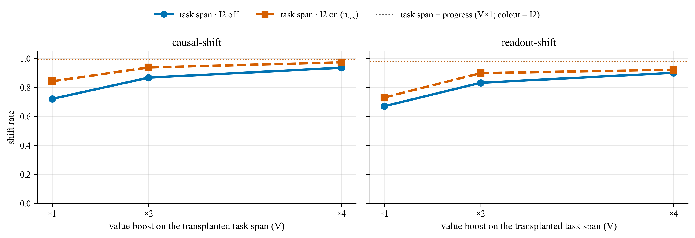
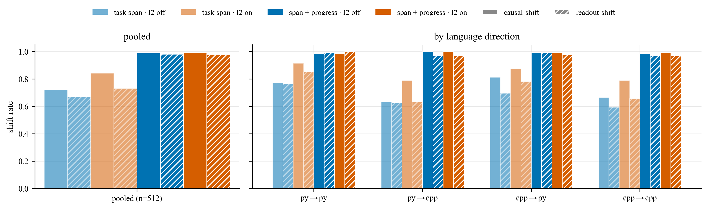
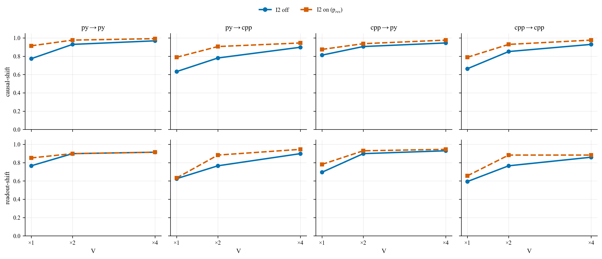
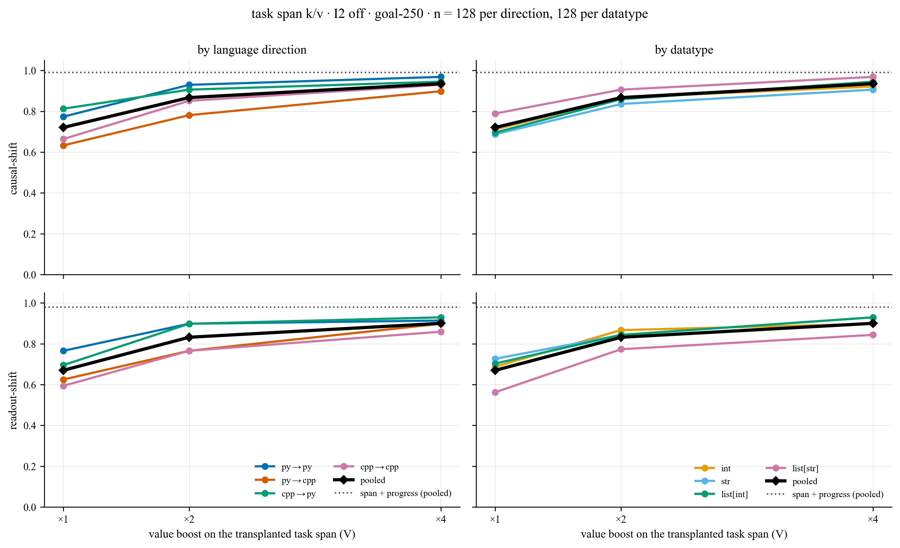
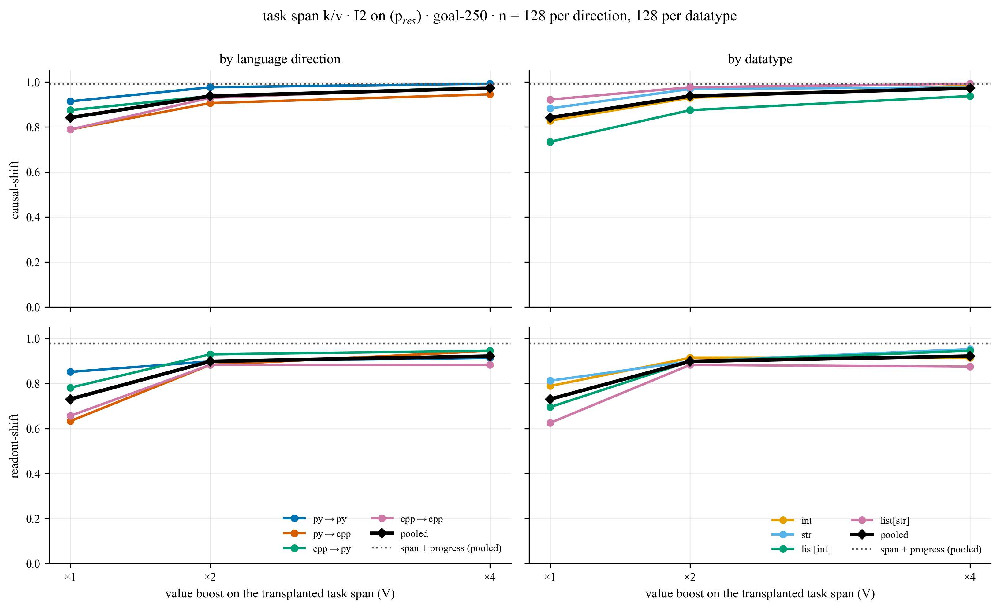
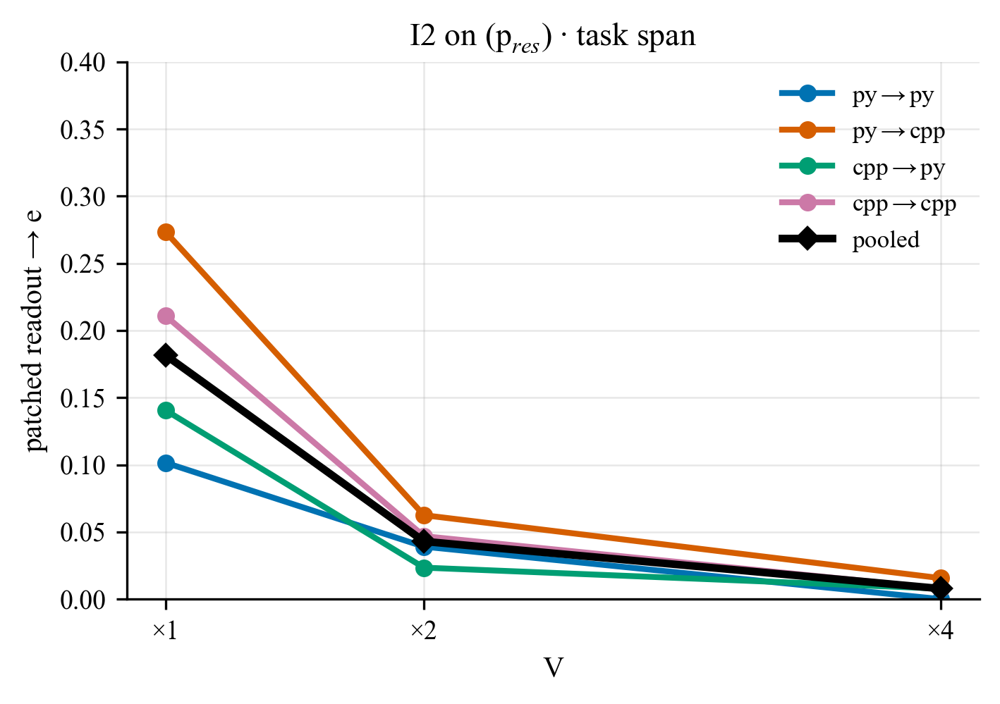

# Path patching: what the goal heads read at the pivot (Qwen2.5-Coder-32B-Instruct)

*Rewritten 2026-10-27 from the task-span reruns (2026-10-26/27), with no values carried over from earlier runs · code
`src/diff/path_patch.py`, `scripts/diff/path_patch_eval.py` (`--span list+gap --cpp-note system`) · job lists
`job_list/diff_eval/path_patch_32b_listgap{,_full}.json`, `path_patch_hier_32b_listgap.json`, `path_patch_control_32b_listgap.json`
· figures / tables `notebooks/fig_n_table_generators/path_patch.ipynb` (`SPAN = "list+gap__cppnote-sys"`) →
`notebooks/Figures/path_patch_listgap/` · the previous version (task list without its closing `\n`) is backed up at
`_backups/path-patching-report__2026-10-26__pre-list+gap.md`; old vs new on every axis: `path-patching-old-vs-new-span.md`*

## TL;DR

The paper's KV transfer reads the source task span at every query from the span on (*task-onwards*). Here the goal heads
read the source task span **only from the pivot ` =` on** (I3, *pivot-onwards KV transfer*); every key before the pivot
keeps the destination's own latents.

* **The task span alone moves the frontier in 72 % of cases** (I3 only, V×1; readout-shift 0.67). With the transplanted
  values boosted (V×a, attention pattern unchanged) it reaches **0.87 / 0.94** at V×2 / V×4 (readout 0.83 / 0.90).
* **I2, the pre-commitment-swap residual transfer** (the destination's progress latents `<|im_end|> … {var}` replaced
  with those of a third prompt p_res, pre-committed to its own frontier e): **0.72 → 0.84** at V×1. Part of the readout then
  follows the swapped-in pre-commitment to e (**18 %**); the drift almost vanishes with a boost (0.04 / 0.01 at V×2 / V×4),
  where I2 on reaches **0.94 / 0.97**.
* **Transplanting span + progress k/v**: **0.99** causal / 0.98 readout, with or without I2, and no readout goes to e.
* **One level down** (sub-sub-goal, pivot = the connective): **0.64 / 0.76 / 0.79** at V×1 / 2 / 4. The spec order
  dominates: 0.98 when the source lists x before z (order match) vs 0.60 when it does not (order diff), at V×4.
* **Random-head control** (V×4, 250 random later-half non-goal heads in place of the goal heads): **1 / 512** at the sub-goal
  level, **0 / 1024** at the sub-sub-goal level.
* Readout-shift tracks causal-shift and sits 0.04–0.11 below it pooled on the task-span window (0.01 for span + progress);
  the gap is largest for `list[str]` and C++ destinations.

## Setup

Multi-predicate instances (`multi_predicate_setups`, k = 3, letters naming, `var_eq` pivot, listed presentation),
32 per datatype × {int, str, list[int], list[str]} × 4 language directions = **128 per direction, 512 per config**.

```
p_src: a'b'c -> c     k/v donor           (task list a, b, c; a, b prefilled; next = c)
p_dst: a'b'd -> d     the patched run     (task list a, b, d; same prefilled a, b; pivot "c =")
p_res: a'b'e -> e     I2 residual donor   (frontier e ∉ {c, d}, compatible with a, b, c, d; rendered in DST's language,
                                          so its "<|im_end|> … {var}" prefill is token-identical to DST's, asserted)
```

**Terminology.** I1 = *task-onwards KV transfer* (heads read the source window k/v at every query from the window on);
I2 = *pre-commitment-swap residual transfer* (if the next pending operation is already decided in the progress latents,
swapping M(p_dst)'s progress latents for M(p_res)'s swaps that pre-commitment); I3 = *pivot-onwards KV transfer* (heads
read the source window k/v only from the pivot on).

| intervention | here | what it does |
|---|---|---|
| I1 · task-onwards KV transfer | **off** | (not used here) |
| I2 · pre-commitment-swap residual transfer | on / off | every decoder layer's OUTPUT residual on `<|im_end|> … {var}` (pivot ` =` excluded) ← p_res's, prompt pass only |
| I3 · pivot-onwards KV transfer | **on** | goal-250 heads read SRC's window k/v from ` =` on (query rule `last`: the pivot, then every generated token); all other heads read the patched run's own k/v |

* **Task span.** The task list `(1) … (3)` **plus its closing `\n`**, i.e. everything from `(1)` up to the user turn's
  `<|im_end|>` (excluded; `PP.build_geometry(span="list+gap")`). In C++ prompts the sentence "Assume that all the libraries
  have been already imported." sits at the end of the **system** prompt (`--cpp-note system`), so in every language the list
  is followed only by its `\n` (exactly one token, the same in SRC and DST; checked on all 512 instances). Python prompts are
  unchanged by this flag.
* **Window** (what I3 transplants): the **task span**, or **task span + progress** (one contiguous window, task-span start →
  ` =` inclusive). SRC / DST windows of different token length are aligned by `\n`-padding the shorter one right before it
  (A1); all runs of that geometry (clean and patched) use the padded prompts.
* **V-boost** (`--i3-v-scale`): the I3 heads read the transplanted span **values × V**; keys, and so the attention pattern,
  are unchanged. V ∈ {1, 2, 4}. No OV boost anywhere (α = 1).
* **Heads**: patch = readout = goal-250 (`head_sets/.../goal_topk/goal__lam20_top250.json`).
* **Eval**: the kv-transfer oracle (`claude-sonnet-4-6`), each verdict one of c / d / BOTH / NEITHER; only a clean **c**
  counts (BOTH is a miss, for both metrics). *Causal-shift* = the patched DST's **first** computation after ` =` pursues c.
  *Readout-shift* = the patched GoalScope readout at ` =` expresses c, as a share of **all** instances. *Validity* = clean
  SRC → c and clean DST → d readouts (0.96 pooled). With I2, the patched readout is also judged 3-way over {d, c, e}
  (*readout → e*).

## 1 · Overview: I2 off vs on



*Figure 1: causal-shift (left) and readout-shift (right) vs the value boost V on the transplanted task span, pooled over
4 directions × 4 datatypes (n = 512 per point). Solid = I2 off, dashed = I2 on (p_res). Dotted = task span + progress k/v
(V×1; 0.99 causal / 0.98 readout for both I2 settings, overlapping).*



*Figure 2: the V×1 base grid. Light = task span only, dark = task span + progress; blue = I2 off, vermillion = I2 on;
solid = causal-shift, hatched = readout-shift.*



*Figure 3: the V-boost trend per language direction (n = 128 per point).*

## 2 · I2 off: the destination's own progress latents are left in place

The goal heads read SRC's task-span k/v from ` =` on; every other key (the code progress, the pivot itself) keeps the
destination's own latents. Pooled causal-shift is **0.72 → 0.87 → 0.94** at V×1 / 2 / 4 (readout 0.67 → 0.83 → 0.90), against
**0.99 / 0.98** for task span + progress. cpp→py and py→py are highest (0.81 / 0.77 at V×1); C++ destinations are lowest
(py→cpp 0.63, cpp→cpp 0.66). `list[str]` moves causally as much as the others but its readout lags (0.79 causal vs 0.56
readout at V×1; 0.97 vs 0.84 at V×4).

### 2.1 · Aggregated trend with the V-boost

Each cell: causal-shift / readout-shift.

**Pooled and by language direction** (n = 512 pooled, 128 per direction)

| V | pooled | py→py | py→cpp | cpp→py | cpp→cpp |
|---|---|---|---|---|---|
| ×1 | 0.72 / 0.67 | 0.77 / 0.77 | 0.63 / 0.62 | 0.81 / 0.70 | 0.66 / 0.59 |
| ×2 | 0.87 / 0.83 | 0.93 / 0.90 | 0.78 / 0.77 | 0.91 / 0.90 | 0.85 / 0.77 |
| ×4 | 0.94 / 0.90 | 0.97 / 0.91 | 0.90 / 0.90 | 0.95 / 0.93 | 0.93 / 0.86 |
| span + progress (×1) | 0.99 / 0.98 | 0.98 / 0.99 | 1.00 / 0.97 | 0.99 / 0.99 | 0.98 / 0.97 |

**By datatype** (n = 128 per datatype, pooled over directions)

| V | int | str | list[int] | list[str] |
|---|---|---|---|---|
| ×1 | 0.71 / 0.69 | 0.69 / 0.73 | 0.70 / 0.70 | 0.79 / 0.56 |
| ×2 | 0.87 / 0.87 | 0.84 / 0.84 | 0.86 / 0.84 | 0.91 / 0.77 |
| ×4 | 0.92 / 0.90 | 0.91 / 0.93 | 0.95 / 0.93 | 0.97 / 0.84 |
| span + progress (×1) | 0.99 / 0.98 | 0.99 / 0.98 | 0.98 / 1.00 | 1.00 / 0.96 |

### 2.2 · By language direction and datatype



*Figure 4: I2 off. Causal-shift (top) and readout-shift (bottom) vs V, by language direction (left) and by datatype
(right); black = pooled, dotted = task span + progress (pooled).*

### 2.3 · Full grids

**Full grids** (datatype × direction, n = 32 per cell; clean-readout validity in brackets)

*×1*

| datatype | py→py | py→cpp | cpp→py | cpp→cpp | all |
|---|---|---|---|---|---|
| int | 0.75 / 0.75 [0.94] | 0.53 / 0.56 [0.97] | 0.88 / 0.75 [1.00] | 0.69 / 0.69 [1.00] | 0.71 / 0.69 [0.98] |
| str | 0.78 / 0.81 [0.94] | 0.72 / 0.75 [0.94] | 0.69 / 0.75 [0.94] | 0.56 / 0.59 [0.94] | 0.69 / 0.73 [0.94] |
| list[int] | 0.78 / 0.78 [1.00] | 0.53 / 0.66 [1.00] | 0.84 / 0.75 [1.00] | 0.62 / 0.62 [0.97] | 0.70 / 0.70 [0.99] |
| list[str] | 0.78 / 0.72 [1.00] | 0.75 / 0.53 [0.94] | 0.84 / 0.53 [0.91] | 0.78 / 0.47 [0.84] | 0.79 / 0.56 [0.92] |
| all | 0.77 / 0.77 [0.97] | 0.63 / 0.62 [0.96] | 0.81 / 0.70 [0.96] | 0.66 / 0.59 [0.94] | 0.72 / 0.67 [0.96] |

*×2*

| datatype | py→py | py→cpp | cpp→py | cpp→cpp | all |
|---|---|---|---|---|---|
| int | 0.94 / 0.91 [0.94] | 0.75 / 0.75 [0.97] | 0.94 / 0.97 [1.00] | 0.84 / 0.84 [1.00] | 0.87 / 0.87 [0.98] |
| str | 0.88 / 0.88 [0.94] | 0.84 / 0.88 [0.94] | 0.84 / 0.88 [0.94] | 0.78 / 0.75 [0.94] | 0.84 / 0.84 [0.94] |
| list[int] | 0.94 / 0.94 [1.00] | 0.69 / 0.72 [1.00] | 0.97 / 0.91 [1.00] | 0.84 / 0.81 [0.97] | 0.86 / 0.84 [0.99] |
| list[str] | 0.97 / 0.88 [1.00] | 0.84 / 0.72 [0.94] | 0.88 / 0.84 [0.91] | 0.94 / 0.66 [0.84] | 0.91 / 0.77 [0.92] |
| all | 0.93 / 0.90 [0.97] | 0.78 / 0.77 [0.96] | 0.91 / 0.90 [0.96] | 0.85 / 0.77 [0.94] | 0.87 / 0.83 [0.96] |

*×4*

| datatype | py→py | py→cpp | cpp→py | cpp→cpp | all |
|---|---|---|---|---|---|
| int | 0.97 / 0.91 [0.94] | 0.84 / 0.84 [0.97] | 0.97 / 0.94 [1.00] | 0.91 / 0.91 [1.00] | 0.92 / 0.90 [0.98] |
| str | 0.94 / 0.94 [0.94] | 0.91 / 1.00 [0.94] | 0.91 / 0.94 [0.94] | 0.88 / 0.84 [0.94] | 0.91 / 0.93 [0.94] |
| list[int] | 0.97 / 0.91 [1.00] | 0.88 / 0.91 [1.00] | 0.97 / 0.97 [1.00] | 0.97 / 0.94 [0.97] | 0.95 / 0.93 [0.99] |
| list[str] | 1.00 / 0.91 [1.00] | 0.97 / 0.84 [0.94] | 0.94 / 0.88 [0.91] | 0.97 / 0.75 [0.84] | 0.97 / 0.84 [0.92] |
| all | 0.97 / 0.91 [0.97] | 0.90 / 0.90 [0.96] | 0.95 / 0.93 [0.96] | 0.93 / 0.86 [0.94] | 0.94 / 0.90 [0.96] |

*span + progress (×1)*

| datatype | py→py | py→cpp | cpp→py | cpp→cpp | all |
|---|---|---|---|---|---|
| int | 0.97 / 0.97 [0.94] | 1.00 / 0.94 [0.97] | 1.00 / 1.00 [0.97] | 1.00 / 1.00 [1.00] | 0.99 / 0.98 [0.97] |
| str | 1.00 / 1.00 [0.94] | 1.00 / 0.94 [0.94] | 1.00 / 1.00 [0.94] | 0.97 / 1.00 [0.94] | 0.99 / 0.98 [0.94] |
| list[int] | 0.97 / 1.00 [1.00] | 1.00 / 1.00 [1.00] | 0.97 / 1.00 [1.00] | 0.97 / 1.00 [0.97] | 0.98 / 1.00 [0.99] |
| list[str] | 1.00 / 1.00 [1.00] | 1.00 / 1.00 [0.94] | 1.00 / 0.97 [0.91] | 1.00 / 0.88 [0.84] | 1.00 / 0.96 [0.92] |
| all | 0.98 / 0.99 [0.97] | 1.00 / 0.97 [0.96] | 0.99 / 0.99 [0.95] | 0.98 / 0.97 [0.94] | 0.99 / 0.98 [0.96] |

## 3 · I2 on: pre-commitment-swap residual transfer from p_res (a'b'e)

Every layer's residual on `<|im_end|> … {var}` is replaced by p_res's, whose progress carries neither c nor d. At V×1 this
lifts causal-shift from 0.72 to **0.84**, and **18 %** of patched readouts then express p_res's frontier e: the goal heads
take on what the swapped-in progress carries, most when the destination is C++ (py→cpp 0.27, cpp→cpp 0.21) and for the list
datatypes (`list[int]` / `list[str]` 0.24). Boosting the span values raises the shift (**0.84 → 0.94 → 0.97**; readout 0.73 →
0.90 → 0.92) and suppresses the drift to e (0.18 → 0.04 → 0.01). py→py saturates (0.98 at V×2, 0.99 at V×4).

### 3.1 · Aggregated trend with the V-boost

Each cell: causal-shift / readout-shift · readout → e.

**Pooled and by language direction** (n = 512 pooled, 128 per direction)

| V | pooled | py→py | py→cpp | cpp→py | cpp→cpp |
|---|---|---|---|---|---|
| ×1 | 0.84 / 0.73 · e 0.18 | 0.91 / 0.85 · e 0.10 | 0.79 / 0.63 · e 0.27 | 0.88 / 0.78 · e 0.14 | 0.79 / 0.66 · e 0.21 |
| ×2 | 0.94 / 0.90 · e 0.04 | 0.98 / 0.90 · e 0.04 | 0.91 / 0.88 · e 0.06 | 0.94 / 0.93 · e 0.02 | 0.93 / 0.88 · e 0.05 |
| ×4 | 0.97 / 0.92 · e 0.01 | 0.99 / 0.91 · e 0.00 | 0.95 / 0.95 · e 0.02 | 0.98 / 0.95 · e 0.01 | 0.98 / 0.88 · e 0.01 |
| span + progress (×1) | 0.99 / 0.98 · e 0.00 | 0.98 / 1.00 · e 0.00 | 1.00 / 0.97 · e 0.00 | 0.99 / 0.98 · e 0.00 | 0.99 / 0.97 · e 0.00 |

**By datatype** (n = 128 per datatype, pooled over directions)

| V | int | str | list[int] | list[str] |
|---|---|---|---|---|
| ×1 | 0.83 / 0.79 · e 0.13 | 0.88 / 0.81 · e 0.11 | 0.73 / 0.70 · e 0.24 | 0.92 / 0.62 · e 0.24 |
| ×2 | 0.93 / 0.91 · e 0.05 | 0.97 / 0.90 · e 0.03 | 0.88 / 0.90 · e 0.05 | 0.98 / 0.88 · e 0.04 |
| ×4 | 0.98 / 0.91 · e 0.01 | 0.98 / 0.95 · e 0.00 | 0.94 / 0.95 · e 0.02 | 0.99 / 0.88 · e 0.00 |
| span + progress (×1) | 0.99 / 0.98 · e 0.00 | 1.00 / 0.97 · e 0.00 | 0.98 / 1.00 · e 0.00 | 1.00 / 0.96 · e 0.00 |

### 3.2 · By language direction and datatype



*Figure 5: I2 on (p_res). Causal-shift (top) and readout-shift (bottom) vs V, by language direction (left) and by datatype
(right); black = pooled, dotted = task span + progress (pooled).*



*Figure 6: I2 on. Share of patched readouts that express p_res's frontier e, vs V, by direction.*

### 3.3 · Full grids

**Full grids** (datatype × direction, n = 32 per cell; clean-readout validity in brackets)

*×1*

| datatype | py→py | py→cpp | cpp→py | cpp→cpp | all |
|---|---|---|---|---|---|
| int | 0.94 / 0.84 · e 0.03 [0.94] | 0.62 / 0.69 · e 0.25 [0.97] | 0.94 / 0.88 · e 0.09 [1.00] | 0.81 / 0.75 · e 0.16 [1.00] | 0.83 / 0.79 · e 0.13 [0.98] |
| str | 0.91 / 0.88 · e 0.09 [0.94] | 0.94 / 0.81 · e 0.09 [0.94] | 0.88 / 0.91 · e 0.06 [0.94] | 0.81 / 0.66 · e 0.19 [0.94] | 0.88 / 0.81 · e 0.11 [0.94] |
| list[int] | 0.84 / 0.88 · e 0.12 [1.00] | 0.66 / 0.56 · e 0.34 [1.00] | 0.78 / 0.72 · e 0.19 [1.00] | 0.66 / 0.62 · e 0.31 [0.97] | 0.73 / 0.70 · e 0.24 [0.99] |
| list[str] | 0.97 / 0.81 · e 0.16 [1.00] | 0.94 / 0.47 · e 0.41 [0.94] | 0.91 / 0.62 · e 0.22 [0.91] | 0.88 / 0.59 · e 0.19 [0.84] | 0.92 / 0.62 · e 0.24 [0.92] |
| all | 0.91 / 0.85 · e 0.10 [0.97] | 0.79 / 0.63 · e 0.27 [0.96] | 0.88 / 0.78 · e 0.14 [0.96] | 0.79 / 0.66 · e 0.21 [0.94] | 0.84 / 0.73 · e 0.18 [0.96] |

*×2*

| datatype | py→py | py→cpp | cpp→py | cpp→cpp | all |
|---|---|---|---|---|---|
| int | 1.00 / 0.94 · e 0.00 [0.94] | 0.84 / 0.91 · e 0.09 [0.97] | 0.94 / 0.94 · e 0.03 [1.00] | 0.94 / 0.88 · e 0.09 [1.00] | 0.93 / 0.91 · e 0.05 [0.98] |
| str | 1.00 / 0.88 · e 0.03 [0.94] | 0.97 / 0.91 · e 0.03 [0.94] | 1.00 / 0.97 · e 0.00 [0.94] | 0.91 / 0.84 · e 0.06 [0.94] | 0.97 / 0.90 · e 0.03 [0.94] |
| list[int] | 0.91 / 0.84 · e 0.09 [1.00] | 0.88 / 0.81 · e 0.06 [1.00] | 0.81 / 0.94 · e 0.03 [1.00] | 0.91 / 1.00 · e 0.00 [0.97] | 0.88 / 0.90 · e 0.05 [0.99] |
| list[str] | 1.00 / 0.94 · e 0.03 [1.00] | 0.94 / 0.91 · e 0.06 [0.94] | 1.00 / 0.88 · e 0.03 [0.91] | 0.97 / 0.81 · e 0.03 [0.84] | 0.98 / 0.88 · e 0.04 [0.92] |
| all | 0.98 / 0.90 · e 0.04 [0.97] | 0.91 / 0.88 · e 0.06 [0.96] | 0.94 / 0.93 · e 0.02 [0.96] | 0.93 / 0.88 · e 0.05 [0.94] | 0.94 / 0.90 · e 0.04 [0.96] |

*×4*

| datatype | py→py | py→cpp | cpp→py | cpp→cpp | all |
|---|---|---|---|---|---|
| int | 1.00 / 0.91 · e 0.00 [0.94] | 0.97 / 0.94 · e 0.00 [0.97] | 1.00 / 0.91 · e 0.00 [1.00] | 0.97 / 0.91 · e 0.03 [1.00] | 0.98 / 0.91 · e 0.01 [0.98] |
| str | 1.00 / 0.94 · e 0.00 [0.94] | 0.94 / 0.94 · e 0.00 [0.94] | 1.00 / 1.00 · e 0.00 [0.94] | 0.97 / 0.94 · e 0.00 [0.94] | 0.98 / 0.95 · e 0.00 [0.94] |
| list[int] | 0.97 / 0.94 · e 0.00 [1.00] | 0.91 / 0.94 · e 0.06 [1.00] | 0.91 / 0.94 · e 0.03 [1.00] | 0.97 / 0.97 · e 0.00 [0.97] | 0.94 / 0.95 · e 0.02 [0.99] |
| list[str] | 1.00 / 0.88 · e 0.00 [1.00] | 0.97 / 0.97 · e 0.00 [0.94] | 1.00 / 0.94 · e 0.00 [0.91] | 1.00 / 0.72 · e 0.00 [0.84] | 0.99 / 0.88 · e 0.00 [0.92] |
| all | 0.99 / 0.91 · e 0.00 [0.97] | 0.95 / 0.95 · e 0.02 [0.96] | 0.98 / 0.95 · e 0.01 [0.96] | 0.98 / 0.88 · e 0.01 [0.94] | 0.97 / 0.92 · e 0.01 [0.96] |

*span + progress (×1)*

| datatype | py→py | py→cpp | cpp→py | cpp→cpp | all |
|---|---|---|---|---|---|
| int | 0.97 / 1.00 · e 0.00 [0.94] | 1.00 / 0.94 · e 0.00 [0.97] | 1.00 / 1.00 · e 0.00 [0.97] | 1.00 / 1.00 · e 0.00 [1.00] | 0.99 / 0.98 · e 0.00 [0.97] |
| str | 1.00 / 1.00 · e 0.00 [0.94] | 1.00 / 0.94 · e 0.00 [0.94] | 1.00 / 0.94 · e 0.00 [0.94] | 1.00 / 1.00 · e 0.00 [0.94] | 1.00 / 0.97 · e 0.00 [0.94] |
| list[int] | 0.97 / 1.00 · e 0.00 [1.00] | 1.00 / 1.00 · e 0.00 [1.00] | 0.97 / 1.00 · e 0.00 [1.00] | 0.97 / 1.00 · e 0.00 [0.97] | 0.98 / 1.00 · e 0.00 [0.99] |
| list[str] | 1.00 / 1.00 · e 0.00 [1.00] | 1.00 / 1.00 · e 0.00 [0.94] | 1.00 / 0.97 · e 0.00 [0.91] | 1.00 / 0.88 · e 0.00 [0.84] | 1.00 / 0.96 · e 0.00 [0.92] |
| all | 0.98 / 1.00 · e 0.00 [0.97] | 1.00 / 0.97 · e 0.00 [0.96] | 0.99 / 0.98 · e 0.00 [0.95] | 0.99 / 0.97 · e 0.00 [0.94] | 0.99 / 0.98 · e 0.00 [0.96] |

## 4 · One level down: the sub-sub-goal (Fig. 23)

`hier` setup (`--setup hier`): p_src `a'(x'z) → z`, p_dst `a'(x'y) → y`, pivot = the connective (` and` / ` or`, ` &&` / ` ||`),
2 datatypes (list[int], list[str]) × 2 connectives × 2 spec orders (match: the source lists x before z; diff: z before x) × 4
directions × 32 = **1024 per V**. I1 off, I2 off, I3 on (goal-250), task span + closing `\n`, readout on.

Each cell: causal-shift / readout-shift (n = 1024 pooled, 256 per direction, 512 per datatype / order / connective).

| V | pooled | py→py | py→cpp | cpp→py | cpp→cpp | list[int] | list[str] | order match | order diff | and | or |
|---|---|---|---|---|---|---|---|---|---|---|---|
| ×1 | 0.64 / 0.54 | 0.69 / 0.61 | 0.58 / 0.44 | 0.70 / 0.64 | 0.61 / 0.46 | 0.64 / 0.56 | 0.65 / 0.52 | 0.87 / 0.71 | 0.42 / 0.37 | 0.60 / 0.53 | 0.69 / 0.55 |
| ×2 | 0.76 / 0.62 | 0.80 / 0.66 | 0.72 / 0.58 | 0.79 / 0.69 | 0.73 / 0.57 | 0.74 / 0.61 | 0.78 / 0.64 | 0.96 / 0.79 | 0.56 / 0.46 | 0.77 / 0.65 | 0.75 / 0.60 |
| ×4 | 0.79 / 0.65 | 0.82 / 0.68 | 0.78 / 0.61 | 0.81 / 0.71 | 0.76 / 0.62 | 0.74 / 0.63 | 0.85 / 0.68 | 0.98 / 0.84 | 0.60 / 0.46 | 0.84 / 0.69 | 0.74 / 0.62 |

The transfer works one level down through the same heads, but saturates lower than at the sub-goal level (0.79 vs 0.94 at
V×4) and gains little beyond V×2. The limit is the spec order: with order match it is at ceiling (0.98), with order diff it
stays at ~0.60 at every boost, and `or` / diff is the weakest cell. Figure: `notebooks/Figures/transfer/kv_multihier_barcharts.pdf`
(generator `transfer.ipynb`).

## 5 · Random-head control (V×4)

The configuration reported in the paper (I1 off, I2 off, I3 on, task-span window, V×4, α = 1, the same seeded instances),
with **250 heads drawn at random from layers 32–63 with no goal head**
(`head_sets/Qwen2.5-Coder-32B-Instruct/control/control250__laterhalf.json`) reading SRC's task-span k/v from the pivot on in
place of the goal heads. Run without GoalScope readouts (`--no-readout`), so causal-shift only.

| level | goal-250 | control-250 | control verdicts |
|---|---|---|---|
| sub-goal (n = 512) | **0.94** | **0.002** (1 / 512) | 509 d · 2 neither · 1 c |
| sub-sub-goal (n = 1024) | **0.79** | **0.000** (0 / 1024) | 1023 the destination's own sub-sub-goal · 1 neither |

The same transplant with the same value boost has essentially **no effect** unless the reading heads are the goal heads.

Runs: `results/diff/<M>/path_patch{,_hier}/I1-off__I2-off__I3-on-V4__win-span__span-list+gap__cppnote-sys__a1__th-control250_250__gh-control250_250__ro-off/`
· job list `job_list/diff_eval/path_patch_control_32b_listgap.json`.

## 6 · Reading

1. **The pivot re-reads the frontier from the task span.** With only the task-span k/v from the source, the goal heads
   write c in 72 % of cases at V×1, with every other key the destination's own. The remaining failures sit on the
   destination's progress (and pivot) latents, built while attending to DST's task list: swapping them for p_res's (I2)
   raises the shift to 0.84, and transplanting them from the source (span + progress) saturates it (0.99).
2. **The pre-commitment swap helps, but it is a secondary signal.** I2 adds 12 points at V×1 and its signature, the readout
   drift to e, reaches 18 % (27 % for py→cpp). So the progress latents carry some of the next operation and the goal heads
   read it there. But the task span alone already moves most cases, and a modest value boost makes the drift vanish.
   `task-vs-progress-report.md` tests the two spans head to head: the source code progress alone moves the frontier in only
   0.00–0.06 of cases at V×1.
3. **Up-weighting the span's values closes most of the remaining gap** without changing where the heads attend: 0.94
   (I2 off) / 0.97 (I2 on) at V×4, against 0.99 for span + progress. The gap is largest with a C++ destination at V×1.
4. **The same heads read one level down**, at the connective (0.79 at V×4), limited by the spec order rather than by the span.
5. **It is the goal heads specifically.** 250 random later-half non-goal heads move nothing (1 / 512, 0 / 1024).
6. **Readout follows causal.** Pooled, readout-shift is 0.04–0.11 below causal-shift on the task-span window. The gap is largest for `list[str]`
   (0.56 vs 0.79 at V×1, I2 off) and for C++ destinations, where clean-readout validity is lowest (0.84 for cpp→cpp `list[str]`).

## 7 · Caveats

* **The task span includes the list's closing `\n`.** That token attends to the whole task list and probably summarises it, so
  "task span" means the task list plus the position that closes it. `path-patching-old-vs-new-span.md` shows how much that
  one token contributes.
* **Cross-language prompts changed in two ways at once** relative to earlier runs: the `\n` in the span and the C++ note in
  the system prompt. py→py changes only the former.
* Cross-language span + progress uses large A1 pads (9–135 `\n`). Clean validity there stays ≈ 0.95.
* p_res's frontier e is a seeded draw per instance (stable across configs). Readout → e is measured over all instances.

## Reproduce

```bash
# sub-goal: I2 off/on x V 1/2/4 + span+progress (one job per datatype x direction)
python scripts/diff/path_patch_eval.py --datatypes 'list[str]' --lang-transfers py-py --n-samples 32 --i1 off --i2 on off \
    --i3 on --span list+gap --cpp-note system --window span --i3-v-scale 1 2 4
python scripts/diff/path_patch_eval.py ... --window span+progress --i3-v-scale 1
# sub-sub-goal
python scripts/diff/path_patch_eval.py --setup hier --datatypes 'list[str]' --lang-transfers py-py --connectives and or \
    --orders match diff --n-samples 32 --i1 off --i2 off --i3 on --window span --span list+gap --cpp-note system --i3-v-scale 1 2 4
# control: add --task-heads/--goal-heads/--readout-heads head_sets/.../control250__laterhalf.json --no-readout --i3-v-scale 4
```

Results: `results/diff/Qwen2.5-Coder-32B-Instruct/path_patch{,_hier}/I1-off__I2-{off,on-res}__I3-on{,-V2,-V4}__win-{span,span+prog}__span-list+gap__cppnote-sys__a1__th-goal_250__gh-goal_250__ro-goal_250/`.
