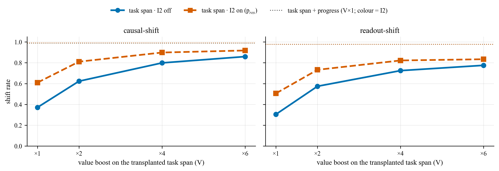
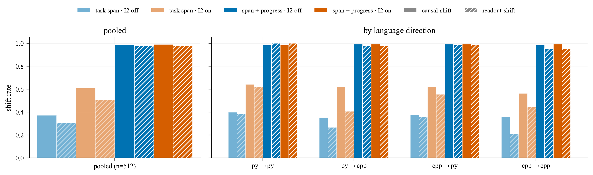
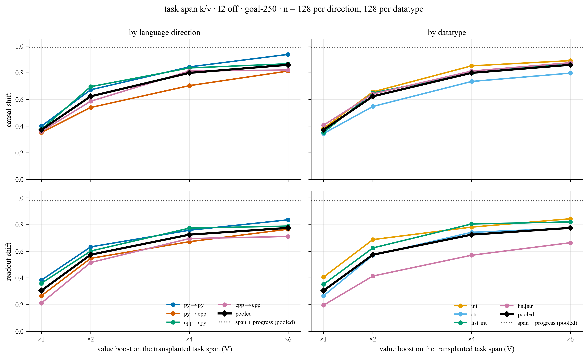
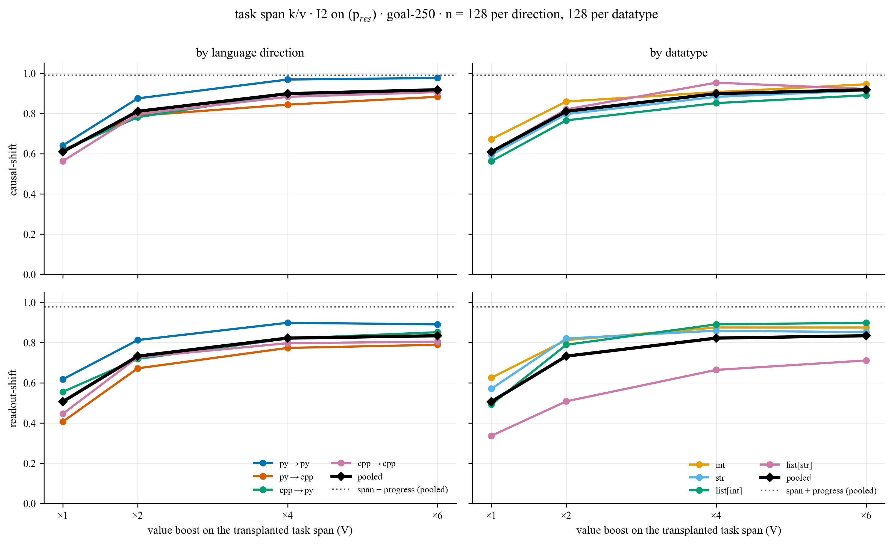
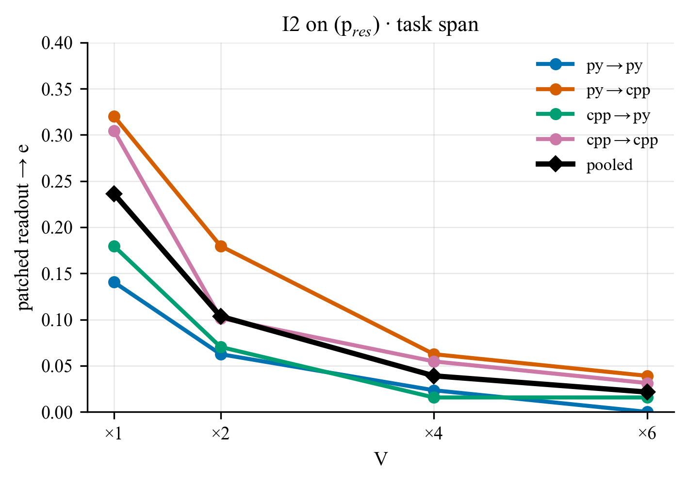

# Path patching: what the goal heads read at the pivot (Qwen2.5-Coder-32B-Instruct)

*2026-10-17 · runs 2026-10-16/17 · code `src/diff/path_patch.py`, `scripts/diff/path_patch_eval.py` · job lists
`job_list/diff_eval/path_patch_32b{,_xlang,_vboost}.json` · figures/tables `notebooks/fig_n_table_generators/path_patch.ipynb`
→ `notebooks/Figures/path_patch/` · prototype `notebooks/diff/05_kv_transfer.ipynb` §Path patching*

## TL;DR

The paper's KV transfer (goal heads read the source task-span k/v **at every query after the span**) moves the frontier
almost perfectly. Here the goal heads read the source task span **only from the pivot ` =` on** (I3). That alone moves the
frontier in just **37 %** of cases: the destination's own **progress tokens** (`<|im_end|> … {var}`) still carry the
destination frontier d, and the goal heads read it there.

* **I2: replacing those progress latents** with a third prompt's (p_res, frontier e, carries neither c nor d):
  0.37 → **0.61**. Part of the readout then follows the progress latents to e (**24 %** of patched readouts).
* **Transplanting span + progress k/v**: **0.99**, with or without I2, and no readout goes to e.
* **Boosting the transplanted task-span values** (V×a, attention pattern unchanged): monotone gains. I2 off:
  0.37 → 0.62 → 0.80 → **0.86** (V×1/2/4/6). I2 on: 0.61 → 0.81 → 0.90 → **0.92**. Drift to e falls 0.24 → 0.02.
  The boost closes most of the gap to span + progress but not all of it. It works best py→py (0.94 / 0.98 at V×6)
  and is weakest with a C++ destination.
* **Readout-shift tracks causal-shift** throughout but sits below it: 0.07–0.10 pooled, up to 0.21 for C++
  destinations at V×1, and persistently for `list[str]` (0.66 / 0.71 readout vs 0.88 / 0.92 causal at V×6).

## Setup

Multi-predicate instances (`multi_predicate_setups`, k = 3, letters naming, `var_eq` pivot, listed presentation),
32 per datatype × {int, str, list[int], list[str]} × 4 language directions = **128 per direction, 512 per config**.

```
p_src: a'b'c -> c     k/v donor           (task list a, b, c; a, b prefilled; next = c)
p_dst: a'b'd -> d     the patched run     (task list a, b, d; same prefilled a, b; pivot "c =")
p_res: a'b'e -> e     I2 residual donor   (frontier e ∉ {c, d}, compatible with a, b, c, d; rendered in DST's language,
                                          so its "<|im_end|> … {var}" prefill is token-identical to DST's, asserted)
```

| intervention | here | what it does |
|---|---|---|
| I1 · task heads | **off** | (not used in these runs) |
| I2 · progress restore | on / off | every decoder layer's OUTPUT residual on `<|im_end|> … {var}` (pivot ` =` excluded) ← p_res's, prompt pass only |
| I3 · goal heads | **on** | goal-250 heads read SRC's window k/v from ` =` on (query rule `last`: the pivot, then every generated token); all other heads read the patched run's own k/v |

* **Window** (what I3 transplants): the **task span** (the whole task list), or **task span + progress** (one
  contiguous window, task-span start → ` =` inclusive). SRC/DST windows of different token length are aligned by
  `\n`-padding the shorter one right before it (A1). This needs 0–8 pad tokens within a language and 9–135 across
  languages; all runs of that geometry (clean and patched) use the padded prompts.
* **V-boost** (`--i3-v-scale`): the I3 heads read the transplanted span **values × V**; keys, and so their attention
  pattern, are unchanged (route option `v_scale` in `headwise_kv_patch_routes`). No OV boost anywhere (α = 1).
* **Heads**: patch = readout = goal-250 (`head_sets/.../goal_topk/goal__lam20_top250.json`).
* **Eval**: the kv-transfer oracle (`claude-sonnet-4-6`), each verdict one of c / d / BOTH / NEITHER; only a clean **c**
  counts (BOTH is a miss, for both metrics). *Causal-shift* = the patched DST's **first** computation after ` =` (the
  frontier's value) pursues c; anything it writes afterwards is not judged. *Readout-shift* = the patched GoalScope
  readout at ` =` expresses c, as a share of **all** instances (paper convention, `readout_shift_rate`). *Validity* = clean SRC → c and clean DST → d readouts (0.95 pooled). With I2,
  the patched readout is also judged 3-way over {d, c, e} (*readout → e*) against the clean p_res readout (which reads
  out e in ≈ 0.97 of instances).
* V×1 numbers come from the base runs; the V-boost runs use the same seeded instances (all 512 matched).

## 1 · Overview: I2 off vs on



*Figure 1: causal-shift (left) and readout-shift (right) vs the value boost V on the transplanted task span, pooled over
4 directions × 4 datatypes (n = 512 per point). Solid = I2 off, dashed = I2 on (p_res). Dotted = task span + progress k/v
(V×1; ≈ 0.99 causal / 0.98 readout for both I2 settings, overlapping).*



*Figure 2: the V×1 base grid. Light = task span only, dark = task span + progress; blue = I2 off, vermillion = I2 on;
solid = causal-shift, hatched = readout-shift.*

## 2 · I2 off: the destination's own progress latents are left in place

The goal heads read SRC's task-span k/v from ` =` on; every other key (the code progress, the pivot itself) keeps the
destination's own latents. Pooled causal-shift climbs **0.37 → 0.62 → 0.80 → 0.86** with V×1/2/4/6 (readout
0.30 → 0.78), against **0.99 / 0.98** for task span + progress. py→py gets closest (0.94 / 0.84 at V×6). Destinations in
C++ and `str` stay lowest (py→cpp 0.81, cpp→cpp 0.82, str 0.80). `list[str]` moves causally like the others (0.88) but its
readout lags (0.66).

### 2.1 · Aggregated trend with the V-boost

Each cell: causal-shift / readout-shift.

**Pooled and by language direction** (n = 512 pooled, 128 per direction)

| V | pooled | py→py | py→cpp | cpp→py | cpp→cpp |
|---|---|---|---|---|---|
| ×1 | 0.37 / 0.30 | 0.40 / 0.38 | 0.35 / 0.27 | 0.38 / 0.36 | 0.36 / 0.21 |
| ×2 | 0.62 / 0.57 | 0.67 / 0.63 | 0.54 / 0.55 | 0.70 / 0.60 | 0.59 / 0.52 |
| ×4 | 0.80 / 0.72 | 0.84 / 0.76 | 0.70 / 0.67 | 0.84 / 0.77 | 0.81 / 0.70 |
| ×6 | 0.86 / 0.78 | 0.94 / 0.84 | 0.81 / 0.77 | 0.87 / 0.79 | 0.82 / 0.71 |
| span + progress (×1) | 0.99 / 0.98 | 0.98 / 1.00 | 0.99 / 0.98 | 0.99 / 0.98 | 0.98 / 0.95 |

**By datatype** (n = 128 per datatype, pooled over directions)

| V | int | str | list[int] | list[str] |
|---|---|---|---|---|
| ×1 | 0.38 / 0.41 | 0.34 / 0.27 | 0.35 / 0.35 | 0.41 / 0.20 |
| ×2 | 0.66 / 0.69 | 0.55 / 0.57 | 0.65 / 0.62 | 0.64 / 0.41 |
| ×4 | 0.85 / 0.78 | 0.73 / 0.74 | 0.80 / 0.80 | 0.81 / 0.57 |
| ×6 | 0.89 / 0.84 | 0.80 / 0.77 | 0.88 / 0.82 | 0.88 / 0.66 |
| span + progress (×1) | 0.98 / 0.98 | 0.99 / 0.98 | 0.98 / 1.00 | 1.00 / 0.95 |

### 2.2 · By language direction and datatype



*Figure 3: I2 off. Causal-shift (top) and readout-shift (bottom) vs V, by language direction (left) and by datatype
(right); black = pooled, dotted = task span + progress (pooled).*

### 2.3 · Full grids

**Full grids** (datatype × direction, n = 32 per cell; clean-readout validity in brackets)

*×1*

| datatype | py→py | py→cpp | cpp→py | cpp→cpp | all |
|---|---|---|---|---|---|
| int | 0.44 / 0.50 [0.94] | 0.28 / 0.28 [0.97] | 0.38 / 0.47 [1.00] | 0.44 / 0.38 [0.94] | 0.38 / 0.41 [0.96] |
| str | 0.34 / 0.41 [0.94] | 0.38 / 0.25 [0.91] | 0.31 / 0.34 [0.94] | 0.34 / 0.06 [0.94] | 0.34 / 0.27 [0.93] |
| list[int] | 0.38 / 0.31 [1.00] | 0.34 / 0.38 [0.97] | 0.41 / 0.41 [1.00] | 0.28 / 0.31 [1.00] | 0.35 / 0.35 [0.99] |
| list[str] | 0.44 / 0.31 [1.00] | 0.41 / 0.16 [0.91] | 0.41 / 0.22 [0.94] | 0.38 / 0.09 [0.81] | 0.41 / 0.20 [0.91] |
| all | 0.40 / 0.38 [0.97] | 0.35 / 0.27 [0.94] | 0.38 / 0.36 [0.97] | 0.36 / 0.21 [0.92] | 0.37 / 0.30 [0.95] |

*×2*

| datatype | py→py | py→cpp | cpp→py | cpp→cpp | all |
|---|---|---|---|---|---|
| int | 0.66 / 0.78 [0.94] | 0.47 / 0.53 [0.97] | 0.84 / 0.78 [1.00] | 0.66 / 0.66 [0.94] | 0.66 / 0.69 [0.96] |
| str | 0.69 / 0.59 [0.94] | 0.56 / 0.56 [0.91] | 0.47 / 0.56 [0.94] | 0.47 / 0.56 [0.94] | 0.55 / 0.57 [0.93] |
| list[int] | 0.69 / 0.66 [1.00] | 0.50 / 0.59 [0.97] | 0.81 / 0.66 [1.00] | 0.59 / 0.59 [1.00] | 0.65 / 0.62 [0.99] |
| list[str] | 0.66 / 0.50 [1.00] | 0.62 / 0.50 [0.91] | 0.66 / 0.41 [0.94] | 0.62 / 0.25 [0.81] | 0.64 / 0.41 [0.91] |
| all | 0.67 / 0.63 [0.97] | 0.54 / 0.55 [0.94] | 0.70 / 0.60 [0.97] | 0.59 / 0.52 [0.92] | 0.62 / 0.57 [0.95] |

*×4*

| datatype | py→py | py→cpp | cpp→py | cpp→cpp | all |
|---|---|---|---|---|---|
| int | 0.88 / 0.88 [0.94] | 0.75 / 0.59 [0.97] | 0.97 / 0.84 [1.00] | 0.81 / 0.81 [0.94] | 0.85 / 0.78 [0.96] |
| str | 0.88 / 0.72 [0.94] | 0.72 / 0.78 [0.91] | 0.69 / 0.72 [0.94] | 0.66 / 0.75 [0.94] | 0.73 / 0.74 [0.93] |
| list[int] | 0.81 / 0.81 [1.00] | 0.59 / 0.72 [0.97] | 0.91 / 0.88 [1.00] | 0.88 / 0.81 [1.00] | 0.80 / 0.80 [0.99] |
| list[str] | 0.81 / 0.62 [1.00] | 0.75 / 0.59 [0.91] | 0.78 / 0.66 [0.94] | 0.91 / 0.41 [0.81] | 0.81 / 0.57 [0.91] |
| all | 0.84 / 0.76 [0.97] | 0.70 / 0.67 [0.94] | 0.84 / 0.77 [0.97] | 0.81 / 0.70 [0.92] | 0.80 / 0.72 [0.95] |

*×6*

| datatype | py→py | py→cpp | cpp→py | cpp→cpp | all |
|---|---|---|---|---|---|
| int | 0.97 / 0.91 [0.94] | 0.81 / 0.72 [0.97] | 0.94 / 0.88 [1.00] | 0.84 / 0.88 [0.94] | 0.89 / 0.84 [0.96] |
| str | 0.91 / 0.81 [0.94] | 0.84 / 0.81 [0.91] | 0.78 / 0.78 [0.94] | 0.66 / 0.69 [0.94] | 0.80 / 0.77 [0.93] |
| list[int] | 0.91 / 0.88 [1.00] | 0.78 / 0.81 [0.97] | 0.91 / 0.78 [1.00] | 0.91 / 0.81 [1.00] | 0.88 / 0.82 [0.99] |
| list[str] | 0.97 / 0.75 [1.00] | 0.81 / 0.72 [0.91] | 0.84 / 0.72 [0.94] | 0.88 / 0.47 [0.81] | 0.88 / 0.66 [0.91] |
| all | 0.94 / 0.84 [0.97] | 0.81 / 0.77 [0.94] | 0.87 / 0.79 [0.97] | 0.82 / 0.71 [0.92] | 0.86 / 0.78 [0.95] |

*span + progress (×1)*

| datatype | py→py | py→cpp | cpp→py | cpp→cpp | all |
|---|---|---|---|---|---|
| int | 0.97 / 1.00 [0.94] | 0.97 / 0.97 [1.00] | 1.00 / 0.97 [1.00] | 1.00 / 1.00 [0.94] | 0.98 / 0.98 [0.97] |
| str | 1.00 / 1.00 [0.94] | 1.00 / 0.94 [0.91] | 1.00 / 1.00 [0.94] | 0.97 / 1.00 [0.94] | 0.99 / 0.98 [0.93] |
| list[int] | 0.97 / 1.00 [1.00] | 1.00 / 1.00 [0.97] | 0.97 / 1.00 [1.00] | 0.97 / 1.00 [1.00] | 0.98 / 1.00 [0.99] |
| list[str] | 1.00 / 1.00 [1.00] | 1.00 / 1.00 [0.91] | 1.00 / 0.97 [0.94] | 1.00 / 0.81 [0.81] | 1.00 / 0.95 [0.91] |
| all | 0.98 / 1.00 [0.97] | 0.99 / 0.98 [0.95] | 0.99 / 0.98 [0.97] | 0.98 / 0.95 [0.92] | 0.99 / 0.98 [0.95] |

## 3 · I2 on: progress latents restored from p_res (a'b'e)

Every layer's residual on `<|im_end|> … {var}` is replaced by p_res's, whose progress carries neither c nor d. At V×1 this
alone lifts causal-shift from 0.37 to **0.61**, but **24 %** of patched readouts then express p_res's frontier e: the goal
heads take on what the restored progress carries (most when the destination is C++: py→cpp 0.32, cpp→cpp 0.30). Boosting the
span values both raises the shift (**0.61 → 0.81 → 0.90 → 0.92**; readout 0.51 → 0.83) and suppresses the drift to e
(0.24 → 0.10 → 0.04 → 0.02). py→py nearly saturates (0.97 at V×4, 0.98 at V×6); py→cpp stays lowest (0.88).

### 3.1 · Aggregated trend with the V-boost

Each cell: causal-shift / readout-shift · readout → e.

**Pooled and by language direction** (n = 512 pooled, 128 per direction)

| V | pooled | py→py | py→cpp | cpp→py | cpp→cpp |
|---|---|---|---|---|---|
| ×1 | 0.61 / 0.51 · e 0.24 | 0.64 / 0.62 · e 0.14 | 0.62 / 0.41 · e 0.32 | 0.62 / 0.55 · e 0.18 | 0.56 / 0.45 · e 0.30 |
| ×2 | 0.81 / 0.73 · e 0.10 | 0.88 / 0.81 · e 0.06 | 0.79 / 0.67 · e 0.18 | 0.78 / 0.72 · e 0.07 | 0.80 / 0.73 · e 0.10 |
| ×4 | 0.90 / 0.82 · e 0.04 | 0.97 / 0.90 · e 0.02 | 0.84 / 0.77 · e 0.06 | 0.90 / 0.82 · e 0.02 | 0.88 / 0.80 · e 0.05 |
| ×6 | 0.92 / 0.83 · e 0.02 | 0.98 / 0.89 · e 0.00 | 0.88 / 0.79 · e 0.04 | 0.91 / 0.85 · e 0.02 | 0.91 / 0.80 · e 0.03 |
| span + progress (×1) | 0.99 / 0.98 · e 0.00 | 0.98 / 1.00 · e 0.00 | 0.99 / 0.98 · e 0.00 | 0.99 / 0.98 · e 0.00 | 0.99 / 0.95 · e 0.00 |

**By datatype** (n = 128 per datatype, pooled over directions)

| V | int | str | list[int] | list[str] |
|---|---|---|---|---|
| ×1 | 0.67 / 0.62 · e 0.23 | 0.59 / 0.57 · e 0.16 | 0.56 / 0.49 · e 0.35 | 0.61 / 0.34 · e 0.20 |
| ×2 | 0.86 / 0.81 · e 0.08 | 0.80 / 0.82 · e 0.05 | 0.77 / 0.79 · e 0.12 | 0.82 / 0.51 · e 0.16 |
| ×4 | 0.91 / 0.88 · e 0.03 | 0.88 / 0.86 · e 0.02 | 0.85 / 0.89 · e 0.05 | 0.95 / 0.66 · e 0.05 |
| ×6 | 0.95 / 0.88 · e 0.02 | 0.91 / 0.85 · e 0.02 | 0.89 / 0.90 · e 0.02 | 0.92 / 0.71 · e 0.02 |
| span + progress (×1) | 0.98 / 0.99 · e 0.00 | 1.00 / 0.98 · e 0.00 | 0.98 / 1.00 · e 0.00 | 1.00 / 0.95 · e 0.00 |

### 3.2 · By language direction and datatype



*Figure 4: I2 on (p_res). Causal-shift (top) and readout-shift (bottom) vs V, by language direction (left) and by datatype
(right); black = pooled, dotted = task span + progress (pooled).*



*Figure 5: I2 on. Share of patched readouts that express p_res's frontier e, vs V, by direction.*

### 3.3 · Full grids

**Full grids** (datatype × direction, n = 32 per cell; clean-readout validity in brackets)

*×1*

| datatype | py→py | py→cpp | cpp→py | cpp→cpp | all |
|---|---|---|---|---|---|
| int | 0.84 / 0.78 · e 0.12 [0.94] | 0.56 / 0.47 · e 0.34 [0.97] | 0.66 / 0.66 · e 0.16 [1.00] | 0.62 / 0.59 · e 0.31 [0.94] | 0.67 / 0.62 · e 0.23 [0.96] |
| str | 0.62 / 0.69 · e 0.09 [0.94] | 0.62 / 0.47 · e 0.19 [0.91] | 0.62 / 0.69 · e 0.12 [0.94] | 0.50 / 0.44 · e 0.25 [0.94] | 0.59 / 0.57 · e 0.16 [0.93] |
| list[int] | 0.44 / 0.53 · e 0.22 [1.00] | 0.59 / 0.44 · e 0.41 [0.97] | 0.62 / 0.56 · e 0.28 [1.00] | 0.59 / 0.44 · e 0.50 [1.00] | 0.56 / 0.49 · e 0.35 [0.99] |
| list[str] | 0.66 / 0.47 · e 0.12 [1.00] | 0.69 / 0.25 · e 0.34 [0.91] | 0.56 / 0.31 · e 0.16 [0.94] | 0.53 / 0.31 · e 0.16 [0.81] | 0.61 / 0.34 · e 0.20 [0.91] |
| all | 0.64 / 0.62 · e 0.14 [0.97] | 0.62 / 0.41 · e 0.32 [0.94] | 0.62 / 0.55 · e 0.18 [0.97] | 0.56 / 0.45 · e 0.30 [0.92] | 0.61 / 0.51 · e 0.24 [0.95] |

*×2*

| datatype | py→py | py→cpp | cpp→py | cpp→cpp | all |
|---|---|---|---|---|---|
| int | 0.97 / 0.88 · e 0.00 [0.94] | 0.75 / 0.75 · e 0.19 [0.97] | 0.88 / 0.81 · e 0.03 [1.00] | 0.84 / 0.81 · e 0.09 [0.94] | 0.86 / 0.81 · e 0.08 [0.96] |
| str | 0.84 / 0.88 · e 0.06 [0.94] | 0.75 / 0.72 · e 0.09 [0.91] | 0.78 / 0.88 · e 0.06 [0.94] | 0.81 / 0.81 · e 0.00 [0.94] | 0.80 / 0.82 · e 0.05 [0.93] |
| list[int] | 0.84 / 0.81 · e 0.12 [1.00] | 0.72 / 0.69 · e 0.16 [0.97] | 0.75 / 0.81 · e 0.09 [1.00] | 0.75 / 0.84 · e 0.12 [1.00] | 0.77 / 0.79 · e 0.12 [0.99] |
| list[str] | 0.84 / 0.69 · e 0.06 [1.00] | 0.94 / 0.53 · e 0.28 [0.91] | 0.72 / 0.38 · e 0.09 [0.94] | 0.78 / 0.44 · e 0.19 [0.81] | 0.82 / 0.51 · e 0.16 [0.91] |
| all | 0.88 / 0.81 · e 0.06 [0.97] | 0.79 / 0.67 · e 0.18 [0.94] | 0.78 / 0.72 · e 0.07 [0.97] | 0.80 / 0.73 · e 0.10 [0.92] | 0.81 / 0.73 · e 0.10 [0.95] |

*×4*

| datatype | py→py | py→cpp | cpp→py | cpp→cpp | all |
|---|---|---|---|---|---|
| int | 0.97 / 0.94 · e 0.00 [0.94] | 0.78 / 0.84 · e 0.06 [0.97] | 0.94 / 0.84 · e 0.00 [1.00] | 0.94 / 0.88 · e 0.06 [0.94] | 0.91 / 0.88 · e 0.03 [0.96] |
| str | 0.94 / 0.91 · e 0.00 [0.94] | 0.88 / 0.84 · e 0.03 [0.91] | 0.88 / 0.91 · e 0.00 [0.94] | 0.84 / 0.78 · e 0.03 [0.94] | 0.88 / 0.86 · e 0.02 [0.93] |
| list[int] | 0.97 / 0.94 · e 0.06 [1.00] | 0.78 / 0.72 · e 0.09 [0.97] | 0.84 / 0.91 · e 0.03 [1.00] | 0.81 / 1.00 · e 0.03 [1.00] | 0.85 / 0.89 · e 0.05 [0.99] |
| list[str] | 1.00 / 0.81 · e 0.03 [1.00] | 0.94 / 0.69 · e 0.06 [0.91] | 0.94 / 0.62 · e 0.03 [0.94] | 0.94 / 0.53 · e 0.09 [0.81] | 0.95 / 0.66 · e 0.05 [0.91] |
| all | 0.97 / 0.90 · e 0.02 [0.97] | 0.84 / 0.77 · e 0.06 [0.94] | 0.90 / 0.82 · e 0.02 [0.97] | 0.88 / 0.80 · e 0.05 [0.92] | 0.90 / 0.82 · e 0.04 [0.95] |

*×6*

| datatype | py→py | py→cpp | cpp→py | cpp→cpp | all |
|---|---|---|---|---|---|
| int | 1.00 / 0.94 · e 0.00 [0.94] | 0.88 / 0.84 · e 0.03 [0.97] | 0.97 / 0.88 · e 0.00 [1.00] | 0.94 / 0.84 · e 0.03 [0.94] | 0.95 / 0.88 · e 0.02 [0.96] |
| str | 0.94 / 0.91 · e 0.00 [0.94] | 0.97 / 0.81 · e 0.03 [0.91] | 0.91 / 0.91 · e 0.00 [0.94] | 0.84 / 0.78 · e 0.06 [0.94] | 0.91 / 0.85 · e 0.02 [0.93] |
| list[int] | 0.97 / 0.94 · e 0.00 [1.00] | 0.84 / 0.78 · e 0.06 [0.97] | 0.84 / 0.94 · e 0.03 [1.00] | 0.91 / 0.94 · e 0.00 [1.00] | 0.89 / 0.90 · e 0.02 [0.99] |
| list[str] | 1.00 / 0.78 · e 0.00 [1.00] | 0.84 / 0.72 · e 0.03 [0.91] | 0.91 / 0.69 · e 0.03 [0.94] | 0.94 / 0.66 · e 0.03 [0.81] | 0.92 / 0.71 · e 0.02 [0.91] |
| all | 0.98 / 0.89 · e 0.00 [0.97] | 0.88 / 0.79 · e 0.04 [0.94] | 0.91 / 0.85 · e 0.02 [0.97] | 0.91 / 0.80 · e 0.03 [0.92] | 0.92 / 0.83 · e 0.02 [0.95] |

*span + progress (×1)*

| datatype | py→py | py→cpp | cpp→py | cpp→cpp | all |
|---|---|---|---|---|---|
| int | 0.97 / 1.00 · e 0.00 [0.94] | 0.97 / 0.97 · e 0.00 [1.00] | 1.00 / 1.00 · e 0.00 [1.00] | 1.00 / 1.00 · e 0.00 [0.94] | 0.98 / 0.99 · e 0.00 [0.97] |
| str | 1.00 / 1.00 · e 0.00 [0.94] | 1.00 / 0.94 · e 0.00 [0.91] | 1.00 / 0.97 · e 0.00 [0.94] | 1.00 / 1.00 · e 0.00 [0.94] | 1.00 / 0.98 · e 0.00 [0.93] |
| list[int] | 0.97 / 1.00 · e 0.00 [1.00] | 1.00 / 1.00 · e 0.00 [0.97] | 0.97 / 1.00 · e 0.00 [1.00] | 0.97 / 1.00 · e 0.00 [1.00] | 0.98 / 1.00 · e 0.00 [0.99] |
| list[str] | 1.00 / 1.00 · e 0.00 [1.00] | 1.00 / 1.00 · e 0.00 [0.91] | 1.00 / 0.97 · e 0.00 [0.94] | 1.00 / 0.81 · e 0.00 [0.81] | 1.00 / 0.95 · e 0.00 [0.91] |
| all | 0.98 / 1.00 · e 0.00 [0.97] | 0.99 / 0.98 · e 0.00 [0.95] | 0.99 / 0.98 · e 0.00 [0.97] | 0.99 / 0.95 · e 0.00 [0.92] | 0.99 / 0.98 · e 0.00 [0.95] |

## 4 · Reading

1. **The pivot re-derives the frontier from the progress tokens as well as the task span.** With the source task span
   alone (I3, V×1) the goal heads write c only 37 % of the time. Their output at ` =` is `Σ_j a_j v_j` over **all** keys,
   and only the span keys are swapped. The destination's progress positions (and the pivot itself) keep values built while
   attending to DST's own task list, so they still carry d. The paper's KV transfer avoids this because its `"all"` query
   rule also rewrites those positions' latents.
2. **Cleaning the progress helps but does not finish the job.** I2 with p_res raises causal-shift to 0.61 in every
   direction. When the destination is C++ about 30 % of patched readouts land on e: the goal heads take on whatever the
   progress latents carry. So the progress tokens are an input to the readout, not just a nuisance.
3. **Transplanting span + progress k/v saturates.** That is 0.98–0.99 causal / 0.95–1.00 readout in every direction and
   datatype, independent of I2, with zero drift to e. Once the goal heads see a fully source-consistent context they
   follow it.
4. **Up-weighting the span's values is a cheap partial substitute.** V×a raises the source-span share of the goal-head
   output without changing where they attend. It climbs monotonically and saturates near 0.86 (I2 off) / 0.92 (I2 on)
   pooled, and suppresses the drift to e. It falls short of span + progress, most with a C++ destination (py→cpp 0.81 /
   0.88, cpp→cpp 0.82 / 0.91 at V×6, vs py→py 0.94 / 0.98).
5. **Readout lags causal.** Pooled, readout-shift is 0.07–0.10 below causal-shift; the gap is largest for `list[str]`
   (readout 0.66 / 0.71 at V×6 vs causal 0.88 / 0.92) and C++ destinations at low V (up to 0.21) (lower clean-readout validity there: 0.81 for cpp→cpp `list[str]`).

## 5 · Caveats

* Cross-language span + progress uses large A1 pads (9–135 `\n`). Clean validity there stays ≈ 0.95, so the padding does
  not visibly disturb the destination, but it is a different prompt from the unpadded task-span runs.
* p_res's frontier e is a seeded draw per instance (stable across configs). Readout → e is measured over all instances
  (its clean p_res readout validity ≈ 0.97).
* V×6 is the largest boost tried; the curves are still rising slightly in some directions.
* Pending: whether the remaining V-boost failures overlap the V×1 failures (inspect with `PP_MANUAL` + the failure finder
  in `05_kv_transfer.ipynb`); I1 (task-span latents via the task heads) has not been run at scale.
