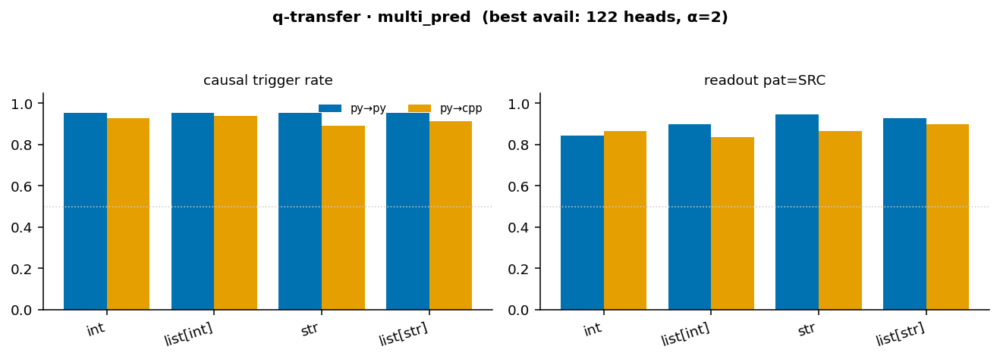
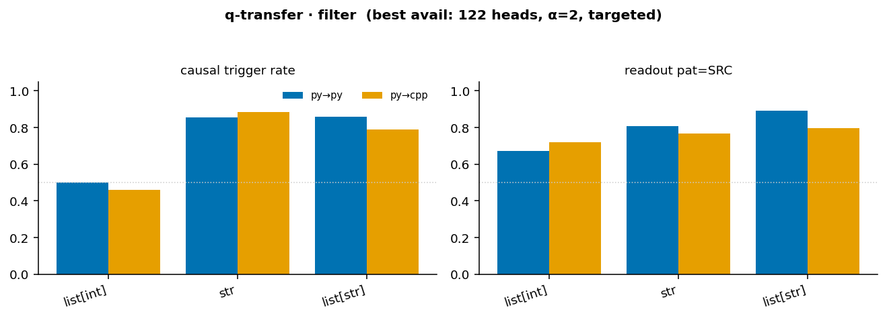
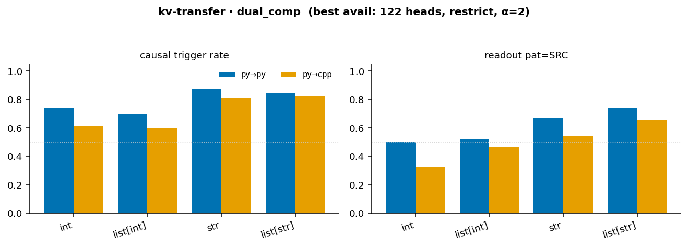
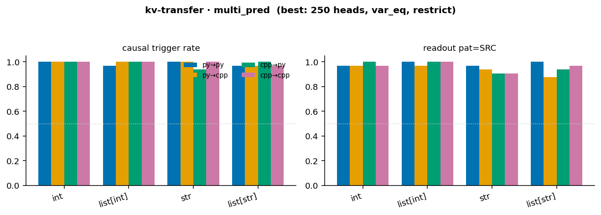
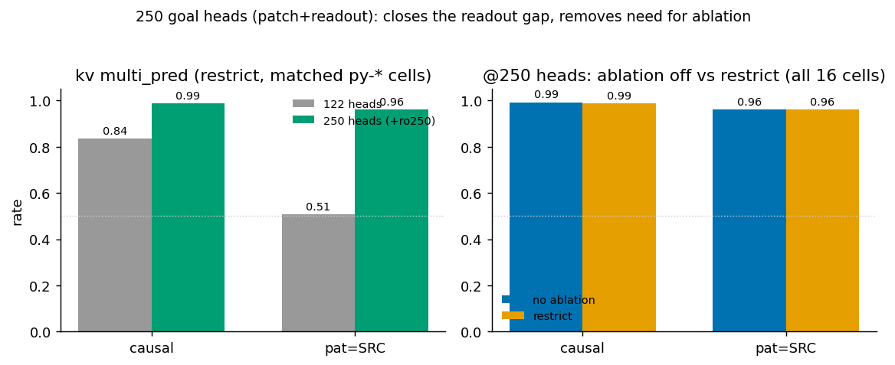

# DIFF eval — setup & results reference (Qwen2.5-Coder-32B-Instruct)

*Living reference for the DIFF-hypothesis evals. Last updated 2026-09-06. All rates recomputed from
per-instance `results.json` (not `meta.json`), so in-progress runs are included. `n` = instances with
an oracle verdict. HTML span boxes render best in the VS Code markdown preview.*

**Model of the LM's behavior.** At a **pivot** (the token where the model is about to begin a sub-task
but has emitted none of it), the LM selects its next instrumental goal by an attention read whose
**query carries its progress** and whose **keys/values carry the goal** (the task specification). Two
transplant mechanisms test the two inputs independently:

| mechanism | transplants | contrast | tests | gaze? |
|---|---|---|---|---|
| **q-transfer** (Spec-1) | pivot **query** | same task, **different progress** | query ⇒ progress | yes (SRC target is in DST prompt) |
| **kv-transfer** (Spec-2) | task-span **keys+values** | **different task**, same progress | k/v ⇒ goal | no (SRC target absent from DST) |

Each mechanism has **two data templates** (§2, §3).

---

## 0. TL;DR

- **q-transfer (query⇒progress) is strong**: `multi_pred` ~0.94 causal / ~0.89 readout at α=2, with
  **gaze shift ≈1.00** vs a ~0.01 baseline. `filter` is weaker and α-critical.
- **kv-transfer (k/v⇒goal) with the top-250 goal heads is near-perfect**: `multi_pred` var_eq hits
  **causal ~0.99 / readout ~0.96 across all 4 datatypes × 4 language directions**, and **ablation is
  unnecessary** (`off` ≈ `restrict`). 122→250 lifts causal 0.84→0.99, readout 0.51→0.96 (§3.2).
- **Standard config going forward:** patch = readout = **top-250 goal heads**, `ablate=off`, α=2,
  var_eq (kv multi_pred), all 4 langs.

---

## 1. Intervention setup (shared)

- **Model:** `Qwen/Qwen2.5-Coder-32B-Instruct`, bf16, `attn_implementation="eager"`. 64 layers, 40
  attention heads, 8 KV heads (GQA group = 5).
- **Goal heads** (`src.diff.functional.setup`): a differentiable head mask (λ=20) localizes heads whose
  pivot output causally carries the upcoming sub-goal.
  - **122-head set** (`goal__lam20_thr0.9_band25-56`): thresholded, **layers 28–55**. The historical default.
  - **250-head set** (`goal_topk/goal__lam20_top250`): top-250 by score, **spans all layers 0–63** (adds
    early + late heads, not just more mid-band ones). **Now the recommended set** (§3.2).
- **Transplant primitives** (`src.diff.functional`, see `src/diff/data.py:02_notations` framing):
  - **query transplant** (q-transfer): replace the goal heads' **query** over the **last `--n-pivot`
    trailing tokens** with the source's (`_n_pivot_for`: `auto` ⇒ multi_pred **1**, filter `targeted`
    **5**, filter `return` **2** — bounded by where the SRC/DST trailing tokens coincide). The prefill
    ends **at** the pivot token (`_finalize_prefill` strips a dangling space), so the pivot is a real
    token (`if` / `=` / trailing indent), not the position after it. Changes *what the read looks for*.
  - **key/value transplant** (kv-transfer): replace the goal heads' **keys+values over the task span**
    with the source's, RoPE-realigned to the destination positions. GQA-bleed-corrected: only the
    selected query heads read the source span (`forward_with_masked_patch` per-query-head routing).
    Changes *what the read finds*.
  - **OV boost** `alpha`: scale the goal heads' output contribution at the pivot by α (1.0 = off; **α=2**
    is the operating point) — applied on both the patched generation and the readout.
  - **alignment** `pad`: token-splice newlines so the SRC and DST task spans are the same length and sit
    at identical absolute positions (prevents positional shift from contaminating the transplant).
- **Ablation** (`--ablate-layer-range`, `--ablation-strat`): optionally suppress non-goal heads in a
  layer band on the patched generation — `zero` (kill OV write) or `restrict` (attention-knockout the
  task span). **At 250 heads this is unnecessary** (§3.2).
- **Readout — GoalScope** (`--readout-heads`, default = goal heads): transplant the goal heads' pivot
  output into a neutral probe prompt and greedily decode a natural-language description of the intent.
  For 250-head runs we set readout heads = the same 250 set.
- **Oracle:** `claude-sonnet-4.6` grades every verdict against the gold sub-task descriptions.
- **Metrics:** **causal** = patched DST's next computation switches to the SRC target;
  **pat=SRC** = GoalScope's patched readout verbalizes the SRC goal (the real transfer signal);
  **src=SRC / dst=DST** = clean-run readout baselines (probe faithfulness, ~0.95–1.00 throughout);
  **ro_shift|v** = readout shift among valid cases; **gaze_shift** = attention re-points to the SRC
  target (q only), baseline **gaze_clean_src** ≈ 0.01.

---

## 2. q-transfer  (query ⇒ progress)

Source and destination share the **same task**; the query transplanted at the pivot carries **how far
along** the model is, so the destination jumps to the source's place in the task. Spans rendered live
in `notebooks/diff/04_q_transfer.ipynb` and `04.2_q_transfer_fail.ipynb`.

### 2.1 multi_pred — multi-predicate ordering (`QTransferInstance`)

An N-predicate task; SRC and DST prefill **different subsets** as completed progress, then hit the same
trailing-indent pivot. The pivot **query** is transplanted SRC→DST.

<table border="0" width="100%"><tr>
<td width="41%" valign="top">

<b>SOURCE</b> cached-from

TASK: (1) integer mean · (2) # even values · (3) any duplicate?

<pre style="margin:0;font-size:90%;background:#f6f8fa;color:#1f2328;padding:6px;border-radius:4px">def func(nums: list[int]):
    a = sum(nums)//len(nums)
    b = sum(1 for x in nums if x%2==0)
     ← pivot = trailing indent (n_pivot=1); QUERY cached here → T3</pre>

</td>
<td width="18%" align="center" valign="middle">

⟶

<b style="color:#c0392b">QUERY @ pivot</b> 
carries <b>progress</b> (SRC is further along)
</td>
<td width="41%" valign="top">

<b>DESTINATION</b> patched-to

TASK: (1) integer mean · (2) # even values · (3) any duplicate?

<pre style="margin:0;font-size:90%;background:#f6f8fa;color:#1f2328;padding:6px;border-radius:4px">def func(nums: list[int]):
    a = sum(nums)//len(nums)
     ← pivot = trailing indent (n_pivot=1); clean DST → T2</pre>

</td>
</tr></table>

Transplant the SRC pivot **query** → DST writes T3 (`has_duplicate`) instead of its own next goal T2
(`count_even`). The SRC target *does* appear in the DST task list, so **gaze** is measurable here.

**Results — best available (122 heads, α=2; n=128/config):** overall **causal 0.94**, readout
**pat=SRC 0.89**, **gaze_shift ≈1.00** (baseline 0.01).

Near lang-invariant (py→py 0.95, py→cpp 0.92) and flat across datatype (0.92–0.95).

**What helped:** α is a mild lever (causal 0.83→0.94 from α=1→2; readout already ~0.89 at both). The
dominant evidence is the **gaze shift ≈1.00 against a ~0.01 clean baseline** — the model's attention
re-points to the source sub-goal almost every time. *(250-head run pending; q-multi is already strong.)*

### 2.2 filter — composed single-line filter (`FilterTransferInstance`)

Two commutative element-wise conditions inside one comprehension. SRC and DST prefill a *different*
first filter, then hit a shared **mid-comprehension** pivot — the prefill ends at the `if` token of
`return [w for w in res if`, and the **last `n_pivot`=5 tokens** (the shared tail ending at `if`) carry
the query for the remaining sub-task.

<b>TASK (both sides):</b> all words that are lowercase AND consist only of letters

<table border="0" width="100%"><tr>
<td width="41%" valign="top">

<b>SOURCE</b> cached-from · first filter = isalpha
<pre style="margin:4px 0 0;font-size:90%;background:#f6f8fa;color:#1f2328;padding:6px;border-radius:4px">def func(words: list[str]):
    res = [w for w in words if w.isalpha()]
    return [w for w in res if</pre>
↑ QUERY = last n_pivot=5 tokens, pivot = <code>if</code> (SRC remaining = lowercase)

</td>
<td width="18%" align="center" valign="middle">

⟶

<b style="color:#c0392b">QUERY @ pivot</b> 
mid-comprehension (remaining sub-task)
</td>
<td width="41%" valign="top">

<b>DESTINATION</b> patched-to · first filter = islower
<pre style="margin:4px 0 0;font-size:90%;background:#f6f8fa;color:#1f2328;padding:6px;border-radius:4px">def func(words: list[str]):
    res = [w for w in words if w.islower()]
    return [w for w in res if</pre>
↑ pivot = <code>if</code> (DST's own remaining = isalpha)

</td>
</tr></table>

**Results — best available (122 heads, α=2, `targeted` postfix; n≈128):** overall **causal 0.72**,
pat=SRC 0.78, gaze_shift ~0.97.

**What helped / hurt:** α=2 is **essential** here — causal 0.41→0.72 vs α=1. Datatype dominates:
`str`/`list[str]` reach 0.82–0.87, but **`list[int]` is the weak spot (0.48)**. The 250-head run
(list[int] only, done) lifts `list[int]` py→py 0.50→0.78 but **py→cpp stays ~0.44** — cross-language
into C++ is the lone soft spot for the composed filter. Only the `targeted` postfix has been run.

---

## 3. kv-transfer  (keys/values ⇒ goal)

Source and destination are at the **same progress** but on **different tasks**; the task-specification
keys/values are transplanted, so the destination pursues the source's task. The SRC target never
appears in the DST prompt → **no gaze**; metrics are causal + readout only. Spans rendered live in
`notebooks/diff/05_kv_transfer.ipynb` (`show_spans`, `align_kv_spans`) and `05.2_kv_transfer_fail.ipynb`.

### 3.1 dual_comp — kv-cluster (`KVTransferInstance`)

Two distinct tasks that share a common prerequisite (both prefill the same "progress" line), then hit a
`return` pivot. The **task-description span (keys+values)** is transplanted.

<table border="0" width="100%"><tr>
<td width="41%" valign="top">

<b>SOURCE</b> cached-from

TASK: the number of DISTINCT words (case-insensitive)

<pre style="margin:0;font-size:90%;background:#f6f8fa;color:#1f2328;padding:6px;border-radius:4px">def func(words: list[str]):
    lowered = [w.lower() for w in words]
    return</pre>

</td>
<td width="18%" align="center" valign="middle">

⟶

<b style="color:#c0392b">KEYS+VALUES</b> 
of the <b>task span</b> (carries the goal)
</td>
<td width="41%" valign="top">

<b>DESTINATION</b> patched-to

TASK: the number of words CONTAINING 'A' (either case)

<pre style="margin:0;font-size:90%;background:#f6f8fa;color:#1f2328;padding:6px;border-radius:4px">def func(words: list[str]):
    lowered = [w.lower() for w in words]
    return</pre>

</td>
</tr></table>
Orange = task-description span whose K,V are transplanted · salmon = pivot (<code>return</code>). Same prefilled progress on both sides.

**Results — best available (122 heads, restrict, α=2):** overall **causal 0.75**, pat=SRC 0.55.

**What helped / hurt:** `restrict` ≈ `zero` (0.75 vs 0.74) — ablation strategy is a wash. Datatype is
the big axis: `str`/`list[str]` 0.84, but `int`/`list[int]` only 0.65–0.68. py→py (0.79) > py→cpp
(0.71). **The causal≫readout gap is largest here** (causal 0.75 vs pat=SRC 0.55). *250-head + all-lang
run is queued (`..._top250_remaining.json`) — expected to close the gap as it did for multi_pred.*

### 3.2 multi_pred — divergent frontier (`MultiPredicateInstance`)  ⭐

SRC and DST share a prefix of predicates and diverge only at the **frontier**; both prefill the shared
lines, then hit the `var_eq` pivot (`c =`). The **whole task-list span (keys+values)** is transplanted.

<table border="0" width="100%"><tr>
<td width="41%" valign="top">

<b>SOURCE</b> cached-from

TASK: (1) max · (2) any duplicate? · (3) SUM of all values

<pre style="margin:0;font-size:90%;background:#f6f8fa;color:#1f2328;padding:6px;border-radius:4px">def func(nums: list[int]):
    a = max(nums)
    b = len(set(nums))!=len(nums)
    c =</pre>

</td>
<td width="18%" align="center" valign="middle">

⟶

<b style="color:#c0392b">KEYS+VALUES</b> 
of the full <b>task list</b> (carries the goal)
</td>
<td width="41%" valign="top">

<b>DESTINATION</b> patched-to

TASK: (1) max · (2) any duplicate? · (3) # NEGATIVE values

<pre style="margin:0;font-size:90%;background:#f6f8fa;color:#1f2328;padding:6px;border-radius:4px">def func(nums: list[int]):
    a = max(nums)
    b = len(set(nums))!=len(nums)
    c =</pre>

</td>
</tr></table>
Orange = full task-list span whose K,V are transplanted · salmon = <code>var_eq</code> pivot (<code>c =</code>). Shared prefix (a, b) prefilled on both sides; only the frontier (T3) differs.

Transplant SRC's task-list K,V → DST writes T3 = `total_sum` (SRC frontier) as `c` instead of its own
`count_negative`.

**Results — 250 heads (patch+readout), var_eq, restrict — the full grid (4 dt × 4 langs, n=32):**
overall **causal 0.99**, **pat=SRC 0.96**.

**What helped (three levers, in order of impact):**
1. **250 goal heads (patch+readout)** — vs 122, on matched restrict py-* cells: **causal 0.84→0.99,
   pat=SRC 0.51→0.96**. Closes the readout gap; makes cross-language (py→cpp) as strong as py→py.
2. **`var_eq` pivot** (prefill `c =` so the model writes only the frontier *value*) — vs `indent`:
   causal 0.55→0.81 (measured at 122 heads).
3. **α=2** OV boost.

And crucially: **ablation is unnecessary at 250 heads** — averaged over all 16 cells, `off` = 0.99/0.96
vs `restrict` = 0.99/0.96 (identical). See the cross-cutting figure below.

---

## 4. Coverage & what to run next

Every result to date is one of py→py, py→cpp, cpp→py, cpp→cpp — but the **250-head** runs are the only
ones with the two `cpp→*` directions (kv multi_pred has all four; 122-head runs are py→{py,cpp} only).

| mechanism / template | best config on disk | langs | status |
|---|---|---|---|
| q / multi_pred | 122, α=2 | py→py, py→cpp | ✓ (250 pending) |
| q / filter | 122, α=2, targeted | py→py, py→cpp | ~ (`list[int]`@250 done; str/list[str]@250 queued; `return` postfix ✗) |
| kv / dual_comp | 122, restrict, α=2 | py→py, py→cpp | ~ (250 + cpp→* queued) |
| kv / multi_pred | **250, var_eq, restrict/off** | **all 4** | ✓ complete, near-perfect |

**Queued** (`job_list/diff_eval/qwen32b_coder_diff_top250_remaining.json`, patch+readout=250, all 4
langs, n=128): kv dual_comp (`abl-off`), q multi_pred, q filter (str, list[str]).

**Next / open:**
1. Land the queued 250 runs → confirm dual_comp closes the causal≫readout gap and off≈restrict there too.
2. Does 250 rescue **q-filter `list[int]` py→cpp** (still ~0.44)?
3. q-filter `return` postfix variant (only `targeted` exists).
4. Retire the stale `kv_transfer/dual_comp/ph-goal__abl-35-50__a1__pad` (n=2 leftover).

*Not needed:* ablation runs (off≈restrict at 250); α sweeps beyond α=2; more `zero`-ablation.
