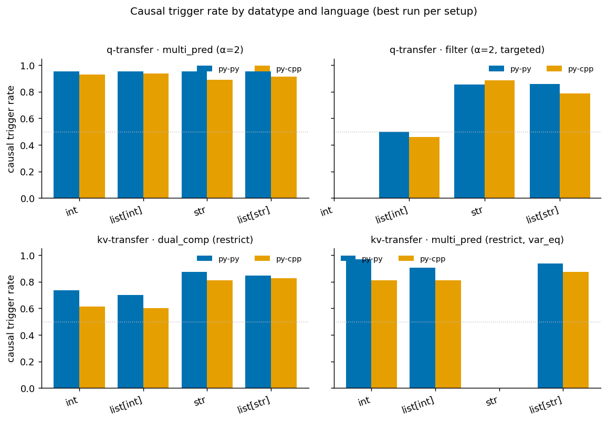
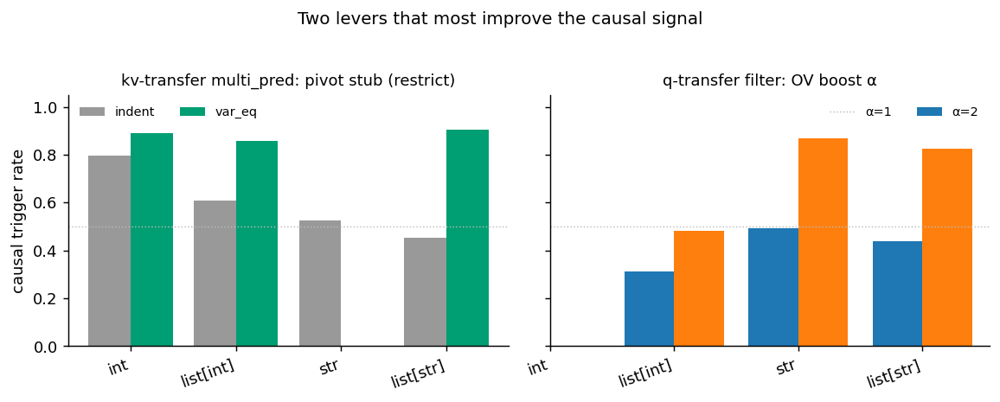

# DIFF eval analysis — q-transfer & kv-transfer (Qwen2.5-Coder-32B-Instruct)

*Generated 2026-09-06. Rates recomputed directly from `results.json` (not `meta.json`), so
still-running configs are included. `n` = instances with an oracle verdict.*

Model of record: at a **pivot**, the LM selects its next instrumental goal by an attention read whose
**query carries progress** and whose **keys/values carry the goal/task**. Two mechanisms test the two
inputs:

| mechanism | file | what it transplants | what it tests | gaze? |
|---|---|---|---|---|
| **q-transfer** (Spec-1) | `q_transfer_eval.py` | pivot **query** (same task, diff progress) | query ⇒ progress | yes (SRC target is in DST prompt) |
| **kv-transfer** (Spec-2) | `kv_transfer_eval.py` | task-spec **keys+values** (diff task, same progress) | k/v ⇒ goal | no (SRC target absent from DST) |

**Metrics** (oracle = `claude-sonnet-4.6`): **causal** = patched DST's next computation switches to the
SRC target; **pat=SRC** = GoalScope's patched readout verbalizes the SRC goal (the real transfer
signal); **src=SRC / dst=DST** = clean-run readout baselines (probe faithfulness); **ro_shift|v** =
readout shift among valid cases; **gaze_shift** = attention moves to the SRC target (q-transfer only),
with **gaze_clean_src** the baseline (clean DST already prefers SRC).

---

## TL;DR

1. **q-transfer is strong and basically done.** With OV boost α=2, `multi_pred` triggers the target at
   **~0.94** causal and **~0.89** readout, with **gaze shift ≈1.00** vs a ~0.01 clean baseline — a clean
   query⇒progress result, robust across datatype and language.
2. **kv-transfer is the harder half**, and the `var_eq` pivot is the single biggest fix:
   **indent 0.55 → var_eq 0.81** causal on `multi_pred`. `restrict` ≥ `zero` ablation.
3. **A persistent causal ≫ readout gap**: the transplant flips *behavior* far more often than GoalScope
   *verbalizes* the source goal (kv `dual_comp`: causal ~0.75 but pat=SRC ~0.55; worst on
   `list[int]` py→cpp: causal ~0.6 but pat=SRC ~0.31). Probe baselines are near-ceiling
   (src=SRC ~0.99, dst=DST ~0.95), so this is a readout-sensitivity gap, not a broken probe.
4. **Biggest open lever not yet tested: the top-250 goal-head patch set.** Manual inspection suggests
   patching 250 goal heads (vs the current 122) fixes many causal/readout failures *and removes the
   need for ablation*. The joblist exists (`job_list/diff_eval/qwen32b_coder_diff_kvtransfer_multi_top250.json`)
   but **has not been launched**.

---

## Coverage matrix

Axes present per setup (✓ done · ~ partial/running · ✗ missing). All runs are **py→py and py→cpp only**
— no reverse (`cpp→py`, `cpp→cpp`) direction anywhere.

| mechanism / setup | datatypes | key axis | run_tags present | status |
|---|---|---|---|---|
| q_transfer / multi_pred | int, list[int], str, list[str] | α ∈ {1,2} | `ph-goal__a1`, `ph-goal__a2` | ✓ complete (16 cfg, n=128) |
| q_transfer / filter | list[int], str, list[str] | α ∈ {1,2}; postfix=`targeted` only | `ph-goal__a1`, `ph-goal__a2` | ~ (`return` postfix ✗; no `int`) |
| kv_transfer / dual_comp | int, list[int], str, list[str] | strat ∈ {restrict, zero} | `…restrict…`, `…zero…` (+1 stale `abl-35-50 a1`) | ✓ complete (16 cfg) |
| kv_transfer / multi_pred | int, list[int], str, **list[str]** | letter_stub ∈ {indent, var_eq} × strat | `…restrict…`, `…zero…` | ~ **str running now** (14/16 each) |
| kv_transfer / **top250** | — | 250 goal heads, var_eq, ±ablation | — | ✗ **not launched** |

Currently running: the two 122-head `kv multi_pred` jobs (restrict, zero), finishing the `str`
datatype (`str__var_eq` not yet started; `str__indent__py-cpp` partial at ~12–13/32).

---

## q-transfer (query ⇒ progress)

### multi_pred (α=2, best) — near-ceiling everywhere

| datatype | lang | n | causal | ro_shift\|v | src=SRC | dst=DST | pat=SRC | gaze_shift |
|---|---|---|---|---|---|---|---|---|
| int | py→py | 128 | 0.95 | 0.93 | 0.91 | 0.88 | 0.84 | 1.00 |
| int | py→cpp | 128 | 0.93 | 0.89 | 0.88 | 0.77 | 0.87 | 0.99 |
| list[int] | py→py | 128 | 0.95 | 0.94 | 0.90 | 0.88 | 0.90 | 1.00 |
| list[int] | py→cpp | 128 | 0.94 | 0.91 | 0.92 | 0.84 | 0.84 | 1.00 |
| list[str] | py→py | 128 | 0.95 | 0.98 | 0.94 | 0.89 | 0.93 | 1.00 |
| list[str] | py→cpp | 128 | 0.91 | 0.96 | 0.94 | 0.79 | 0.90 | 1.00 |
| str | py→py | 128 | 0.95 | 0.97 | 0.97 | 0.94 | 0.94 | 1.00 |
| str | py→cpp | 128 | 0.89 | 0.96 | 0.88 | 0.74 | 0.87 | 1.00 |

- **α is a mild lever here:** causal 0.83 (α=1) → 0.94 (α=2); readout pat=SRC is already ~0.89 at both.
- **Gaze is the standout:** shift ≈1.00 against a ~0.01 clean baseline — after the query transplant the
  model's attention re-points to the SRC sub-goal almost every time. Strongest single piece of evidence
  in the whole study.
- Language and datatype barely matter (py→py 0.89 vs py→cpp 0.88; datatypes 0.86–0.91).

### filter (composed single-line filter) — weaker, α-sensitive

| datatype | lang | n | causal (α=1→α=2) | pat=SRC (α=2) | gaze_shift |
|---|---|---|---|---|---|
| list[int] | py→py | 128 | 0.38 → 0.50 | 0.67 | 0.90 |
| list[int] | py→cpp | 128 | 0.24 → 0.46 | 0.72 | 0.95 |
| list[str] | py→py | 128 | 0.41 → 0.86 | 0.89 | 1.00 |
| list[str] | py→cpp | 128 | 0.47 → 0.79 | 0.80 | 0.99 |
| str | py→py | 104 | 0.48 → 0.86 | 0.81 | 0.98 |
| str | py→cpp | 104 | 0.51 → 0.89 | 0.77 | 0.99 |

- **α=2 is essential here:** causal 0.41 → 0.72 overall. The mid-expression pivot needs the boost.
- **`list[int]` is the weak spot** (causal ~0.5 even at α=2) — numeric element predicates in a
  comprehension are the hardest to trigger. `str`/`list[str]` reach 0.79–0.89.
- Gaze still ~0.97+; readout pat=SRC ~0.77. Only the **`targeted`** postfix has been run.

---

## kv-transfer (keys/values ⇒ goal)

### dual_comp (kv-cluster: diff task, shared progress)

| datatype | lang | causal (restrict/zero) | pat=SRC (restrict) | ro_shift\|v |
|---|---|---|---|---|
| int | py→py | 0.74 / 0.70 | 0.50 | 0.52 |
| int | py→cpp | 0.61 / 0.61 | 0.33 | 0.38 |
| list[int] | py→py | 0.70 / 0.60 | 0.52 | 0.54 |
| list[int] | py→cpp | 0.60 / 0.52 | 0.46 | 0.50 |
| list[str] | py→py | 0.85 / 0.98 | 0.74 | 0.74 |
| list[str] | py→cpp | 0.83 / 0.89 | 0.65 | 0.64 |
| str | py→py | 0.88 / 0.79 | 0.67 | 0.76 |
| str | py→cpp | 0.81 / 0.83 | 0.54 | 0.52 |

- Overall causal ~0.75; **restrict ≈ zero** (0.75 vs 0.74). **`list[str]`/`str` strong (0.8–0.98);
  `int`/`list[int]` weak (0.52–0.74).**
- **The causal≫readout gap is largest here:** pat=SRC ~0.55 vs causal ~0.75; worst on `int`/`list[int]`
  py→cpp (pat=SRC 0.33/0.46). Probe baselines are near-ceiling (src=SRC ~0.99, dst=DST ~0.96).

### multi_pred (divergent frontier) — the `var_eq` win

Marginals (restrict shown; zero is 5–10 pts lower):

| lever | causal | pat=SRC |
|---|---|---|
| letter_stub = **indent** | 0.55 | 0.45 |
| letter_stub = **var_eq** | **0.81** | 0.54 |
| strat = restrict | 0.72 | 0.49 |
| strat = zero | 0.61 | 0.48 |
| lang = py→py | 0.71 | 0.63 |
| lang = py→cpp | 0.61 | 0.35 |

Per-config (restrict, both stubs):

| datatype | stub | lang | n | causal | pat=SRC |
|---|---|---|---|---|---|
| int | indent | py→py | 32 | 0.91 | 0.75 |
| int | var_eq | py→py | 32 | 0.97 | 0.69 |
| int | var_eq | py→cpp | 32 | 0.81 | 0.56 |
| list[int] | indent | py→py | 32 | 0.50 | 0.59 |
| list[int] | var_eq | py→py | 32 | 0.91 | 0.72 |
| list[int] | var_eq | py→cpp | 32 | 0.81 | 0.31 |
| list[str] | indent | py→cpp | 32 | 0.31 | 0.22 |
| list[str] | var_eq | py→py | 32 | 0.94 | 0.56 |
| list[str] | var_eq | py→cpp | 32 | 0.88 | 0.44 |
| str | indent | py→py | 32 | 0.62 | 0.62 |
| str | **var_eq** | — | — | **✗ running** | — |

- **`var_eq` is the biggest single fix** (causal 0.55→0.81); it especially rescues the weak
  `indent` cells (list[str] py→cpp 0.31→0.88).
- **`restrict` > `zero`** here (unlike dual_comp), driven by cross-language cells that crater under
  `zero` (e.g. `zero list[str] py→cpp` 0.50 vs restrict 0.88).
- **`str` var_eq is missing** (running now) — the one hole in this grid.
- Same causal≫readout gap: var_eq pat=SRC ~0.54 vs causal ~0.81, worst py→cpp (0.35).

---

## Cross-cutting findings

- **Levers that work:** α=2 (essential for q-filter, mild elsewhere); **var_eq pivot** (kv multi_pred,
  huge); **restrict > zero** for kv multi_pred (wash for dual_comp).
- **Language:** py→py consistently beats py→cpp, and the gap is almost entirely in the **readout**
  (behavior transfers cross-language; verbalization lags). q-transfer is the exception — near lang-invariant.
- **Datatype:** for kv, **`list[str]`/`str` > `int`/`list[int]`**; for q-filter, `list[int]` is the weak spot.
- **causal ≫ readout everywhere for kv** — the transplant drives behavior more reliably than GoalScope
  reads it out. This is the main thing to explain/fix (candidate: the top-250 readout/patch set).

---

## What to run next (prioritized)

1. **Launch the top-250 goal-head jobs** (`job_list/diff_eval/qwen32b_coder_diff_kvtransfer_multi_top250.json`).
   Manual inspection says 250 heads fix many causal + readout failures and remove the need for ablation.
   This is the highest-value untested change and directly targets the causal≫readout gap. *(2 jobs:
   no-ablation `ph-goal_250__abl-off`, and `ph-goal_250__abl-33-43-restrict`.)*
2. **Finish `str` in kv multi_pred** (already running) → completes the 16/16 var_eq grid.
3. **Reverse-language runs** (`cpp→py`, `cpp→cpp`) for at least q-multi_pred and kv-multi_pred (var_eq).
   The paper claims *bidirectional* cross-language transfer, but every current run is py→{py,cpp} only.
   Add `--lang-transfers cpp-py cpp-cpp`.
4. **top-250 for dual_comp and q** — if (1) helps multi_pred, mirror it to `--setups dual_comp` and to
   `q_transfer_eval` to see whether the readout gap closes generally.
5. **q-filter `return` postfix** variant (only `targeted` exists) + consider `int` if a filterable
   framing exists — to round out the filter axis.
6. **Retire the stale `dual_comp/ph-goal__abl-35-50__a1__pad`** (n=2 leftover) to avoid confusion.

*Not needed:* α sweeps beyond {1,2} (α=2 is clearly the operating point); more `zero`-ablation runs
(restrict ≥ zero everywhere it matters).
