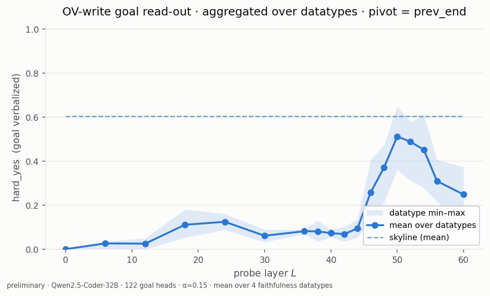
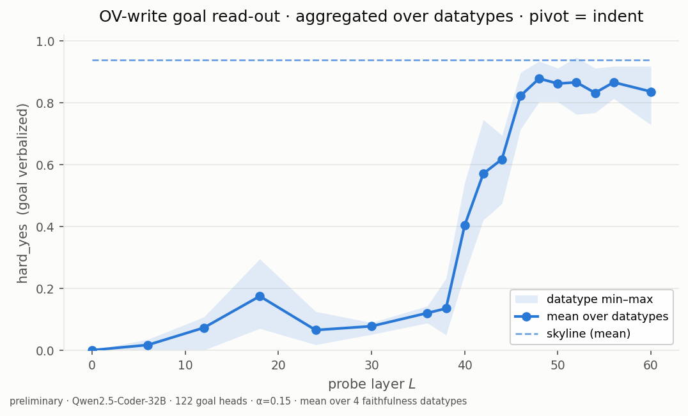
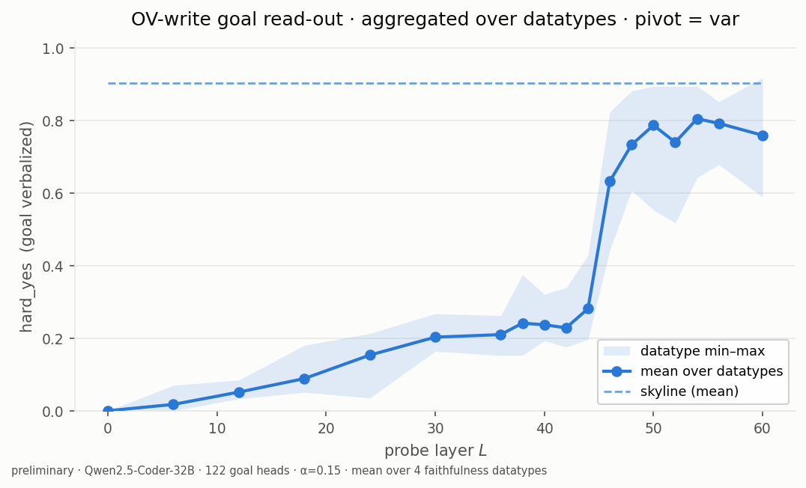
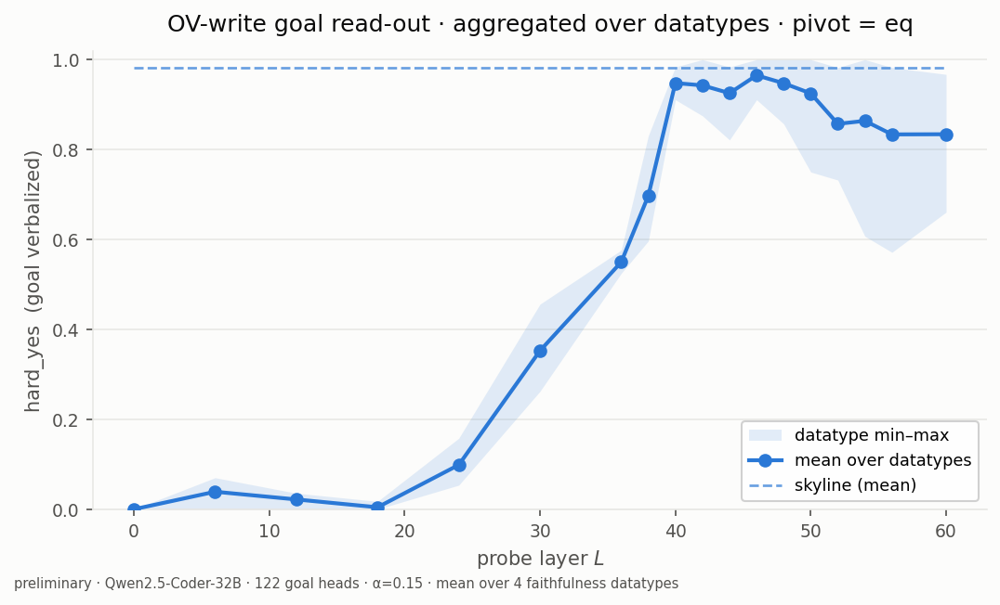
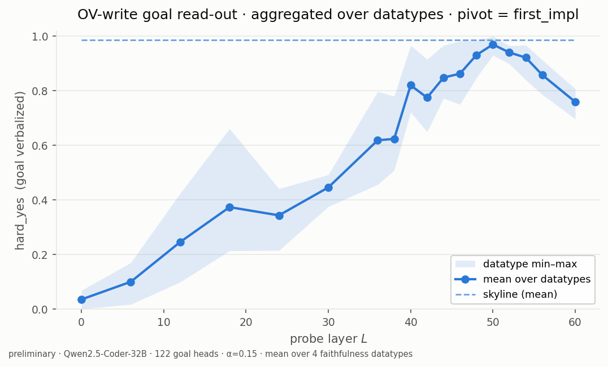
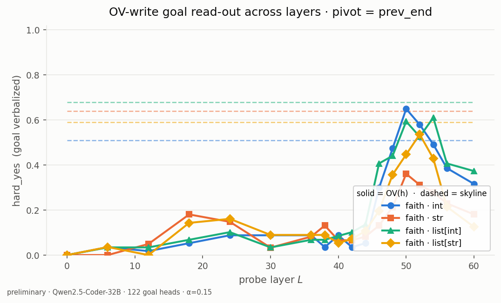
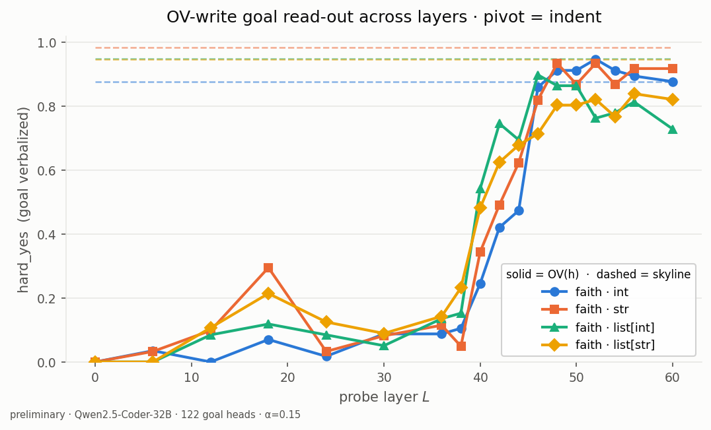
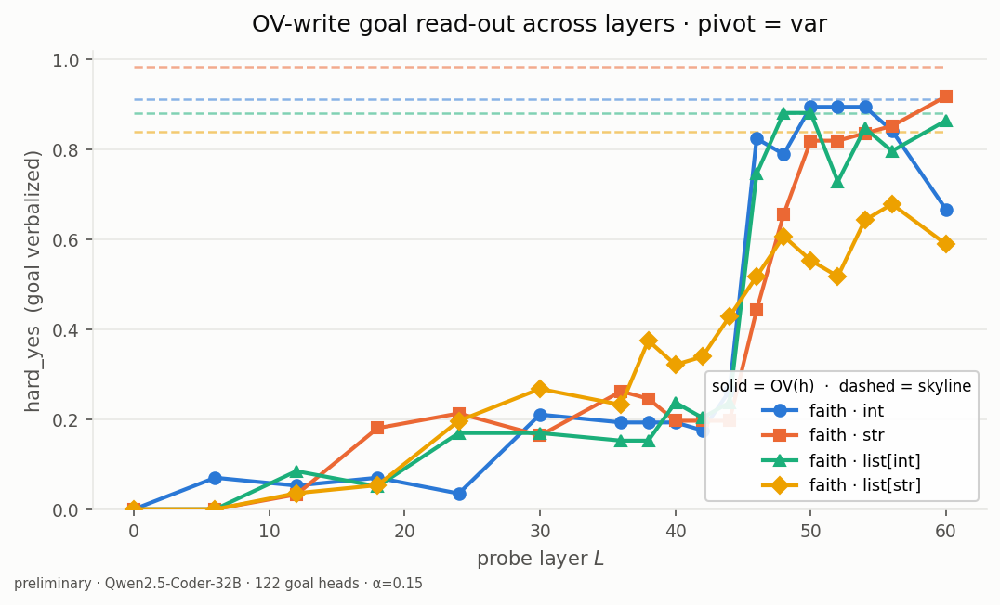
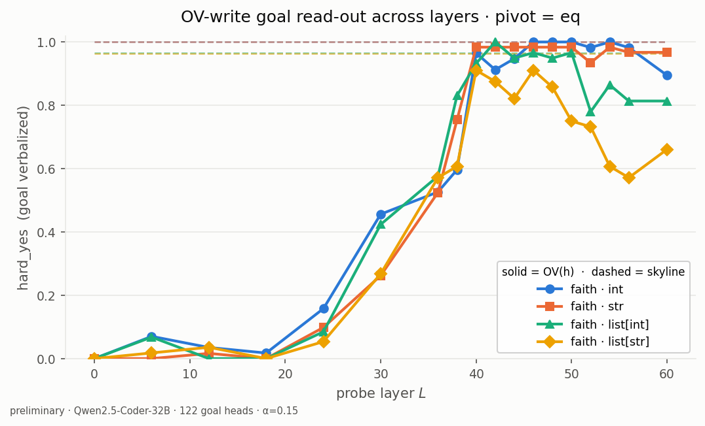
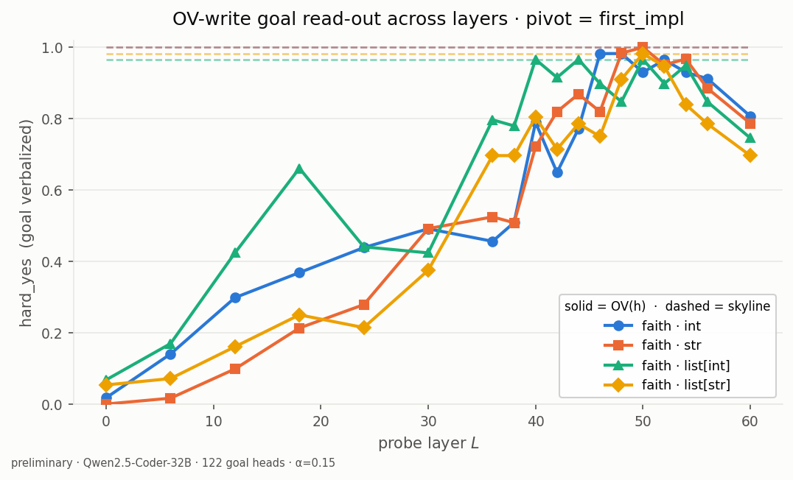

# OVReader — probing the residual's OV-write subspace for the goal (DIFF)

*Companion to `src/goals/goalscope.py` (`OVReader`), `scripts/evaluation/eval_ov_reader.py`,
`scripts/evaluation/ov_reader_io.py`, and `notebooks/diff/7_ov_reader_eval_demo.ipynb`.
Last updated 2026-09-09. **Eval numbers below are PRELIMINARY** (runs in flight, n≈45–53/64); they will
be refreshed once the joblist completes.*

---

## 0. What it is, in one line

For a residual stream `h` taken after an arbitrary layer `L` at a pivot token, **OVReader measures whether
the goal heads' output–value (OV) circuit, applied to `h`, already points along the goal direction** — i.e.
whether the upcoming sub-goal (the "DIFF") is *already present in the residual* before the goal-head layers
concentrate. It does so by turning that OV image of `h` into a steering vector and reading it out through
GoalScope.

This is the **write-side** complement to the goal-head *transplant* evals (`diff_eval_analysis.md`): those
ask "can I move the goal by transplanting head q/k/v"; OVReader asks "is the goal *linearly readable* from
the residual, in the exact form a goal head would write it, and from which layer on".

---

## 1. Motivation

The DIFF hypothesis says the model, at a pivot, holds a representation of the next instrumental goal. The
transplant evals show the goal heads' pivot **output** carries it (GoalScope readout ≈ 0.9). Two newer
observations push the locus *earlier*:

1. the goal-head **query** already carries the computed next goal, not just progress
   (`diff_eval_analysis.md` ★ Headline);
2. we want to know **where in depth** the goal first becomes linearly present in the residual.

OVReader answers (2) on the write side: it sweeps `L` and asks at each layer whether the goal is in the
subspace the goal heads *write from*.

### Why the OV transform (and not a projection)

Three candidate "does `h` contain the goal" probes were tried; only the third was useful:

| probe | operator on `h` | subspace | result |
|---|---|---|---|
| Q-read | `W_Q_j·diag(g)` then pseudo-inverse back | rowspace(`W_Q`) — what the query *reads* | not useful |
| O-write | `W_O_j·W_O_j⁺` | colspace(`W_O`) — where the head *writes* | not useful |
| **OV-write** | `W_O_j·W_V_kv·diag(g)` | the actual OV **image** of `h` | **useful** ✓ |

The projections only test "is `h` non-orthogonal to the read/write subspace". The **OV transform** is the
concrete vector the head *would inject into the residual if its value came from `h`* — a much stronger,
directional test, and the one that verbalizes the goal.

---

## 2. The mechanism (math)

Notation: `d = d_model` (5120), `d_h = d_head` (128), `n_heads = 40`, `n_kv = 8`, GQA `group = 5`.
Goal head `k = (l, j)`; its GQA key/value head is `kv = j // group`.

**Per-head weights** (read straight from the model):

- `W_O^{(l,j)} = o_proj.weight[:, j·d_h : (j+1)·d_h]` — shape `(d, d_h)`, the head's write matrix.
- `W_V^{(l,kv)} = v_proj.weight[kv·d_h : (kv+1)·d_h, :]` — shape `(d_h, d)`, the kv-head's value matrix.
- `g^{(l)} = input_layernorm.weight` — shape `(d,)`, the pre-attention RMSNorm gain (Qwen2 uses `weight*`,
  no `1+`).

**The OV image of `h`.** A head's contribution to the residual is `W_O · (Σ attn · value)`, and each value
is `W_V · RMSNorm(x)`. Ask the counterfactual "what would head `(l,j)` write if its value were sourced from
this residual `h`":

$$
\text{ov}_{(l,j)}(h) \;=\; W_O^{(l,j)}\; W_V^{(l,kv)}\; \mathrm{RMSNorm}_l(h)
\;=\; \underbrace{\tfrac{1}{\mathrm{rms}(h)}}_{\text{scalar → drop}} \; W_O^{(l,j)}\,W_V^{(l,kv)}\,\big(g^{(l)}\odot h\big).
$$

- **RMSNorm** = `(1/rms(x))·(g ⊙ x)`. The `1/rms` factor is a positive **scalar** (direction-preserving),
  dropped since we only use the resulting direction. The per-dimension **gain `g` rotates** the direction,
  so it is **folded into the value read** as `g ⊙ h` (not ignored).
- This is the full **OV transform** `M = W_O W_V diag(g)` (a `d×d` map) applied to `h` — *not* a projection.
  It is computed lazily from the small factors `(W_O_j, W_V_kv, g)` (never materializing `M`).

**Aggregate over goal heads** (unit-normalized per head so no single head dominates; only direction is used
downstream):

$$
h_{\text{ov}}(L) \;=\; \operatorname{mean}_{(l,j)\in\text{READOUT\_HEADS}}\; \frac{\text{ov}_{(l,j)}(h)}{\lVert \text{ov}_{(l,j)}(h)\rVert}, \qquad h = h(L)\ \text{= residual after layer } L.
$$

**Steer + read out (GoalScope).** Inject `h_ov(L)` into a neutral probe prompt over a steer band (layers
35–46) with `head_additive_generate(strategy="additive_norm", alpha)`:

$$
h' \;=\; h_{\text{resid}} \;+\; \alpha\,\lVert h_{\text{resid}}\rVert\,\frac{h_{\text{ov}}}{\lVert h_{\text{ov}}\rVert},\qquad \alpha=0.15.
$$

`additive_norm` normalizes internally, so only the **direction** of `h_ov` matters — which is why dropping
`1/rms` and the per-head magnitudes is sound. If the probe then verbalizes the goal, `h(L)` already carries
it in the goal heads' OV-write direction.

**Two read-out modes** (`mode=` — the only thing that differs is the destination prompt):
- `faithfulness` — the NL probe "What are you doing at this line?"; grade the description vs the frontier code.
- `causality` — steer into an information-less C++ stub `bool check(auto value){`; grade the C++ continuation
  as cross-language transfer of the same idea (the read-out is prefixed with the stub before grading).

RoPE is applied *after* `W_Q/W_K` and does not enter the OV path, so it is irrelevant here.

---

## 3. Implementation (`src.goals.goalscope.OVReader`)

```
OVReader(mt, readout_heads)
  .readers                     # cached per-head (W_O_j, W_V_kv, g), CPU float32 — built once
  .resid_ov_vec(h)             # h_ov = mean_j unit(W_O_j W_V_kv (g⊙h))
  .probe_inputs(mode)          # cached GoalScope destination prompt per mode
  .apply_probe(prompt, pivot, probe_layers, *, mode, steer_layers, max_new_tokens, alpha,
               n_steer_tokens) -> {layer: readout}
```

Efficiency: `apply_probe` reads the residual after **every** probe layer at the pivot in **one** forward
(`src.functional.get_hs` with a list of `(layer_name, pivot)` locations), stacks the per-layer `h_ov` into a
`(n_layers, d)` batch, and issues **one batched** `head_additive_generate` call — so N probe layers cost one
forward + one generation, not N of each. Readers are built once in `__init__` and reused across every
datapoint/pivot/layer.

---

## 4. Evaluation harness (`scripts/evaluation/eval_ov_reader.py`)

**Corpus — prefill-to-frontier.** From `D.QTASKS[datatype]`, sample a task of `T ∈ --n_conditions`
single-line predicates (letters naming `a,b,c,…`), prefill the first `j ∈ 1..T-1` as completed, and end the
prompt at the frontier's `{var} =` (the DIFF `var_eq` stub; C++ decls auto-ified). The frontier predicate is
the **known goal**, so the grading target (`impl_span`) is exactly the first generated line — no oracle
span-labelling needed. Then greedy-decode 64 tokens.

**Five pivots** = the last four prompt tokens `(prev_end, indent, var, eq)` + the first generated token
`(first_impl)`.

**Per datapoint, at each pivot:**
- **Skyline** — `apply_goalscope(strategy="additive_norm", alpha=0.1)` = the goal heads' actual **output**
  read-out (the upper reference OVReader is compared against).
- **OVReader** — `apply_probe` across `--layers` (default 18: `0..36:6, 38..54:2, 56..:4`).

**Grading** — `eval_goalscope.hard_eval` (oracle `claude-sonnet-4.6`), the same rubric/verdict parser as the
GoalScope evals; `hard_yes` = fraction graded YES. `mode ∈ {faithfulness, causality}`.

**Storage / ops** — `results/evaluation/ov-reader/<model>/<layer_idx>/<mode>/<leaf>/` with
`layer_idx = int | "goalscope"`; `config.json / records.jsonl / samples.jsonl / summary.json`. Resume-safe
(a datapoint is redone only if missing from any target dir); **parallel by `datatype × lang`** (disjoint
dirs). Parse with `ov_reader_io.py` (`compute_summary`, `across_layers_df`, `grid_df`). Live status is best
recomputed from `records.jsonl` (summary.json is written only at job end).

Joblist: `job_list/diff_eval/qwen32b_coder_ov_reader.json` (8 jobs = {faithfulness, causality} × 4 datatypes,
python; α=0.15, heads = 122 goal set).

---

## 5. Current results (PRELIMINARY — n≈45–53/64, runs in flight)

Qwen2.5-Coder-32B-Instruct, 122 goal heads, α=0.15, python source. `faithfulness` has all 4 datatypes;
`causality` has `int` only so far (`str/list[int]/list[str]` queued).

### 5.1 hard_yes across layers (overall, pooled over the 5 pivots)

| job | skyline | L0 | L36 | L40 | L46 | L50 | L54 | L60 | OV peak |
|---|---|---|---|---|---|---|---|---|---|
| faithfulness int | 0.86 | 0.00 | 0.28 | 0.47 | 0.80 | 0.88 | 0.84 | 0.71 | **0.88 @ L50** |
| faithfulness str | 0.91 | 0.00 | 0.29 | 0.46 | 0.64 | 0.80 | 0.78 | 0.75 | **0.80 @ L50** |
| faithfulness list[int] | 0.90 | 0.01 | 0.36 | 0.56 | 0.79 | 0.85 | 0.82 | 0.73 | **0.85 @ L50** |
| faithfulness list[str] | 0.86 | 0.01 | 0.33 | 0.51 | 0.60 | 0.72 | 0.65 | 0.57 | **0.72 @ L50** |
| causality int | 0.90 | 0.25 | 0.40 | 0.51 | 0.80 | 0.91 | 0.91 | 0.83 | **0.91 @ L50–54** |

**Read:** near-zero at L0–12, climbs from ~L36–40, **saturates ~L48–54 at ≈ the goal-head OUTPUT skyline**,
then tapers by L56–60. For `int` the OV-write read-out *matches* the skyline (0.88/0.91 vs 0.86/0.90) — the
goal is as readable from the residual's OV-write subspace as from the goal heads' own output. Datatype
gradient: `int` ≈ skyline; `list[int]`/`str` slightly below; `list[str]` clearly weaker (0.72 vs 0.86).
`causality` tracks `faithfulness` and is a touch higher at the peak.

### 5.2 Breakdown across pivot

`hard_yes` per pivot (representative jobs; skyline vs selected OV layers):

```
faithfulness · int                         causality · int
pivot        skyline L40 L46 L50 L54       skyline L40 L46 L50 L54
prev_end        0.54  .11 .50* .59 —          0.66  .25 .45*.66 —      (*L48)
indent          0.85  .28 .48 .93 .96*         0.92  .32 .62 .96 1.00*  (*L52)
var             0.89  .22 .24 .89 .83          0.92  .25 .43 .90 .94
eq              1.00  .96 .93 1.00 1.00        1.00 1.00 1.00 1.00 .98
first_impl      1.00  .76 .76 .98 .96          0.98  .72 .79 .98 .98
```

**Pivot ordering (consistent across datatypes & modes): `eq ≈ first_impl > indent ≈ var ≫ prev_end`.**
- **`eq` (`c =`)** is strongest and **earliest** — near-ceiling from **L40** (0.94–1.00); once the model has
  written `c =`, the goal is fully present in the OV-write direction well before the goal-head layers.
- **`first_impl`** tracks `eq`, saturating ~L46–50.
- **`indent` / `var`** emerge later (~L44–52), peak ~0.85–0.96.
- **`prev_end` is the weak pivot** — and notably **even the skyline is low there** (0.54–0.69): before the
  line begins, the next goal isn't yet formed, so there's nothing for OV-write to carry (peak ~0.4–0.7 @ L50).

### 5.3 Layer curves

**Aggregated across datatypes** — one figure per pivot: the mean `OV(h)` `hard_yes` over the 4 faithfulness
datatypes (shaded band = datatype min–max), dashed = the mean GoalScope skyline.







**Per datatype** — one figure per pivot, a line per faithfulness datatype (dashed = its skyline), markers
per series. Preliminary (n≈56–61); regenerate after the runs finish. *(Causality omitted until its runs
complete.)*







The curves make the emergence explicit: `eq`/`first_impl` are flat-low through L≤30 then rise steeply to
the skyline by ~L40–48; `indent`/`var` lag; `prev_end` never reaches its (already low) skyline.

### 5.4 Interpretation

The goal (DIFF) is **linearly present in the residual's OV-write subspace from ~L40, before the goal-head
layers concentrate**, and by mid-50s it is as readable as the goal heads' own output. It is **pivot-gated**:
strong at/after the `=` (goal committed), absent before the line begins (`prev_end`, where the goal heads
themselves are also weak). Together with the ★ Headline result (the goal-head *query* already carries the
computed next goal), this supports: **the DIFF is computed upstream of the goal heads and is already in the
residual by the low-40s layers** — the goal heads read/route it rather than compute it.

---

## 6. To finish / update

- Refresh §5 (tables + the §5.3 per-pivot figures) once the 8 jobs complete (~15–18 h from 2026-09-09
  morning); fill in `causality` `str / list[int] / list[str]`.
- Consider a scaled version of the ★ Headline divergent-order query-transfer test (currently qualitative).
